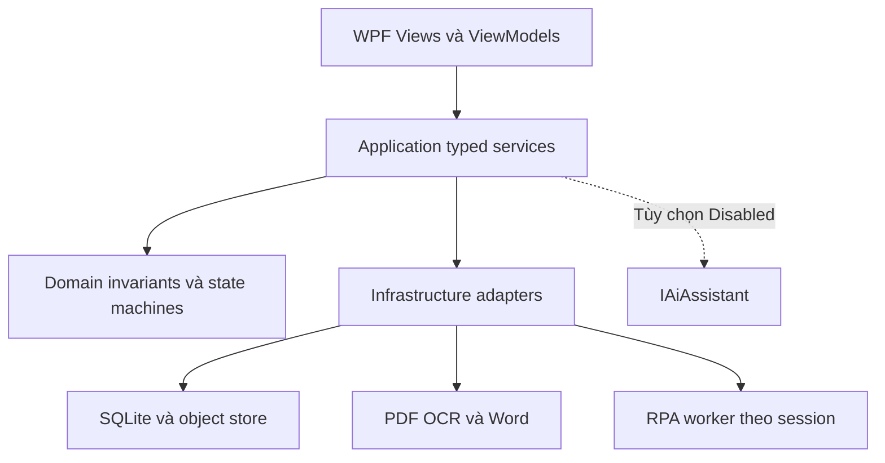
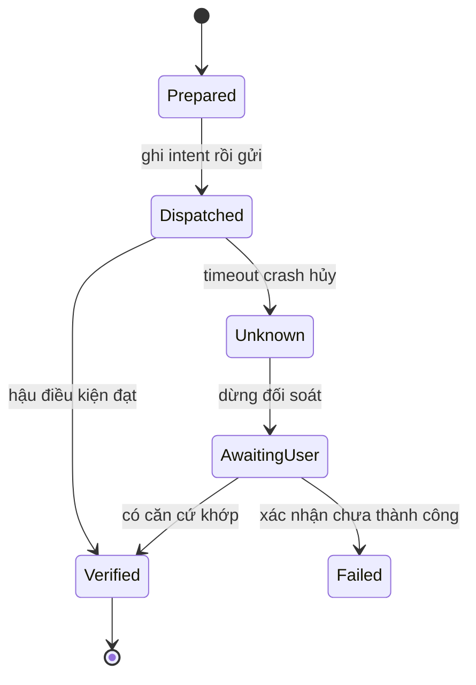

> Cập nhật 20/10/2026: [bản sửa, chạy thử và giới hạn](09_SACD_Ban_sua_va_chay_thu_2026-10-20.md). Các yêu cầu bên dưới là baseline thiết kế, không tự đồng nghĩa đã hiện thực.

# SACD SDS đặc tả thiết kế phần mềm

> Cập nhật triển khai 16/10/2026: [luồng hợp nhất v1.2](08_SACD_Quy_trinh_hop_nhat_v1.2.md) dùng `CorrespondenceViewModel` → `CorrespondenceService` → SQLite/kho object. `ControlledFormFiller` là adapter Windows UIA theo mapping chính xác, đọc lại giá trị và dừng trước Lưu. `RpaEngine` cũ vẫn là mô phỏng, được ghi rõ trên giao diện. Phiếu DOCX dùng `ProcessingSlipGenerator` và QRCoder. Không có API/email/cloud AI mới trong bản này. Dòng công việc được lưu trong ba bảng mở rộng và audit; chưa hoàn tất toàn bộ kiến trúc mục tiêu bên dưới.

**Mã tài liệu:** SACD-DOC-03  
**Phiên bản:** 1.1  
**Ngày:** 15/10/2026  
**Người biên soạn:** Đàm Quang Trung  
**Trạng thái:** Dự thảo chi tiết để rà soát; chưa phê duyệt baseline triển khai.

**Căn cứ:** Phiếu đăng ký và Report 1 SACD v1.0 trong `references/`. Các đặc tả bổ sung ở bản 1.1 là thiết kế đề xuất để hiện thực phạm vi đã nêu, không phải bằng chứng phần mềm đã có. AI mặc định tắt. Các mục DEC còn mở không được coi là quyết định đã được đơn vị chấp thuận.

## 1 Kiến trúc mục tiêu và các quyết định

SACD là desktop modular monolith: một ứng dụng WPF, Application/Domain trong tiến trình, SQLite và kho tệp cục bộ. Tiến trình phụ OCR/RPA/AI chỉ thực hiện adapter được allowlist. Không dựng web backend hoặc dùng shared SQLite qua mạng. Định hướng này giữ nguyên ADR-01–ADR-04; quyền và tương thích được khảo sát trước chạy.



| Gói | Trách nhiệm | Phụ thuộc được phép |
|---|---|---|
| SACD.Desktop | Views/ViewModels, binding, command, validation summary, progress | Application DTO/interfaces; không SQL/Process trong ViewModel |
| SACD.Application | UC, orchestration, auth, transaction và OperationResult | Domain và interfaces adapter |
| SACD.Domain | Value objects, state transitions, numeric/deadline rules | Thư viện chuẩn; không WPF/SQLite/HTTP |
| SACD.Infrastructure | Repository, file store, OpenXML, OCR, process, RPA, backup | Implements Application interfaces; không gọi ngược UI |
| SACD.Worker | Thực thi adapter có giới hạn/PID/timeout | IPC typed và manifest đã khóa; không tự đọc mọi kho |
| SACD.Tests | Unit, contract, integration, system, fixture harness | Mock cho invariants; worker thật trong ca tương thích/benchmark |

Prototype event-handlers hiện có chưa là kiến trúc mục tiêu; thay đổi cần migration/refactor có test, không chỉ đổi tên thư mục.

## 2 Hợp đồng ứng dụng và xử lý lỗi

```csharp
public record ActorContext(string WindowsSid, string WorkspaceId, string CorrelationId);
public record OperationResult<T>(bool Success, T? Value, string Code,
    string Message, string CorrelationId, IReadOnlyList<string> Warnings);
// Ví dụ signature ở biên application, không phải REST endpoint.
Task<OperationResult<ReportRevisionInfo>> CreateDraftAsync(
    ReportRequest request, ActorContext actor, CancellationToken ct);
```

ActorContext được tạo từ phiên Windows/kho đã mở; service kiểm tra quyền thực, không nhận isAdmin từ UI. Mutation nhận expectedRevisionId/expectedRowVersion, idempotencyKey nếu có nguy cơ lặp. Success=false không kèm value thành công. Error message không trộn toàn văn/secret; correlationId dùng đối chiếu log.

| Code | Khi nào | Xử lý |
|---|---|---|
| AccessDenied | ACL/SID/role profile không cho phép | Không commit; chỉ rõ thao tác bị chặn |
| WorkspaceBusy | Phiên khác giữ writer lock | Không xóa lock hoặc mở ghi đồng thời |
| RevisionConflict | Con trỏ nguồn/rowVersion cũ | Tải lại và giữ bản sửa chưa lưu riêng nếu được phép |
| InputLimitExceeded | Vượt size/page/pixel/unzip | Dừng trước full decode; dọn staging của job |
| InvalidEvidence | Sai revision/block/offset/hash | Không Confirmed/Reviewed/Submission |
| NeedsReview | Thiếu dữ liệu/nguồn/căn cứ | Giữ Draft/Proposed với blocking issues |
| TemplateInvalid / TemplateUnsupported | Tag/mapping sai hoặc vị trí chưa hỗ trợ | Chỉ vị trí cần sửa, không phá mẫu nguồn |
| TargetMismatch / MultipleMatches | Sai app/cửa sổ/DPI hoặc nhiều phần tử | Dừng runner; không fallback âm thầm |
| NeedsReconciliation | Write/in đã dispatch nhưng chưa biết kết quả | Không retry; người dùng đối soát và ghi bằng chứng |
| TransferConflict / PackageInvalid | Origin/version/hash hoặc schema/path sai | Quarantine toàn gói; không merge nửa chừng |
| ToolHashMismatch | Manifest hoặc binary/model/DLL thay | Chặn worker cho đến self-test/cấu hình version mới |
| NumericOverflow / NumericPrecisionLoss | Tràn hoặc không lưu exact decimal | Không trả 0 hoặc làm tròn nguồn |
| Cancelled / TimedOut | Hủy/hết hạn chờ | Dừng input/worker; giữ commit và Unknown nếu side effect |
| NotConfigured | Nhánh OCR/AI chưa cài | Manual fallback; AI không chặn lõi |
| StorageFailure | DB/disk/audit lỗi | Rollback nội bộ, giữ bản nguồn; external effect có thể cần đối soát |

## 3 Catalog thành phần và hợp đồng

Các bảng dưới đây là interface dự kiến. Tất cả method Async có ActorContext và CancellationToken. DTO không chứa WPF control, SqliteConnection hoặc Process. Chỉ component sở hữu aggregate được đổi projection; repository không được tự tạo quyết định thẩm quyền.

### CMP-01 WorkspaceService

**Use Cases:** UC-001.

| Khía cạnh | Đặc tả |
|---|---|
| Phương thức | OpenAsync |
| Request chuyên biệt | WorkspaceOpenRequest |
| Result typed | WorkspaceInfo |
| Dữ liệu sở hữu/đọc | Workspace, AuditEvent |
| Trách nhiệm | Mở kho và kiểm tra quyền |
| Ràng buộc nổi bật | BR-01; BR-02 |
| Commit | Áp dụng expected version trước ghi; event/projection/audit cùng transaction. External side effect dùng attempt riêng, không giữ DB transaction lúc chờ worker/con người. |

### CMP-02 IntakeService

**Use Cases:** UC-002, UC-003.

| Khía cạnh | Đặc tả |
|---|---|
| Phương thức | ImportAsync / ReceiveMailAsync |
| Request chuyên biệt | ImportRequest / MailIntakeRequest |
| Result typed | ImportBatchResult |
| Dữ liệu sở hữu/đọc | Dossier, Document, FileObject, Job |
| Trách nhiệm | Tiếp nhận thư nội bộ đã chọn; Nhập tệp và giữ bản gốc |
| Ràng buộc nổi bật | BR-03; BR-04; BR-05; BR-06 |
| Commit | Áp dụng expected version trước ghi; event/projection/audit cùng transaction. External side effect dùng attempt riêng, không giữ DB transaction lúc chờ worker/con người. |

### CMP-03 TextService

**Use Cases:** UC-004, UC-005, UC-006.

| Khía cạnh | Đặc tả |
|---|---|
| Phương thức | ExtractAsync / OcrAsync / SaveReviewAsync |
| Request chuyên biệt | ExtractRequest / OcrRequest / TextReviewRequest |
| Result typed | TextRevisionResult |
| Dữ liệu sở hữu/đọc | TextRevision, TextBlock, EvidenceRef, Job |
| Trách nhiệm | Đọc văn bản điện tử; OCR theo trang và hủy tác vụ; Đối chiếu và xác nhận text |
| Ràng buộc nổi bật | BR-06; BR-07; BR-08; BR-09 |
| Commit | Áp dụng expected version trước ghi; event/projection/audit cùng transaction. External side effect dùng attempt riêng, không giữ DB transaction lúc chờ worker/con người. |

### CMP-04 MetadataService

**Use Cases:** UC-007, UC-008.

| Khía cạnh | Đặc tả |
|---|---|
| Phương thức | SaveMetadataAsync / ClassifyAsync |
| Request chuyên biệt | MetadataRequest / ClassificationRequest |
| Result typed | MetadataResult |
| Dữ liệu sở hữu/đọc | MetadataVersion, ClassificationRecord |
| Trách nhiệm | Xác nhận metadata và nhiệm vụ đề xuất; Phân loại và ghi thông tin mật giải mật |
| Ràng buộc nổi bật | BR-09; BR-10; BR-11 |
| Commit | Áp dụng expected version trước ghi; event/projection/audit cùng transaction. External side effect dùng attempt riêng, không giữ DB transaction lúc chờ worker/con người. |

### CMP-05 PrintService

**Use Cases:** UC-009.

| Khía cạnh | Đặc tả |
|---|---|
| Phương thức | PrepareAsync / SubmitAsync / ConfirmAsync |
| Request chuyên biệt | PrintRequest / PrintConfirmation |
| Result typed | PrintAttemptInfo |
| Dữ liệu sở hữu/đọc | PrintAttempt, TemplateVersion |
| Trách nhiệm | Xem trước và gửi lệnh in |
| Ràng buộc nổi bật | BR-12; BR-13 |
| Commit | Áp dụng expected version trước ghi; event/projection/audit cùng transaction. External side effect dùng attempt riêng, không giữ DB transaction lúc chờ worker/con người. |

### CMP-06 TransferService

**Use Cases:** UC-010, UC-011.

| Khía cạnh | Đặc tả |
|---|---|
| Phương thức | PrepareAsync / ImportAsync |
| Request chuyên biệt | TransferPrepareRequest / TransferImportRequest |
| Result typed | TransferResult |
| Dữ liệu sở hữu/đọc | TransferPackage, TransferItem, ImportMap |
| Trách nhiệm | Tạo gói chuyển máy; Nhận gói và xử lý xung đột |
| Ràng buộc nổi bật | BR-14; BR-15; BR-16 |
| Commit | Áp dụng expected version trước ghi; event/projection/audit cùng transaction. External side effect dùng attempt riêng, không giữ DB transaction lúc chờ worker/con người. |

### CMP-07 WorkflowService

**Use Cases:** UC-012, UC-013, UC-020.

| Khía cạnh | Đặc tả |
|---|---|
| Phương thức | SaveTaskAsync / EvaluateDeadlinesAsync / CompleteAsync |
| Request chuyên biệt | TaskRequest / DeadlineQuery / CompleteTaskRequest |
| Result typed | TaskResult / DeadlinePage |
| Dữ liệu sở hữu/đọc | TaskItem, TaskEvent, WorkflowEvent |
| Trách nhiệm | Tạo và cập nhật nhiệm vụ; Tính cảnh báo và ghi gia hạn; Cập nhật kết quả hoàn thành |
| Ràng buộc nổi bật | BR-17; BR-18; BR-19; BR-24 |
| Commit | Áp dụng expected version trước ghi; event/projection/audit cùng transaction. External side effect dùng attempt riêng, không giữ DB transaction lúc chờ worker/con người. |

### CMP-08 ExternalEntryService

**Use Cases:** UC-014.

| Khía cạnh | Đặc tả |
|---|---|
| Phương thức | FillAsync / ReconcileAsync |
| Request chuyên biệt | ExternalFillRequest / ReconciliationRequest |
| Result typed | ExternalEntryResult |
| Dữ liệu sở hữu/đọc | ExternalEntryAttempt, RpaRun |
| Trách nhiệm | Điền dữ liệu vào QLVB và đối soát |
| Ràng buộc nổi bật | BR-20; BR-21 |
| Commit | Áp dụng expected version trước ghi; event/projection/audit cùng transaction. External side effect dùng attempt riêng, không giữ DB transaction lúc chờ worker/con người. |

### CMP-09 ProposalService

**Use Cases:** UC-015, UC-016, UC-017.

| Khía cạnh | Đặc tả |
|---|---|
| Phương thức | CreateAsync / SubmitAsync / RecordDecisionAsync |
| Request chuyên biệt | ProposalRequest / SubmitProposalRequest / DecisionRequest |
| Result typed | ProposalResult |
| Dữ liệu sở hữu/đọc | ProposalVersion, DecisionRecord, WorkflowEvent |
| Trách nhiệm | Lập đề xuất xử lý; Ghi nhận đã trình duyệt; Cập nhật quyết định thực tế |
| Ràng buộc nổi bật | BR-11; BR-12; BR-18; BR-22 |
| Commit | Áp dụng expected version trước ghi; event/projection/audit cùng transaction. External side effect dùng attempt riêng, không giữ DB transaction lúc chờ worker/con người. |

### CMP-10 DeliveryService

**Use Cases:** UC-018, UC-019.

| Khía cạnh | Đặc tả |
|---|---|
| Phương thức | DeliverAsync / RecordReceiptAsync |
| Request chuyên biệt | DeliveryRequest / ReceiptRequest |
| Result typed | DeliveryResult |
| Dữ liệu sở hữu/đọc | DeliveryRecord, ReceiptRecord |
| Trách nhiệm | Ghi nhận giao văn bản; Ghi nhận ký nhận có căn cứ |
| Ràng buộc nổi bật | BR-23; BR-24 |
| Commit | Áp dụng expected version trước ghi; event/projection/audit cùng transaction. External side effect dùng attempt riêng, không giữ DB transaction lúc chờ worker/con người. |

### CMP-11 SearchService

**Use Cases:** UC-021, UC-022.

| Khía cạnh | Đặc tả |
|---|---|
| Phương thức | SearchAsync / HistoryAsync / ArchiveAsync |
| Request chuyên biệt | SearchRequest / HistoryRequest / ArchiveRequest |
| Result typed | SearchPage / HistoryPage |
| Dữ liệu sở hữu/đọc | Dossier, Document, TextRevision, TextBlock |
| Trách nhiệm | Tìm kiếm và mở nguồn; Xem lịch sử và lưu trữ logic |
| Ràng buộc nổi bật | BR-05; BR-06; BR-25; BR-26 |
| Commit | Áp dụng expected version trước ghi; event/projection/audit cùng transaction. External side effect dùng attempt riêng, không giữ DB transaction lúc chờ worker/con người. |

### CMP-12 FactService

**Use Cases:** UC-023, UC-024, UC-025.

| Khía cạnh | Đặc tả |
|---|---|
| Phương thức | ConfirmAsync / ResolveDuplicateAsync / AggregateAsync |
| Request chuyên biệt | FactRequest / DedupRequest / AggregateRequest |
| Result typed | FactResult / DedupResult / AggregateResult |
| Dữ liệu sở hữu/đọc | FactVersion, FactEvidence, DedupDecisionVersion, AggregationRun |
| Trách nhiệm | Xác nhận fact theo chỉ tiêu; Quyết định trùng và mâu thuẫn; Tổng hợp số liệu có kiểm chứng |
| Ràng buộc nổi bật | BR-27; BR-28; BR-29 |
| Commit | Áp dụng expected version trước ghi; event/projection/audit cùng transaction. External side effect dùng attempt riêng, không giữ DB transaction lúc chờ worker/con người. |

### CMP-13 ReportService

**Use Cases:** UC-026, UC-027, UC-028, UC-029.

| Khía cạnh | Đặc tả |
|---|---|
| Phương thức | ValidateTemplateAsync / CreateDraftAsync / ReviewAsync / ExportAsync |
| Request chuyên biệt | TemplateRequest / ReportRequest / ReviewRequest / ExportRequest |
| Result typed | TemplateResult / ReportRevisionInfo / ExportInfo |
| Dữ liệu sở hữu/đọc | TemplateVersion, ReportRevision, Claim, ReportSource, ExportRecord |
| Trách nhiệm | Đăng ký mẫu Word có mapping; Tạo dự thảo và snapshot; Rà soát báo cáo; Xuất Word nháp hoặc bản trình |
| Ràng buộc nổi bật | BR-09; BR-30; BR-31; BR-32; BR-33 |
| Commit | Áp dụng expected version trước ghi; event/projection/audit cùng transaction. External side effect dùng attempt riêng, không giữ DB transaction lúc chờ worker/con người. |

### CMP-14 RecorderService

**Use Cases:** UC-030, UC-031.

| Khía cạnh | Đặc tả |
|---|---|
| Phương thức | StartAsync / StopAsync / PublishScriptAsync |
| Request chuyên biệt | RecordRequest / PublishScriptRequest |
| Result typed | ScriptDraftInfo / ScriptVersionInfo |
| Dữ liệu sở hữu/đọc | Script, ScriptVersion, ScriptStep |
| Trách nhiệm | Ghi thao tác có chủ đích; Biên tập và khóa phiên bản kịch bản |
| Ràng buộc nổi bật | BR-03; BR-34; BR-35 |
| Commit | Áp dụng expected version trước ghi; event/projection/audit cùng transaction. External side effect dùng attempt riêng, không giữ DB transaction lúc chờ worker/con người. |

### CMP-15 RunnerService

**Use Cases:** UC-032, UC-033.

| Khía cạnh | Đặc tả |
|---|---|
| Phương thức | RunAsync / PauseAsync / ResumeAsync / CancelAsync |
| Request chuyên biệt | RunRequest / RunControlRequest |
| Result typed | RunInfo |
| Dữ liệu sở hữu/đọc | RpaRun, RpaStepRun, Job |
| Trách nhiệm | Chạy kịch bản có điều kiện; Tạm dừng hủy và đối soát kết quả chưa rõ |
| Ràng buộc nổi bật | BR-13; BR-20; BR-21; BR-35 |
| Commit | Áp dụng expected version trước ghi; event/projection/audit cùng transaction. External side effect dùng attempt riêng, không giữ DB transaction lúc chờ worker/con người. |

### CMP-16 OperationsService

**Use Cases:** UC-034, UC-035, UC-036, UC-037.

| Khía cạnh | Đặc tả |
|---|---|
| Phương thức | SaveConfigAsync / QueryAuditAsync / BackupAsync / RestoreAsync |
| Request chuyên biệt | ConfigRequest / AuditQuery / BackupRequest / RestoreRequest |
| Result typed | ConfigInfo / AuditPage / BackupInfo / RestoreInfo |
| Dữ liệu sở hữu/đọc | ConfigVersion, ToolVersion, AuditEvent, BackupRecord |
| Trách nhiệm | Khóa cấu hình và công cụ; Tra cứu nhật ký metadata; Sao lưu snapshot đầy đủ; Phục hồi vào kho mới và diễn tập |
| Ràng buộc nổi bật | BR-02; BR-03; BR-05; BR-36; BR-37; BR-38; BR-39 |
| Commit | Áp dụng expected version trước ghi; event/projection/audit cùng transaction. External side effect dùng attempt riêng, không giữ DB transaction lúc chờ worker/con người. |

### CMP-17 AiAssistant

**Use Cases:** UC-038.

| Khía cạnh | Đặc tả |
|---|---|
| Phương thức | ProposeAsync |
| Request chuyên biệt | AiRequest |
| Result typed | AiProposal |
| Dữ liệu sở hữu/đọc | AiInvocation, EvidenceRef |
| Trách nhiệm | Tích hợp AI tùy chọn và kiểm tra đầu ra |
| Ràng buộc nổi bật | BR-03; BR-40 |
| Commit | Áp dụng expected version trước ghi; event/projection/audit cùng transaction. External side effect dùng attempt riêng, không giữ DB transaction lúc chờ worker/con người. |

### CMP-18 DirectoryService

**Use Cases:** UC-039.

| Khía cạnh | Đặc tả |
|---|---|
| Phương thức | PublishAsync / RetireAsync |
| Request chuyên biệt | DirectoryRequest / MappingRequest |
| Result typed | DirectoryVersionInfo |
| Dữ liệu sở hữu/đọc | DirectoryEntryVersion, MappingVersion |
| Trách nhiệm | Quản lý danh mục và ánh xạ |
| Ràng buộc nổi bật | BR-18; BR-36 |
| Commit | Áp dụng expected version trước ghi; event/projection/audit cùng transaction. External side effect dùng attempt riêng, không giữ DB transaction lúc chờ worker/con người. |

## 4 Các DTO quan trọng

| DTO | Trường và validation |
|---|---|
| WorkspaceOpenRequest | path cục bộ, mode, expectedSchemaVersion; SID lấy từ OS; không nhận ownerSid tùy ý |
| ImportRequest | paths, dossierId?, sourceKind, sourceRef?, limitsConfigVersion; từ chối path reparse không được phép |
| TextReviewRequest | documentId, expectedRevisionId, editedBlocks theo ID/ordinal, reviewedPages, reason; không đổi ID nguồn cũ |
| MetadataRequest | dossierId, fieldKey, typed value, status, evidenceIds, expectedVersion; date loại riêng |
| TaskRequest | dossierId, taskId?, expectedRowVersion, assigneeVersionId, dueKind, dueDate/dueUtc, evidenceId |
| DecisionRequest | proposalVersionId, outcome, decisionMakerVersionId, decidedAt, evidenceId, recordedBy từ OS |
| ReceiptRequest | deliveryId, actualReceiverVersionId, signedAt, evidenceId, exceptionReason; không tự ký |
| AggregateRequest | metricVersionIds, period inclusive, scope/grain, confirmedFactVersionIds, dedup versions |
| ReportRequest | logicalReportId?, expectedRevisionId?, period, templateVersionId, section inputs, sourceRevisionIds, aggregationIds |
| ReviewRequest | reportRevisionId, expectedRevisionId, checkedClaimIds, checkedSectionKeys, checklist, comment; content không đổi |
| ExportRequest | reportRevisionId, mode Draft/Submission, destinationPath; target ngoài protected store; no overwrite mặc định |
| RunRequest | scriptVersionId, profileConfigVersionId, inputSnapshotHash, variableBindings không secret, mode Step/Full, idempotencyKey |
| RunControlRequest | runId, expectedState, Pause/Resume/Cancel/Reconcile, reconciliation proof; không ép Unknown thành Success |
| BackupRequest / RestoreRequest | đích/nguồn, expected manifest/schema/owner; đích restore mới; policy transfer-owner chưa chốt thì chặn |
| AiRequest | taskKind, evidenceIds/quotes, configVersionId, maxOutput; không URL cloud/tool/shell |

## 5 Luồng dữ liệu và ranh giới giao dịch

### 5.1 Nhập và trích xuất

1. FileInspector kiểm tra chữ ký, kích thước, entry/trang/pixel theo config đã khóa; parser chạy trên snapshot file staging, không đọc path gốc có thể đang bị sửa.
2. FileStore copy/hash theo luồng, không load toàn PDF/model vào RAM. Object path do hash sinh; tên gốc chỉ là metadata.
3. Transaction tạo Document/Job và audit sau object đã verify. Recovery có thể phát hiện orphan; không xóa ngay khi chưa đối chiếu.
4. Extractor tạo TextRevision/TextBlock, giữ extractedText và NFC. OCR/checkpoint riêng từng trang. Trang lỗi để Partial, không tự rút ngắn tài liệu.
5. Review ghi kết quả trang và kiểm tra đủ trước Reviewed. Current pointer update phải đảm bảo documentId khớp; stale marker cập nhật report/fact/mapping phụ thuộc.

### 5.2 RPA và thao tác có tác dụng phụ



Không giữ transaction SQLite trong lúc đợi ứng dụng khác hoặc người dùng. Trước dispatch save/in: ghi RpaStepRun=Prepared và intent trong transaction ngắn; đánh Dispatched ngay trước phát input. Sau quan sát đích ghi Verified hoặc Unknown. Crash ở khoảng giữa có thể không biết write đã xảy ra; **exactly-once xuyên hệ thống ngoài không được bảo đảm**. Idempotency key chỉ chặn yêu cầu lặp ở SACD; phải đọc/đối soát hệ thống đích để tránh trùng.

Runner ưu tiên UIA pattern theo control; SendInput chỉ sau kiểm tra focus/handle/PID/profile. Relative coords lấy client rect hiện tại; absolute coords phải khớp monitor layout/DPI đã kiểm thử. Không tự nâng quyền. Khi người dùng chạm bàn phím/chuột ngoài kịch bản, policy mặc định pause và yêu cầu xác nhận, không tranh con trỏ. Phím dừng ưu tiên được đăng ký/tự kiểm tra xung đột trước chạy; luôn nhả key/button đang giữ khi stop.

### 5.3 Số liệu và báo cáo

Chốt tập fact/version/dedup/metric trong read snapshot; kiểm tra coverage và unit trước phép toán. Decimal checked, giữ exact input; ratio gộp tử/mẫu, mẫu 0 trả NotApplicable. Stock lấy observation cuối đúng scope; cumulative difference chỉ khi cùng coverage và không điều chỉnh chưa giải thích. Không làm tròn trung gian; rounding display/version khóa theo metric và DEC-08. Với thương thập phân vô hạn, giữ numerator/denominator chính xác; tính display từ phân số bằng số nguyên theo scale để làm tròn một lần, không dùng quotient đã làm tròn làm đầu vào phép tính sau.

ReportRevision trỏ TemplateVersion, ReportSource và ReportAggregation, mỗi Claim có kind và evidence links. Validate ngữ nghĩa vẫn là người dùng; ID/hash đúng không chứng minh diễn giải đúng. Review thành công khi nguồn current, Reviewed và checklist đủ. Trường Commentary cần lý do và kiểm tra không dùng để né nguồn của factual statement.

Export ghi temp cùng volume đích, kiểm tra package/schema bằng OpenXML validator cùng phiên bản, kiểm tra phần điền đủ và nhãn mode, rồi atomic rename. Ghi record sau verify hash. Nếu rename xong mà ghi ExportRecord lỗi, đánh xuất chưa được ghi nhận và đối soát tệp đích/hash; không giả rollback tệp đã được người dùng mở.

## 6 Scheduler worker và hủy

Một global heavy semaphore cho OCR/AI/renderer theo profile thấp; RPA có session lock riêng và tạm dừng thao tác nhập thủ công xung đột. Tránh xếp background extraction cùng RPA nếu chúng thay focus/mở app. UI dispatcher chỉ hiển thị/progress, không parse PDF/ZIP hoặc hash model.

WorkerSupervisor xác minh executable/model/dependency manifest, chạy ArgumentList không shell, giới hạn timeout/output, theo dõi PID và thu hồi cả process tree. Với AI localhost, xác minh cổng thuộc PID con, token ngẫu nhiên trong RAM, no proxy/redirect, không bind LAN. Disabled adapter không khởi chạy tiến trình. Client không được xem cancel HTTP là bằng chứng worker đã dừng.

Job Running sau restart chuyển Interrupted; OCR dùng checkpoint từng trang và revision staged, runner dùng NeedsReconciliation nếu có Dispatched chưa Verified. Chỉ retry read-only với giới hạn; mutation luôn qua expected version/idempotency và kiểm tra hậu điều kiện.

## 7 Nhất quán cache chỉ mục và recovery

FTS cùng transaction với current revision hoặc dirty flag; rebuild không xóa nguồn. Cache AI key gồm source/query/model/config/prompt hashes, không reuse khi source đổi; nhánh E chưa triển khai thì không tạo cache giả.

Startup kiểm tra lock/schema và journal recovery; chạy integrity/FK có báo cáo. Nếu hỏng, chặn writer và đề nghị phục hồi từ backup vào kho mới. Không sửa hash hoặc tự bỏ FK để mở được kho.

## 8 Triển khai và đường dẫn

Mỗi máy có App (binaries/runtime chỉ quản trị cập nhật), Workspace (SQLite/objects), Staging (job có ACL), Backups và Tools đã khóa. Workspace không nằm trong App để cập nhật không đụng dữ liệu. Không dùng registry/mật khẩu riêng để giả lập phân quyền; ACL thư mục và policy ứng dụng phải được khảo sát với quản lý máy.

## 9 Giới hạn thiết kế

Đây là thiết kế mục tiêu. Cần xác minh profile email/QLVB, parser/renderer, khả năng UIA, machine SID/OS, mẫu Word và corpus. DDL, contract examples và test design không phải code triển khai hoàn chỉnh. Xem các DEC và ADR trước khi đóng baseline; mọi thay đổi ảnh hưởng hợp đồng gói/script/schema cần version và migration plan.
