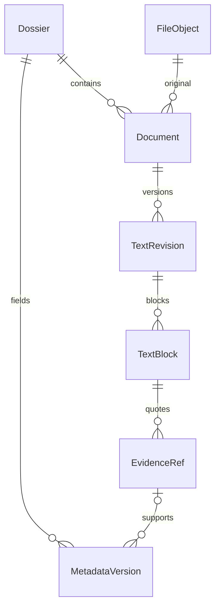
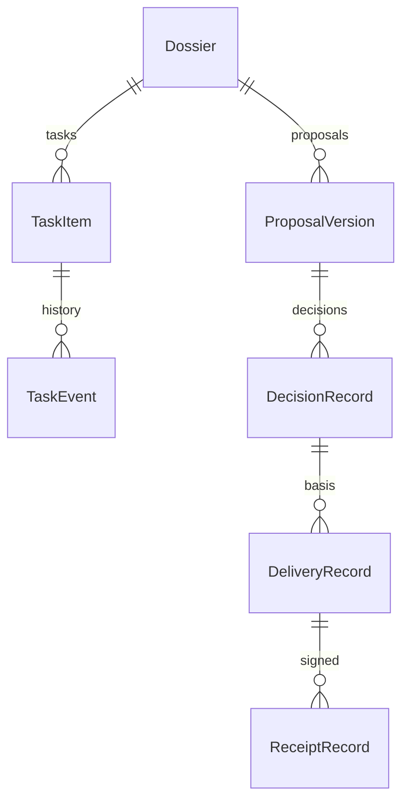
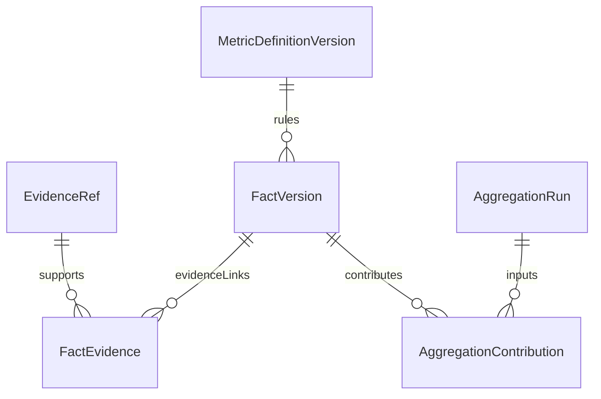
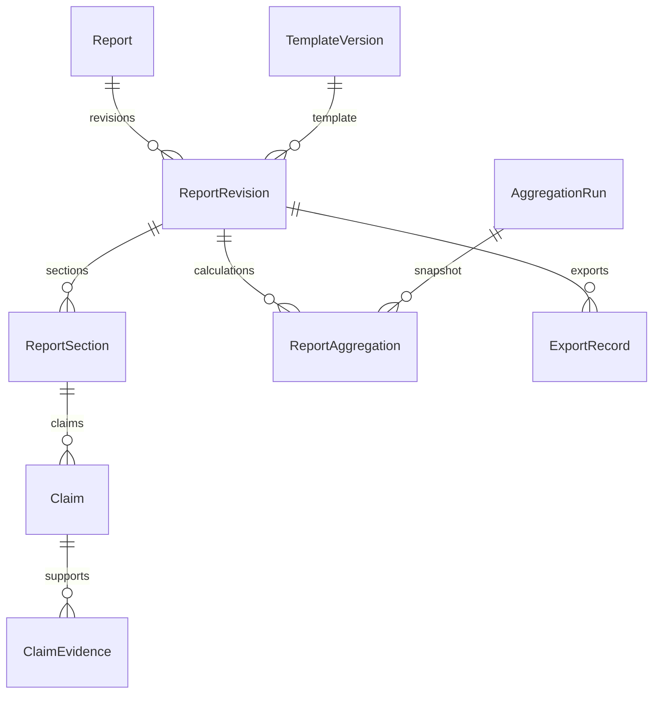
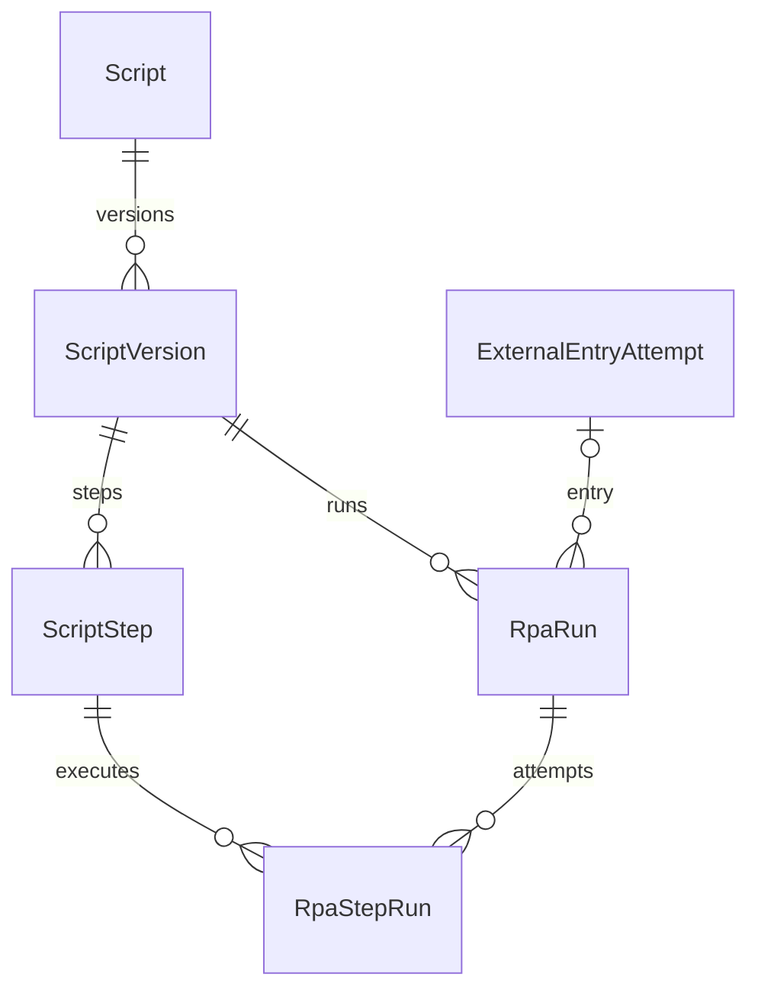
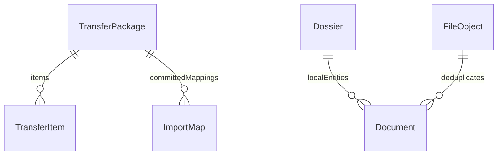

> Cập nhật 20/10/2026: [bản sửa, chạy thử và giới hạn](09_SACD_Ban_sua_va_chay_thu_2026-10-20.md). Các yêu cầu bên dưới là baseline thiết kế, không tự đồng nghĩa đã hiện thực.

# SACD Mô hình dữ liệu ERD và từ điển dữ liệu

> Mở rộng additive 16/10/2026: thêm `CorrespondenceCase(id PK, documentId UNIQUE FK Document, payloadJson, rowVersion)`, `CorrespondenceCaseEvent(id PK, caseId FK, action, actor, atUtc, note)` và `CorrespondenceCaseImport(originWorkspaceId + originCaseId PK, originVersion, contentHash, localCaseId FK)`. Tổng hiện thực là 53 bảng nghiệp vụ, chưa tính FTS/shadow; schemaVersion vẫn là 1. JSON hồ sơ giữ metadata, trạng thái, căn cứ quyết định/ký nhận và thời điểm hoàn thành. StateLabel/DeadlineLabel chỉ là projection giao diện, không ghi vào gói/hash. Cùng nguồn/hồ sơ khác hash bị chặn để đối soát; không ghi đè tiến trình Máy 2. Xem [quy trình v1.2](08_SACD_Quy_trinh_hop_nhat_v1.2.md).

**Mã tài liệu:** SACD-DOC-05  
**Phiên bản:** 1.1  
**Ngày:** 15/10/2026  
**Người biên soạn:** Đàm Quang Trung  
**Trạng thái:** Dự thảo chi tiết để rà soát; chưa phê duyệt baseline triển khai.

**Căn cứ:** Phiếu đăng ký và Report 1 SACD v1.0 trong `references/`. Các đặc tả bổ sung ở bản 1.1 là thiết kế đề xuất để hiện thực phạm vi đã nêu, không phải bằng chứng phần mềm đã có. AI mặc định tắt. Các mục DEC còn mở không được coi là quyết định đã được đơn vị chấp thuận.

## 1 Quy ước thiết kế và trạng thái

Mô hình này là thiết kế mục tiêu cho phạm vi mới, không mô tả nguyên trạng schema prototype. Có 50 bảng nghiệp vụ và một chỉ mục FTS5. DDL trong mục 7 là schema đề xuất có thể thực thi để rà soát cú pháp/khóa; ứng dụng vẫn phải áp dụng invariants liên bảng trong transaction. Kiểm tra schema không phải kiểm thử phần mềm hoặc migration dữ liệu thực.

- Mỗi kho một SQLite database, một Workspace, một writer. UUID dạng TEXT; PK được ghi NOT NULL tường minh. Không tái sử dụng ID theo tên tệp.
- UTC ISO8601 cho sự kiện; ngày nghiệp vụ YYYY-MM-DD cho DateOnly, không chuyển ngày ban hành sang UTC làm đổi ngày.
- Decimal lưu chuỗi invariant kiểm tra bằng C#, không dùng REAL; giữ chuỗi nguồn và numberFormat riêng. UUID, ngày, enum, JSON và độ dài còn được service kiểm tra, SQLite không tự hiểu tất cả kiểu ngữ nghĩa này.
- FileObject lưu hash/path/size; bytes ở objects/<hash>. Quyền tệp, staging, giới hạn và reparse phải kiểm tra ở FileStore.
- Với revision, chỉ metadata review/projection có thể thay theo state machine. Nội dung/references/snapshot đã publish không sửa; chỉnh nội dung tạo revision mới.
- JSON phải đúng schemaVersion trong hợp đồng, canonical hóa trước hash; không eval/deserialize thành kiểu tùy ý. Field dạng TEXT JSON trong DDL chưa tự được JSON Schema kiểm tra.
- Dossier và TaskItem là projection có rowVersion; lịch sử quyết định/giao nhận/tasks là append. Cập nhật event+projection+audit cùng transaction.

## 2 ERD theo miền

Các hình chia theo quan hệ để đọc được; tất cả FK vật lý được liệt kê ở mục 4. Không có đường nối CSDL trực tiếp giữa máy A và B.

### 2.1 Nguồn văn bản và chứng cứ



### 2.2 Quy trình xử lý và giao nhận



### 2.3 Số liệu và báo cáo





### 2.4 Kịch bản và phiên thực thi



### 2.5 Gói chuyển và provenance



ImportMap.localEntityId là tham chiếu đa hình theo entityType, không phải FK khai báo được đến nhiều bảng; TransferService phải resolve theo allowlist và kiểm tra mọi mapping trước commit. Bảng vẽ không có quan hệ FK giả giữa ImportMap và Document.

## 3 Từ điển bảng và trường

### Workspace

Chủ kho và schema của một CSDL cục bộ.

| Trường | Kiểu và ràng buộc cột | Ý nghĩa |
|---|---|---|
| id | TEXT NOT NULL PRIMARY KEY | UUID kho, độc lập với đường dẫn máy |
| ownerSid | TEXT NOT NULL | SID chủ kho, kiểm tra bằng hệ điều hành |
| machineProfile | TEXT NOT NULL CHECK(machineProfile IN ('Intake','Management','Test')) | Vai trò máy A B hoặc thử nghiệm |
| schemaVersion | INTEGER NOT NULL CHECK(schemaVersion>0) | Phiên bản migration đã áp dụng |
| createdUtc | TEXT NOT NULL | Thời điểm tạo theo UTC |

**Ràng buộc bảng:** PK và FK tại từng cột; invariants service ở mục 5.

### FileObject

Tệp bất biến theo hash.

| Trường | Kiểu và ràng buộc cột | Ý nghĩa |
|---|---|---|
| hash | TEXT NOT NULL PRIMARY KEY CHECK(length(hash)=64) | SHA256 lowercase của bytes |
| relativePath | TEXT NOT NULL UNIQUE | Đường dẫn trong objects, không chứa tên gốc tùy ý |
| sizeBytes | INTEGER NOT NULL CHECK(sizeBytes>=0) | Số byte được đo thực |
| mediaType | TEXT NOT NULL | MIME được kiểm tra |
| createdUtc | TEXT NOT NULL | Thời điểm lưu object |

**Ràng buộc bảng:** PK và FK tại từng cột; invariants service ở mục 5.

### Dossier

Hồ sơ và projection trạng thái nghiệp vụ.

| Trường | Kiểu và ràng buộc cột | Ý nghĩa |
|---|---|---|
| id | TEXT NOT NULL PRIMARY KEY | UUID hồ sơ cục bộ |
| businessCode | TEXT NOT NULL UNIQUE | Mã hồ sơ để đối chiếu, không phải ID QLVB |
| state | TEXT NOT NULL CHECK(state IN ('Received','Checking','Prepared','AwaitingDecision','Approved','Returned','Rejected','Delivered','Acknowledged','InProgress','Completed','Archived')) | Trạng thái projection từ workflow events |
| rowVersion | INTEGER NOT NULL DEFAULT 1 CHECK(rowVersion>0) | Kiểm soát optimistic concurrency |
| receivedUtc | TEXT NOT NULL | Lần tiếp nhận hồ sơ |
| archivedUtc | TEXT | Thời điểm archive logic, NULL khi hiện hành |

**Ràng buộc bảng:** PK và FK tại từng cột; invariants service ở mục 5.

### Document

Tài liệu thuộc hồ sơ và object gốc.

| Trường | Kiểu và ràng buộc cột | Ý nghĩa |
|---|---|---|
| id | TEXT NOT NULL PRIMARY KEY | UUID tài liệu |
| dossierId | TEXT NOT NULL REFERENCES Dossier(id) | Hồ sơ chứa tài liệu |
| objectHash | TEXT NOT NULL REFERENCES FileObject(hash) | Bản gốc bất biến |
| originalName | TEXT NOT NULL | Tên hiển thị, không dùng làm path lưu trữ |
| sourceKind | TEXT NOT NULL CHECK(sourceKind IN ('Mail','File','Scan','Transfer','Manual')) | Loại nguồn |
| sourceRef | TEXT | Định danh thư hoặc gói, tránh lưu thông tin xác thực |
| currentRevisionId | TEXT | Con trỏ revision hiện hành, FK được khai báo dưới |
| status | TEXT NOT NULL | Imported/Processing/NeedsReview/Ready/Partial/Archived |
| createdUtc | TEXT NOT NULL | Ngày nhập |

**Ràng buộc bảng:** UNIQUE(dossierId,objectHash), FOREIGN KEY(currentRevisionId) REFERENCES TextRevision(id) DEFERRABLE INITIALLY DEFERRED.

### TextRevision

Phiên bản văn bản không sửa đè nội dung.

| Trường | Kiểu và ràng buộc cột | Ý nghĩa |
|---|---|---|
| id | TEXT NOT NULL PRIMARY KEY | UUID revision |
| documentId | TEXT NOT NULL REFERENCES Document(id) | Tài liệu nguồn |
| versionNo | INTEGER NOT NULL CHECK(versionNo>0) | Số tăng trong từng tài liệu |
| method | TEXT NOT NULL | PDF/DOCX/TXT/OCR/ManualCorrection |
| reviewState | TEXT NOT NULL CHECK(reviewState IN ('NeedsReview','Partial','Reviewed')) | Trạng thái kiểm tra, không suy theo OCR score |
| reviewerSid | TEXT | Người xác nhận khi Reviewed |
| reviewedUtc | TEXT | Thời điểm xác nhận |
| createdUtc | TEXT NOT NULL | Thời điểm tạo |

**Ràng buộc bảng:** UNIQUE(documentId,versionNo), CHECK(reviewState<>'Reviewed' OR (reviewerSid IS NOT NULL AND reviewedUtc IS NOT NULL)).

### TextBlock

Khối văn bản có vị trí và chuẩn hóa.

| Trường | Kiểu và ràng buộc cột | Ý nghĩa |
|---|---|---|
| id | TEXT NOT NULL PRIMARY KEY | UUID block theo revision |
| revisionId | TEXT NOT NULL REFERENCES TextRevision(id) | Revision chứa block |
| ordinal | INTEGER NOT NULL CHECK(ordinal>=1) | Thứ tự ổn định 1-based |
| locatorJson | TEXT NOT NULL | Loại PDF/DOCX/TXT/OCR và tọa độ theo hợp đồng |
| extractedText | TEXT NOT NULL | Văn bản trích xuất nguyên bản |
| rawTextNfc | TEXT NOT NULL | Căn cứ NFC dùng offsets và hash |
| searchText | TEXT NOT NULL | Dạng chuẩn hóa tìm không dấu |
| reviewed | INTEGER NOT NULL DEFAULT 0 CHECK(reviewed IN (0,1)) | Block/trang đã được người dùng đối chiếu |

**Ràng buộc bảng:** UNIQUE(revisionId,ordinal), UNIQUE(revisionId,id).

### EvidenceRef

Trích đoạn gắn đúng block và revision.

| Trường | Kiểu và ràng buộc cột | Ý nghĩa |
|---|---|---|
| id | TEXT NOT NULL PRIMARY KEY | UUID evidence |
| revisionId | TEXT NOT NULL | Revision được trích dẫn |
| blockId | TEXT NOT NULL | Block thuộc cùng revision |
| startOffset | INTEGER NOT NULL CHECK(startOffset>=0) | UTF16 code unit đầu 0-based |
| endOffset | INTEGER NOT NULL | UTF16 code unit cuối exclusive |
| quoteHash | TEXT NOT NULL CHECK(length(quoteHash)=64) | SHA256 UTF8 đoạn NFC |
| createdUtc | TEXT NOT NULL | Lúc tạo tham chiếu |

**Ràng buộc bảng:** CHECK(endOffset>startOffset), FOREIGN KEY(revisionId,blockId) REFERENCES TextBlock(revisionId,id).

### MetadataVersion

Giá trị trường metadata theo phiên bản.

| Trường | Kiểu và ràng buộc cột | Ý nghĩa |
|---|---|---|
| id | TEXT NOT NULL PRIMARY KEY | UUID giá trị phiên bản |
| dossierId | TEXT NOT NULL REFERENCES Dossier(id) | Hồ sơ có trường |
| fieldKey | TEXT NOT NULL | Loại/số/ngày/đơn vị/người ký/trích yếu... |
| versionNo | INTEGER NOT NULL CHECK(versionNo>0) | Version theo dossier và field |
| valueJson | TEXT | Giá trị typed hoặc NULL khi Unknown |
| status | TEXT NOT NULL CHECK(status IN ('Unknown','Proposed','Confirmed','Rejected')) | Mức xác nhận |
| evidenceId | TEXT REFERENCES EvidenceRef(id) | Nguồn của trường, nullable nếu chưa Confirmed |
| manualReason | TEXT | Lý do nhập/sửa tay, không thay cho nguồn |
| actorSid | TEXT NOT NULL | Người nhập hoặc xác nhận |
| createdUtc | TEXT NOT NULL | Thời điểm lưu |

**Ràng buộc bảng:** UNIQUE(dossierId,fieldKey,versionNo), CHECK(status<>'Confirmed' OR (valueJson IS NOT NULL AND evidenceId IS NOT NULL)).

### DirectoryEntryVersion

Đơn vị người loại và chủ đề có version.

| Trường | Kiểu và ràng buộc cột | Ý nghĩa |
|---|---|---|
| id | TEXT NOT NULL PRIMARY KEY | UUID bản ghi phiên bản |
| logicalId | TEXT NOT NULL | ID ổn định qua đổi tên |
| versionNo | INTEGER NOT NULL CHECK(versionNo>0) | Version danh mục |
| kind | TEXT NOT NULL | Unit/Person/Topic/DocumentType/Urgency/Sensitivity |
| code | TEXT NOT NULL | Mã nghiệp vụ |
| name | TEXT NOT NULL | Tên tại phiên bản này |
| parentVersionId | TEXT REFERENCES DirectoryEntryVersion(id) | Cấp cha snapshot, cycle kiểm tra ở service |
| active | INTEGER NOT NULL CHECK(active IN (0,1)) | Còn dùng cho lựa chọn mới |
| createdUtc | TEXT NOT NULL | Thời điểm tạo |

**Ràng buộc bảng:** UNIQUE(logicalId,versionNo), UNIQUE(kind,code,versionNo).

### ClassificationRecord

Phân loại và thông tin mật có căn cứ.

| Trường | Kiểu và ràng buộc cột | Ý nghĩa |
|---|---|---|
| id | TEXT NOT NULL PRIMARY KEY | UUID lần phân loại |
| dossierId | TEXT NOT NULL REFERENCES Dossier(id) | Hồ sơ |
| versionNo | INTEGER NOT NULL CHECK(versionNo>0) | Thứ tự thay đổi |
| classificationJson | TEXT NOT NULL | Chủ đề, mật, khẩn, declassificationState và version danh mục |
| milestoneDate | TEXT | Ngày cần nhắc kiểm tra, không tự giải mật |
| evidenceId | TEXT REFERENCES EvidenceRef(id) | Căn cứ đã được phép lưu |
| actorSid | TEXT NOT NULL | Người cập nhật |
| createdUtc | TEXT NOT NULL | Thời điểm |

**Ràng buộc bảng:** UNIQUE(dossierId,versionNo).

### TaskItem

Nhiệm vụ và hạn hiện hành.

| Trường | Kiểu và ràng buộc cột | Ý nghĩa |
|---|---|---|
| id | TEXT NOT NULL PRIMARY KEY | UUID nhiệm vụ |
| dossierId | TEXT NOT NULL REFERENCES Dossier(id) | Hồ sơ nguồn |
| name | TEXT NOT NULL | Nội dung công việc |
| assigneeVersionId | TEXT REFERENCES DirectoryEntryVersion(id) | Người/đội snapshot, service kiểm tra kind |
| state | TEXT NOT NULL CHECK(state IN ('Draft','Assigned','InProgress','Completed','Cancelled','Reopened')) | Projection trạng thái |
| dueKind | TEXT NOT NULL CHECK(dueKind IN ('Unknown','Date','Instant')) | Loại hạn |
| dueDate | TEXT | DateOnly YYYY-MM-DD theo ngày nghiệp vụ |
| dueUtc | TEXT | Thời điểm UTC khi Instant |
| completedUtc | TEXT | Thời điểm hoàn thành thực tế |
| rowVersion | INTEGER NOT NULL DEFAULT 1 | Bản concurrency của projection |

**Ràng buộc bảng:** CHECK((dueKind='Unknown' AND dueDate IS NULL AND dueUtc IS NULL) OR (dueKind='Date' AND dueDate IS NOT NULL AND dueUtc IS NULL) OR (dueKind='Instant' AND dueUtc IS NOT NULL AND dueDate IS NULL)).

### TaskEvent

Lịch sử giao gia hạn hoàn thành và mở lại.

| Trường | Kiểu và ràng buộc cột | Ý nghĩa |
|---|---|---|
| id | TEXT NOT NULL PRIMARY KEY | UUID event |
| taskId | TEXT NOT NULL REFERENCES TaskItem(id) | Nhiệm vụ |
| sequenceNo | INTEGER NOT NULL | Thứ tự trong task, không dựa đồng hồ |
| kind | TEXT NOT NULL | Created/Assigned/Extended/Progressed/Completed/Reopened |
| payloadJson | TEXT NOT NULL | Hạn cũ/mới, kết quả, lý do, căn cứ và effective time |
| evidenceId | TEXT REFERENCES EvidenceRef(id) | Căn cứ nguồn nếu có |
| actorSid | TEXT NOT NULL | Người cập nhật |
| createdUtc | TEXT NOT NULL | Thời điểm ghi |

**Ràng buộc bảng:** UNIQUE(taskId,sequenceNo).

### WorkflowEvent

Sự kiện luồng hồ sơ và căn cứ chuyển trạng thái.

| Trường | Kiểu và ràng buộc cột | Ý nghĩa |
|---|---|---|
| id | TEXT NOT NULL PRIMARY KEY | UUID event |
| dossierId | TEXT NOT NULL REFERENCES Dossier(id) | Hồ sơ |
| sequenceNo | INTEGER NOT NULL | Thứ tự projection |
| fromState | TEXT NOT NULL | Trạng thái trước |
| toState | TEXT NOT NULL | Trạng thái sau |
| reason | TEXT NOT NULL | Lý do và loại tham chiếu chứng từ, không toàn văn |
| actorSid | TEXT NOT NULL | Người cập nhật |
| createdUtc | TEXT NOT NULL | Thời điểm ghi |

**Ràng buộc bảng:** UNIQUE(dossierId,sequenceNo).

### TemplateVersion

Mẫu DOCX và mapping bất biến.

| Trường | Kiểu và ràng buộc cột | Ý nghĩa |
|---|---|---|
| id | TEXT NOT NULL PRIMARY KEY | UUID mẫu phiên bản |
| logicalId | TEXT NOT NULL | ID mẫu qua các phiên bản |
| versionNo | INTEGER NOT NULL | Version mẫu |
| objectHash | TEXT NOT NULL REFERENCES FileObject(hash) | File DOCX gốc |
| mappingJson | TEXT NOT NULL | Hợp đồng tag/section/bảng, schemaVersion=1 |
| mappingHash | TEXT NOT NULL | SHA256 canonical JSON |
| createdUtc | TEXT NOT NULL | Thời điểm khóa mẫu |

**Ràng buộc bảng:** UNIQUE(logicalId,versionNo).

### ProposalVersion

Đề xuất và phiếu trình theo revision.

| Trường | Kiểu và ràng buộc cột | Ý nghĩa |
|---|---|---|
| id | TEXT NOT NULL PRIMARY KEY | UUID proposal version |
| dossierId | TEXT NOT NULL REFERENCES Dossier(id) | Hồ sơ liên quan |
| logicalId | TEXT NOT NULL | ID đề xuất ổn định |
| versionNo | INTEGER NOT NULL | Revision đề xuất |
| recipientVersionId | TEXT NOT NULL REFERENCES DirectoryEntryVersion(id) | Lãnh đạo/đội đề xuất |
| contentJson | TEXT NOT NULL | Công việc, hạn và nguồn trong snapshot |
| templateVersionId | TEXT REFERENCES TemplateVersion(id) | Mẫu phiếu khi có |
| state | TEXT NOT NULL CHECK(state IN ('Draft','Submitted','Superseded')) | Trình khác với duyệt |
| submittedUtc | TEXT | Thời điểm đã trình thực tế |
| actorSid | TEXT NOT NULL | Người lập |
| createdUtc | TEXT NOT NULL | Thời điểm lưu |

**Ràng buộc bảng:** UNIQUE(logicalId,versionNo).

### DecisionRecord

Quyết định thực tế được cán bộ ghi nhận.

| Trường | Kiểu và ràng buộc cột | Ý nghĩa |
|---|---|---|
| id | TEXT NOT NULL PRIMARY KEY | UUID quyết định |
| proposalVersionId | TEXT NOT NULL REFERENCES ProposalVersion(id) | Đề xuất cụ thể |
| outcome | TEXT NOT NULL CHECK(outcome IN ('Approved','Rejected','ReturnedForEdit','Superseded')) | Kết quả có căn cứ |
| decisionMakerVersionId | TEXT NOT NULL REFERENCES DirectoryEntryVersion(id) | Người quyết định thực tế |
| decidedUtc | TEXT NOT NULL | Thời điểm quyết định |
| evidenceId | TEXT NOT NULL REFERENCES EvidenceRef(id) | Nguồn/chứng từ quyết định được phép lưu |
| supersedesId | TEXT REFERENCES DecisionRecord(id) | Bản thay thế không sửa bản cũ |
| recordedBySid | TEXT NOT NULL | Cán bộ cập nhật, khác người quyết định |
| createdUtc | TEXT NOT NULL | Thời điểm nhập |

**Ràng buộc bảng:** PK và FK tại từng cột; invariants service ở mục 5.

### DeliveryRecord

Lượt giao văn bản tách khỏi ký nhận.

| Trường | Kiểu và ràng buộc cột | Ý nghĩa |
|---|---|---|
| id | TEXT NOT NULL PRIMARY KEY | UUID lượt giao |
| dossierId | TEXT NOT NULL REFERENCES Dossier(id) | Hồ sơ |
| decisionId | TEXT NOT NULL REFERENCES DecisionRecord(id) | Căn cứ phân công có hiệu lực |
| recipientVersionId | TEXT NOT NULL REFERENCES DirectoryEntryVersion(id) | Người/đội nhận |
| snapshotJson | TEXT NOT NULL | Danh sách document/revision và công việc được giao |
| deliveredUtc | TEXT NOT NULL | Lúc giao thực tế |
| recordedBySid | TEXT NOT NULL | Người cập nhật |
| createdUtc | TEXT NOT NULL | Lúc ghi |

**Ràng buộc bảng:** PK và FK tại từng cột; invariants service ở mục 5.

### ReceiptRecord

Ký nhận theo chứng từ ngoài SACD.

| Trường | Kiểu và ràng buộc cột | Ý nghĩa |
|---|---|---|
| id | TEXT NOT NULL PRIMARY KEY | UUID lần nhận |
| deliveryId | TEXT NOT NULL REFERENCES DeliveryRecord(id) | Lượt giao |
| receiverVersionId | TEXT NOT NULL REFERENCES DirectoryEntryVersion(id) | Người ký thực tế hoặc nhận thay có căn cứ |
| signedUtc | TEXT NOT NULL | Thời điểm ký nhận |
| evidenceId | TEXT NOT NULL REFERENCES EvidenceRef(id) | Chứng từ ký nhận |
| exceptionReason | TEXT | Lý do ngoại lệ người nhận/thời gian nếu có |
| recordedBySid | TEXT NOT NULL | Người nhập kết quả |
| createdUtc | TEXT NOT NULL | Lúc ghi |

**Ràng buộc bảng:** PK và FK tại từng cột; invariants service ở mục 5.

### MappingVersion

Ánh xạ dữ liệu và giao diện đích.

| Trường | Kiểu và ràng buộc cột | Ý nghĩa |
|---|---|---|
| id | TEXT NOT NULL PRIMARY KEY | UUID mapping |
| logicalId | TEXT NOT NULL | Mapping ổn định |
| versionNo | INTEGER NOT NULL | Revision mapping |
| kind | TEXT NOT NULL | ExternalEntry/Template/Directory |
| payloadJson | TEXT NOT NULL | Schema nguồn-đích, kiểm tra, profile fingerprint |
| contentHash | TEXT NOT NULL | Hash canonical JSON |
| createdUtc | TEXT NOT NULL | Thời điểm publish |

**Ràng buộc bảng:** UNIQUE(logicalId,versionNo).

### ExternalEntryAttempt

Lần điền QLVB và đối soát sau tác dụng phụ.

| Trường | Kiểu và ràng buộc cột | Ý nghĩa |
|---|---|---|
| id | TEXT NOT NULL PRIMARY KEY | UUID attempt |
| dossierId | TEXT NOT NULL REFERENCES Dossier(id) | Hồ sơ nguồn |
| mappingVersionId | TEXT NOT NULL REFERENCES MappingVersion(id) | Mapping đóng băng |
| idempotencyKey | TEXT NOT NULL UNIQUE | Khóa logic chống chạy trùng ở SACD |
| snapshotHash | TEXT NOT NULL | Hash dữ liệu đã duyệt |
| state | TEXT NOT NULL CHECK(state IN ('Prepared','Executing','AwaitingUser','Verified','Failed','NeedsReconciliation','Cancelled')) | Không Success khi chưa kiểm tra đích |
| externalRef | TEXT | ID QLVB sau đối soát, nullable khi chưa rõ |
| reconciledBySid | TEXT | Người xác nhận sau timeout nếu có |
| createdUtc | TEXT NOT NULL | Thời điểm bắt đầu |

**Ràng buộc bảng:** PK và FK tại từng cột; invariants service ở mục 5.

### PrintAttempt

Lệnh in và xác nhận giấy tách biệt.

| Trường | Kiểu và ràng buộc cột | Ý nghĩa |
|---|---|---|
| id | TEXT NOT NULL PRIMARY KEY | UUID lần in |
| dossierId | TEXT REFERENCES Dossier(id) | Hồ sơ nếu có |
| objectHash | TEXT NOT NULL REFERENCES FileObject(hash) | File đã render để in |
| printerProfileJson | TEXT NOT NULL | Máy in/trang/số bản, không nội dung tài liệu |
| state | TEXT NOT NULL CHECK(state IN ('Prepared','Submitted','ConfirmedPrinted','Failed','Unknown','Cancelled')) | Trạng thái thật sự quan sát được |
| spoolJobId | TEXT | Mã hàng đợi nếu có |
| confirmedBySid | TEXT | Người kiểm tra bản giấy |
| createdUtc | TEXT NOT NULL | Thời điểm tạo |

**Ràng buộc bảng:** PK và FK tại từng cột; invariants service ở mục 5.

### TransferPackage

Gói trao đổi máy và hash manifest.

| Trường | Kiểu và ràng buộc cột | Ý nghĩa |
|---|---|---|
| id | TEXT NOT NULL PRIMARY KEY | UUID package ổn định |
| originWorkspaceId | TEXT NOT NULL | UUID kho nguồn, không là endpoint mạng |
| schemaVersion | INTEGER NOT NULL | Phiên bản hợp đồng gói |
| manifestHash | TEXT NOT NULL | Hash canonical manifest |
| state | TEXT NOT NULL | Staged/Exported/Validated/Imported/Quarantined/Failed |
| createdUtc | TEXT NOT NULL | Thời điểm nguồn tạo, không dùng để thắng conflict |
| importedUtc | TEXT | Lúc kho nhận commit thành công |

**Ràng buộc bảng:** PK và FK tại từng cột; invariants service ở mục 5.

### TransferItem

Tệp và entity snapshot trong gói.

| Trường | Kiểu và ràng buộc cột | Ý nghĩa |
|---|---|---|
| packageId | TEXT NOT NULL REFERENCES TransferPackage(id) | Gói cha |
| relativePath | TEXT NOT NULL | Path allowlist trong gói |
| sizeBytes | INTEGER NOT NULL CHECK(sizeBytes>=0) | Kích thước thực cần đối chiếu |
| contentHash | TEXT NOT NULL | SHA256 của item |
| entityType | TEXT NOT NULL | Document/TextRevision/MetadataVersion và allowlist |
| originEntityId | TEXT NOT NULL | ID phía nguồn |
| originVersion | TEXT NOT NULL | Revision phía nguồn |

**Ràng buộc bảng:** PRIMARY KEY(packageId,relativePath), UNIQUE(packageId,entityType,originEntityId,originVersion).

### ImportMap

Chống nhập trùng và ánh xạ provenance.

| Trường | Kiểu và ràng buộc cột | Ý nghĩa |
|---|---|---|
| originWorkspaceId | TEXT NOT NULL | Nguồn định danh |
| entityType | TEXT NOT NULL | Kiểu entity trong allowlist |
| originEntityId | TEXT NOT NULL | ID gốc |
| originVersion | TEXT NOT NULL | Version gốc |
| contentHash | TEXT NOT NULL | Hash đã nhập, kiểm tra conflict |
| localEntityId | TEXT NOT NULL | ID local được ánh xạ; kiểm tra theo type trong service |
| packageId | TEXT NOT NULL REFERENCES TransferPackage(id) | Gói đã commit |

**Ràng buộc bảng:** PRIMARY KEY(originWorkspaceId,entityType,originEntityId,originVersion).

### MetricDefinitionVersion

Chỉ tiêu đơn vị loại kỳ grain và quy tắc.

| Trường | Kiểu và ràng buộc cột | Ý nghĩa |
|---|---|---|
| id | TEXT NOT NULL PRIMARY KEY | UUID metric version |
| logicalId | TEXT NOT NULL | ID chỉ tiêu ổn định |
| versionNo | INTEGER NOT NULL | Version bất biến |
| name | TEXT NOT NULL | Tên chỉ tiêu |
| unitCode | TEXT NOT NULL | Đơn vị không tự đổi |
| kind | TEXT NOT NULL CHECK(kind IN ('Flow','Stock','Ratio','Cumulative')) | Quy tắc gộp |
| ruleJson | TEXT NOT NULL | Grain, dimensions, negative/fraction, coverage, displayScale, roundingMode |
| createdUtc | TEXT NOT NULL | Thời điểm publish |

**Ràng buộc bảng:** UNIQUE(logicalId,versionNo).

### FactVersion

Số/sự kiện có nguồn và phiên bản.

| Trường | Kiểu và ràng buộc cột | Ý nghĩa |
|---|---|---|
| id | TEXT NOT NULL PRIMARY KEY | UUID fact version |
| logicalId | TEXT NOT NULL | ID fact qua chỉnh sửa |
| versionNo | INTEGER NOT NULL | Revision fact |
| metricVersionId | TEXT NOT NULL REFERENCES MetricDefinitionVersion(id) | Quy tắc chỉ tiêu khóa phiên bản |
| sourceRevisionId | TEXT NOT NULL REFERENCES TextRevision(id) | Nguồn Reviewed trước Confirmed |
| sourceNumberText | TEXT | Chuỗi nguồn, NULL khi Missing |
| numberFormat | TEXT | vi-VN/invariant hoặc NULL khi chưa biết |
| valueStatus | TEXT NOT NULL CHECK(valueStatus IN ('Known','Missing')) | Missing khác 0 |
| valueDecimalText | TEXT | Decimal invariant không dùng REAL |
| periodStart | TEXT NOT NULL | Ngày đầu inclusive |
| periodEnd | TEXT NOT NULL | Ngày cuối inclusive |
| periodKind | TEXT NOT NULL | Month/Instant/Cumulative và rule tương ứng |
| scopeJson | TEXT NOT NULL | Unit/grain/dimensions/coverage và eventKey |
| status | TEXT NOT NULL CHECK(status IN ('Proposed','Confirmed','Rejected')) | Trạng thái xác nhận |
| reviewerSid | TEXT | Người xác nhận |
| reviewedUtc | TEXT | Thời điểm xác nhận |
| createdUtc | TEXT NOT NULL | Thời điểm tạo |

**Ràng buộc bảng:** UNIQUE(logicalId,versionNo), CHECK(periodStart<=periodEnd), CHECK((valueStatus='Known' AND valueDecimalText IS NOT NULL) OR (valueStatus='Missing' AND valueDecimalText IS NULL)), CHECK(status<>'Confirmed' OR (reviewerSid IS NOT NULL AND reviewedUtc IS NOT NULL)).

### FactEvidence

Quan hệ nhiều nguồn cho một fact.

| Trường | Kiểu và ràng buộc cột | Ý nghĩa |
|---|---|---|
| factVersionId | TEXT NOT NULL REFERENCES FactVersion(id) | Fact |
| evidenceId | TEXT NOT NULL REFERENCES EvidenceRef(id) | Nguồn hỗ trợ |

**Ràng buộc bảng:** PRIMARY KEY(factVersionId,evidenceId).

### DedupDecisionVersion

Quyết định nhóm trùng bất biến.

| Trường | Kiểu và ràng buộc cột | Ý nghĩa |
|---|---|---|
| id | TEXT NOT NULL PRIMARY KEY | UUID decision version |
| logicalId | TEXT NOT NULL | Nhóm quyết định |
| versionNo | INTEGER NOT NULL | Phiên bản |
| canonicalFactVersionId | TEXT REFERENCES FactVersion(id) | Fact chuẩn, NULL khi unresolved |
| state | TEXT NOT NULL CHECK(state IN ('Resolved','Unresolved')) | Đã giải quyết hay chờ |
| reason | TEXT NOT NULL | Lý do con người quyết định |
| actorSid | TEXT NOT NULL | Người quyết định |
| createdUtc | TEXT NOT NULL | Thời điểm |

**Ràng buộc bảng:** UNIQUE(logicalId,versionNo), CHECK(state<>'Resolved' OR canonicalFactVersionId IS NOT NULL).

### DedupMember

Thành viên và vai trò trong nhóm.

| Trường | Kiểu và ràng buộc cột | Ý nghĩa |
|---|---|---|
| decisionVersionId | TEXT NOT NULL REFERENCES DedupDecisionVersion(id) | Quyết định |
| factVersionId | TEXT NOT NULL REFERENCES FactVersion(id) | Thành viên |
| role | TEXT NOT NULL CHECK(role IN ('Canonical','Equivalent','Excluded','Unresolved')) | Vai trò được xác nhận |

**Ràng buộc bảng:** PRIMARY KEY(decisionVersionId,factVersionId).

### AggregationRun

Kết quả tính tái lập được.

| Trường | Kiểu và ràng buộc cột | Ý nghĩa |
|---|---|---|
| id | TEXT NOT NULL PRIMARY KEY | UUID lần tổng hợp |
| metricVersionId | TEXT NOT NULL REFERENCES MetricDefinitionVersion(id) | Rule version |
| queryJson | TEXT NOT NULL | Kỳ/phạm vi và tập nguồn khóa lại |
| resultJson | TEXT NOT NULL | Value đầy đủ/display/NA/missing/issues, decimal strings |
| snapshotHash | TEXT NOT NULL | Hash snapshot canonical |
| state | TEXT NOT NULL CHECK(state IN ('Valid','NeedsReview','Failed')) | Không Valid khi có blocking issue |
| createdUtc | TEXT NOT NULL | Thời điểm tính |

**Ràng buộc bảng:** PK và FK tại từng cột; invariants service ở mục 5.

### AggregationContribution

Các fact đóng góp theo nhóm chỉ tiêu.

| Trường | Kiểu và ràng buộc cột | Ý nghĩa |
|---|---|---|
| aggregationId | TEXT NOT NULL REFERENCES AggregationRun(id) | Lần tính |
| factVersionId | TEXT NOT NULL REFERENCES FactVersion(id) | Fact đóng góp |
| groupKey | TEXT NOT NULL | Khóa nhóm canonically serialized |
| operation | TEXT NOT NULL | Add/StockLast/Numerator/Denominator/Difference |
| contributionDecimalText | TEXT | Số đóng góp invariant hoặc NULL khi Missing |
| dedupDecisionVersionId | TEXT REFERENCES DedupDecisionVersion(id) | Căn cứ giữ/loại trùng |

**Ràng buộc bảng:** PRIMARY KEY(aggregationId,groupKey,factVersionId,operation).

### Report

Báo cáo logic.

| Trường | Kiểu và ràng buộc cột | Ý nghĩa |
|---|---|---|
| id | TEXT NOT NULL PRIMARY KEY | UUID report |
| name | TEXT NOT NULL | Tên logic |
| createdUtc | TEXT NOT NULL | Lúc tạo |

**Ràng buộc bảng:** PK và FK tại từng cột; invariants service ở mục 5.

### ReportRevision

Snapshot báo cáo và review.

| Trường | Kiểu và ràng buộc cột | Ý nghĩa |
|---|---|---|
| id | TEXT NOT NULL PRIMARY KEY | UUID revision |
| reportId | TEXT NOT NULL REFERENCES Report(id) | Báo cáo logic |
| versionNo | INTEGER NOT NULL | Số version |
| templateVersionId | TEXT NOT NULL REFERENCES TemplateVersion(id) | Mẫu khóa |
| snapshotJson | TEXT NOT NULL | Kỳ/config/model/rule IDs/nguồn và hash cần tái lập |
| state | TEXT NOT NULL CHECK(state IN ('Draft','Reviewed')) | Xuất không là state |
| isStale | INTEGER NOT NULL DEFAULT 0 CHECK(isStale IN (0,1)) | Cờ phụ thuộc thay đổi |
| reviewerSid | TEXT | Người review |
| reviewedUtc | TEXT | Lúc review |
| checklistJson | TEXT | Checklist từng mục, không thay cho evidence |
| createdUtc | TEXT NOT NULL | Lúc tạo |

**Ràng buộc bảng:** UNIQUE(reportId,versionNo), CHECK(state<>'Reviewed' OR (reviewerSid IS NOT NULL AND reviewedUtc IS NOT NULL AND checklistJson IS NOT NULL)).

### ReportSection

Nội dung từng mục của revision.

| Trường | Kiểu và ràng buộc cột | Ý nghĩa |
|---|---|---|
| id | TEXT NOT NULL PRIMARY KEY | UUID mục |
| reportRevisionId | TEXT NOT NULL REFERENCES ReportRevision(id) | Bản báo cáo |
| sectionKey | TEXT NOT NULL | Khóa khớp mapping mẫu |
| ordinal | INTEGER NOT NULL | Thứ tự mục |
| text | TEXT NOT NULL | Nội dung kiểm tra được |

**Ràng buộc bảng:** UNIQUE(reportRevisionId,sectionKey).

### Claim

Nhận định và loại nội dung.

| Trường | Kiểu và ràng buộc cột | Ý nghĩa |
|---|---|---|
| id | TEXT NOT NULL PRIMARY KEY | UUID nhận định |
| sectionId | TEXT NOT NULL REFERENCES ReportSection(id) | Mục báo cáo |
| kind | TEXT NOT NULL CHECK(kind IN ('Factual','Commentary')) | Commentary không được dùng để giấu fact/số |
| text | TEXT NOT NULL | Câu người dùng/AI đề xuất |
| checked | INTEGER NOT NULL DEFAULT 0 CHECK(checked IN (0,1)) | Người dùng đối chiếu cho revision này |
| commentaryReason | TEXT | Lý do dùng Commentary, không che số liệu hoặc nhận định thực tế |

**Ràng buộc bảng:** CHECK(kind<>'Commentary' OR commentaryReason IS NOT NULL).

### ClaimEvidence

Liên kết nguồn của nhận định.

| Trường | Kiểu và ràng buộc cột | Ý nghĩa |
|---|---|---|
| claimId | TEXT NOT NULL REFERENCES Claim(id) | Claim |
| evidenceId | TEXT NOT NULL REFERENCES EvidenceRef(id) | Căn cứ |

**Ràng buộc bảng:** PRIMARY KEY(claimId,evidenceId).

### ReportSource

Tập phụ thuộc trực tiếp của report.

| Trường | Kiểu và ràng buộc cột | Ý nghĩa |
|---|---|---|
| reportRevisionId | TEXT NOT NULL REFERENCES ReportRevision(id) | Report |
| sourceRevisionId | TEXT NOT NULL REFERENCES TextRevision(id) | Revision nguồn |
| sourceHash | TEXT NOT NULL | Hash nội dung nguồn đã chốt |

**Ràng buộc bảng:** PRIMARY KEY(reportRevisionId,sourceRevisionId).

### ExportRecord

Mỗi lần xuất có hash và đường dẫn.

| Trường | Kiểu và ràng buộc cột | Ý nghĩa |
|---|---|---|
| id | TEXT NOT NULL PRIMARY KEY | UUID xuất |
| reportRevisionId | TEXT NOT NULL REFERENCES ReportRevision(id) | Báo cáo xuất |
| mode | TEXT NOT NULL CHECK(mode IN ('Draft','Submission')) | Chế độ xuất |
| outputHash | TEXT NOT NULL | Hash tệp DOCX sau verify |
| outputPath | TEXT NOT NULL | Đích được người dùng chọn, không dùng làm ID nguồn |
| actorSid | TEXT NOT NULL | Người xuất |
| createdUtc | TEXT NOT NULL | Thời điểm |

**Ràng buộc bảng:** PK và FK tại từng cột; invariants service ở mục 5.

### Script

Kịch bản logic.

| Trường | Kiểu và ràng buộc cột | Ý nghĩa |
|---|---|---|
| id | TEXT NOT NULL PRIMARY KEY | UUID script |
| name | TEXT NOT NULL | Tên hiển thị |
| createdUtc | TEXT NOT NULL | Thời điểm |

**Ràng buộc bảng:** PK và FK tại từng cột; invariants service ở mục 5.

### ScriptVersion

Kịch bản đã publish hoặc bản nháp.

| Trường | Kiểu và ràng buộc cột | Ý nghĩa |
|---|---|---|
| id | TEXT NOT NULL PRIMARY KEY | UUID version |
| scriptId | TEXT NOT NULL REFERENCES Script(id) | Script logic |
| versionNo | INTEGER NOT NULL | Revision |
| state | TEXT NOT NULL CHECK(state IN ('Draft','Published','Retired')) | Chỉ Published đã kiểm thử được chạy nghiệp vụ |
| profileJson | TEXT NOT NULL | Target fingerprint và compatibility/DPI assumptions |
| contentHash | TEXT NOT NULL | Hash payload chuẩn hóa gồm step/mapping |
| mappingVersionId | TEXT REFERENCES MappingVersion(id) | Biến nguồn-đích |
| createdUtc | TEXT NOT NULL | Thời điểm |

**Ràng buộc bảng:** UNIQUE(scriptId,versionNo).

### ScriptStep

Bước whitelist và điểm người dùng can thiệp.

| Trường | Kiểu và ràng buộc cột | Ý nghĩa |
|---|---|---|
| id | TEXT NOT NULL PRIMARY KEY | UUID step |
| scriptVersionId | TEXT NOT NULL REFERENCES ScriptVersion(id) | Version |
| ordinal | INTEGER NOT NULL CHECK(ordinal>0) | Thứ tự |
| action | TEXT NOT NULL CHECK(action IN ('WaitWindow','WaitElement','Invoke','SetValue','Click','DoubleClick','Scroll','Move','KeyChord','TypeVariable','Assert','PauseForUser')) | Hành động cho phép |
| selectorJson | TEXT | UIA/relative/absolute và điều kiện fallback |
| paramsJson | TEXT NOT NULL | Variable references, pre/post, sideEffect, confirmation |
| timeoutMs | INTEGER NOT NULL CHECK(timeoutMs>0 AND timeoutMs<=180000) | Giới hạn chờ |
| retryPolicy | TEXT NOT NULL CHECK(retryPolicy IN ('None','ReadOnlyBounded')) | Không retry write Unknown |

**Ràng buộc bảng:** UNIQUE(scriptVersionId,ordinal).

### RpaRun

Phiên chạy kịch bản và snapshot đầu vào.

| Trường | Kiểu và ràng buộc cột | Ý nghĩa |
|---|---|---|
| id | TEXT NOT NULL PRIMARY KEY | UUID run |
| scriptVersionId | TEXT NOT NULL REFERENCES ScriptVersion(id) | Version bất biến |
| externalAttemptId | TEXT REFERENCES ExternalEntryAttempt(id) | Attempt nhập QLVB nếu có |
| idempotencyKey | TEXT NOT NULL UNIQUE | Chống run trùng ở SACD |
| inputSnapshotHash | TEXT NOT NULL | Hash biến đã Confirmed, không secret |
| state | TEXT NOT NULL CHECK(state IN ('Queued','Running','Paused','AwaitingUser','Succeeded','Failed','Cancelled','Interrupted','NeedsReconciliation')) | Trạng thái phiên |
| currentStep | INTEGER NOT NULL DEFAULT 0 | Ordinal hiện tại |
| actorSid | TEXT NOT NULL | Người bắt đầu |
| createdUtc | TEXT NOT NULL | Lúc tạo |

**Ràng buộc bảng:** PK và FK tại từng cột; invariants service ở mục 5.

### RpaStepRun

Lịch sử thực thi từng bước.

| Trường | Kiểu và ràng buộc cột | Ý nghĩa |
|---|---|---|
| id | TEXT NOT NULL PRIMARY KEY | UUID lần thử step |
| runId | TEXT NOT NULL REFERENCES RpaRun(id) | Run |
| stepId | TEXT NOT NULL REFERENCES ScriptStep(id) | Step trong script tương ứng, service kiểm tra cùng version |
| attemptNo | INTEGER NOT NULL CHECK(attemptNo>0) | Retry đọc có giới hạn |
| state | TEXT NOT NULL CHECK(state IN ('Prepared','Dispatched','Verified','Failed','Cancelled','Unknown','AwaitingUser')) | Prepared/Dispatched ghi trước side effect |
| observedJson | TEXT | Chỉ hậu điều kiện đã lược nội dung nhạy cảm |
| startedUtc | TEXT NOT NULL | Bắt đầu |
| endedUtc | TEXT | Kết thúc nếu có |

**Ràng buộc bảng:** UNIQUE(runId,stepId,attemptNo).

### ToolVersion

Công cụ và manifest kiểm thử.

| Trường | Kiểu và ràng buộc cột | Ý nghĩa |
|---|---|---|
| id | TEXT NOT NULL PRIMARY KEY | UUID bản công cụ |
| kind | TEXT NOT NULL | Renderer/Ocr/Ai/TargetApplication |
| versionLabel | TEXT NOT NULL | Build dùng để đối chiếu |
| manifestJson | TEXT NOT NULL | Executable, DLL/tessdata/model hashes, license và compatibility |
| manifestHash | TEXT NOT NULL | Hash manifest đã chốt |
| createdUtc | TEXT NOT NULL | Ngày duyệt cấu hình thử |

**Ràng buộc bảng:** PK và FK tại từng cột; invariants service ở mục 5.

### ConfigVersion

Cấu hình bất biến được tham chiếu.

| Trường | Kiểu và ràng buộc cột | Ý nghĩa |
|---|---|---|
| id | TEXT NOT NULL PRIMARY KEY | UUID config |
| kind | TEXT NOT NULL | Limits/Deadline/Ocr/Rpa/Ai/Backup |
| versionNo | INTEGER NOT NULL | Version theo kind |
| payloadJson | TEXT NOT NULL | Schema và giá trị typed |
| contentHash | TEXT NOT NULL | Hash canonical config |
| createdUtc | TEXT NOT NULL | Thời điểm |

**Ràng buộc bảng:** UNIQUE(kind,versionNo).

### Job

Tác vụ nặng và checkpoint phục hồi.

| Trường | Kiểu và ràng buộc cột | Ý nghĩa |
|---|---|---|
| id | TEXT NOT NULL PRIMARY KEY | UUID job |
| kind | TEXT NOT NULL | Extract/Ocr/Ai/Backup/Import |
| entityId | TEXT NOT NULL | Root entity cần xử lý; service kiểm tra theo kind |
| idempotencyKey | TEXT NOT NULL UNIQUE | Chống enqueue lặp |
| state | TEXT NOT NULL CHECK(state IN ('Queued','Running','Partial','Succeeded','Failed','Cancelled','Interrupted')) | Không tự Success sau restart |
| checkpointJson | TEXT | Trang/bước đã commit, không nguyên văn tài liệu |
| errorCode | TEXT | Mã lỗi chuẩn hóa |
| createdUtc | TEXT NOT NULL | Lúc xếp hàng |
| updatedUtc | TEXT NOT NULL | Lần cập nhật cuối |

**Ràng buộc bảng:** PK và FK tại từng cột; invariants service ở mục 5.

### AuditEvent

Metadata hành động append-only từ app.

| Trường | Kiểu và ràng buộc cột | Ý nghĩa |
|---|---|---|
| id | TEXT NOT NULL PRIMARY KEY | UUID audit |
| sequenceNo | INTEGER NOT NULL UNIQUE | Thứ tự cục bộ |
| actorSid | TEXT NOT NULL | Người thực hiện thực tế |
| action | TEXT NOT NULL | Hành động được allowlist |
| objectType | TEXT NOT NULL | Loại root |
| objectId | TEXT NOT NULL | Root UUID |
| revisionId | TEXT | Revision liên quan |
| resultCode | TEXT NOT NULL | Success/Failure/Unknown và code |
| correlationId | TEXT NOT NULL | Nhóm sự kiện của một request |
| createdUtc | TEXT NOT NULL | UTC, giữ clock warning riêng |

**Ràng buộc bảng:** PK và FK tại từng cột; invariants service ở mục 5.

### BackupRecord

Lịch sử backup và drill.

| Trường | Kiểu và ràng buộc cột | Ý nghĩa |
|---|---|---|
| id | TEXT NOT NULL PRIMARY KEY | UUID backup |
| manifestHash | TEXT NOT NULL | Hash manifest gói đã verify |
| relativeOrSelectedPath | TEXT NOT NULL | Đích backup được phép |
| state | TEXT NOT NULL CHECK(state IN ('Creating','Verified','Failed','Cancelled')) | Verified không tự nghĩa đã drill |
| drillState | TEXT NOT NULL CHECK(drillState IN ('NotRun','Passed','Failed')) | Kết quả mở thử phục hồi |
| actorSid | TEXT NOT NULL | Người vận hành |
| createdUtc | TEXT NOT NULL | Lúc tạo |

**Ràng buộc bảng:** PK và FK tại từng cột; invariants service ở mục 5.

### AiInvocation

Metadata của nhánh AI tùy chọn.

| Trường | Kiểu và ràng buộc cột | Ý nghĩa |
|---|---|---|
| id | TEXT NOT NULL PRIMARY KEY | UUID lời gọi |
| configVersionId | TEXT NOT NULL REFERENCES ConfigVersion(id) | Cấu hình model/prompt/budget |
| modelHash | TEXT NOT NULL | Model thực tế |
| sourceIdsJson | TEXT NOT NULL | Evidence IDs, không prompt đầy đủ |
| inputTokens | INTEGER NOT NULL CHECK(inputTokens>=0) | Số token đo bằng tokenizer |
| outputTokens | INTEGER NOT NULL CHECK(outputTokens>=0) | Số token trả |
| state | TEXT NOT NULL | Proposed/Rejected/TimedOut/Cancelled |
| createdUtc | TEXT NOT NULL | Thời điểm |

**Ràng buộc bảng:** PK và FK tại từng cột; invariants service ở mục 5.

### ReportAggregation

Quan hệ nhiều kết quả tổng hợp trong một báo cáo.

| Trường | Kiểu và ràng buộc cột | Ý nghĩa |
|---|---|---|
| reportRevisionId | TEXT NOT NULL REFERENCES ReportRevision(id) | Revision report |
| aggregationId | TEXT NOT NULL REFERENCES AggregationRun(id) | Snapshot tổng hợp |

**Ràng buộc bảng:** PRIMARY KEY(reportRevisionId,aggregationId).

## 4 Khóa ngoại và cardinality

Các FK đều mặc định NO ACTION; không cascade delete dữ liệu bằng chứng. Khóa ngoại nullable nghĩa quan hệ 0..1 ở phía con; khóa NOT NULL nghĩa mỗi hàng con phải có đúng một cha hợp lệ. Cha có 0..n con nếu không có UNIQUE bổ sung.

| Bảng con | Cột con | Bảng cha | Cột cha | Xóa/cập nhật |
|---|---|---|---|---|
| Document | currentRevisionId | TextRevision | id | RESTRICT/NO ACTION; không cascade nguồn |
| Document | objectHash | FileObject | hash | RESTRICT/NO ACTION; không cascade nguồn |
| Document | dossierId | Dossier | id | RESTRICT/NO ACTION; không cascade nguồn |
| TextRevision | documentId | Document | id | RESTRICT/NO ACTION; không cascade nguồn |
| TextBlock | revisionId | TextRevision | id | RESTRICT/NO ACTION; không cascade nguồn |
| EvidenceRef | revisionId | TextBlock | revisionId | RESTRICT/NO ACTION; không cascade nguồn |
| EvidenceRef | blockId | TextBlock | id | RESTRICT/NO ACTION; không cascade nguồn |
| MetadataVersion | evidenceId | EvidenceRef | id | RESTRICT/NO ACTION; không cascade nguồn |
| MetadataVersion | dossierId | Dossier | id | RESTRICT/NO ACTION; không cascade nguồn |
| DirectoryEntryVersion | parentVersionId | DirectoryEntryVersion | id | RESTRICT/NO ACTION; không cascade nguồn |
| ClassificationRecord | evidenceId | EvidenceRef | id | RESTRICT/NO ACTION; không cascade nguồn |
| ClassificationRecord | dossierId | Dossier | id | RESTRICT/NO ACTION; không cascade nguồn |
| TaskItem | assigneeVersionId | DirectoryEntryVersion | id | RESTRICT/NO ACTION; không cascade nguồn |
| TaskItem | dossierId | Dossier | id | RESTRICT/NO ACTION; không cascade nguồn |
| TaskEvent | evidenceId | EvidenceRef | id | RESTRICT/NO ACTION; không cascade nguồn |
| TaskEvent | taskId | TaskItem | id | RESTRICT/NO ACTION; không cascade nguồn |
| WorkflowEvent | dossierId | Dossier | id | RESTRICT/NO ACTION; không cascade nguồn |
| TemplateVersion | objectHash | FileObject | hash | RESTRICT/NO ACTION; không cascade nguồn |
| ProposalVersion | templateVersionId | TemplateVersion | id | RESTRICT/NO ACTION; không cascade nguồn |
| ProposalVersion | recipientVersionId | DirectoryEntryVersion | id | RESTRICT/NO ACTION; không cascade nguồn |
| ProposalVersion | dossierId | Dossier | id | RESTRICT/NO ACTION; không cascade nguồn |
| DecisionRecord | supersedesId | DecisionRecord | id | RESTRICT/NO ACTION; không cascade nguồn |
| DecisionRecord | evidenceId | EvidenceRef | id | RESTRICT/NO ACTION; không cascade nguồn |
| DecisionRecord | decisionMakerVersionId | DirectoryEntryVersion | id | RESTRICT/NO ACTION; không cascade nguồn |
| DecisionRecord | proposalVersionId | ProposalVersion | id | RESTRICT/NO ACTION; không cascade nguồn |
| DeliveryRecord | recipientVersionId | DirectoryEntryVersion | id | RESTRICT/NO ACTION; không cascade nguồn |
| DeliveryRecord | decisionId | DecisionRecord | id | RESTRICT/NO ACTION; không cascade nguồn |
| DeliveryRecord | dossierId | Dossier | id | RESTRICT/NO ACTION; không cascade nguồn |
| ReceiptRecord | evidenceId | EvidenceRef | id | RESTRICT/NO ACTION; không cascade nguồn |
| ReceiptRecord | receiverVersionId | DirectoryEntryVersion | id | RESTRICT/NO ACTION; không cascade nguồn |
| ReceiptRecord | deliveryId | DeliveryRecord | id | RESTRICT/NO ACTION; không cascade nguồn |
| ExternalEntryAttempt | mappingVersionId | MappingVersion | id | RESTRICT/NO ACTION; không cascade nguồn |
| ExternalEntryAttempt | dossierId | Dossier | id | RESTRICT/NO ACTION; không cascade nguồn |
| PrintAttempt | objectHash | FileObject | hash | RESTRICT/NO ACTION; không cascade nguồn |
| PrintAttempt | dossierId | Dossier | id | RESTRICT/NO ACTION; không cascade nguồn |
| TransferItem | packageId | TransferPackage | id | RESTRICT/NO ACTION; không cascade nguồn |
| ImportMap | packageId | TransferPackage | id | RESTRICT/NO ACTION; không cascade nguồn |
| FactVersion | sourceRevisionId | TextRevision | id | RESTRICT/NO ACTION; không cascade nguồn |
| FactVersion | metricVersionId | MetricDefinitionVersion | id | RESTRICT/NO ACTION; không cascade nguồn |
| FactEvidence | evidenceId | EvidenceRef | id | RESTRICT/NO ACTION; không cascade nguồn |
| FactEvidence | factVersionId | FactVersion | id | RESTRICT/NO ACTION; không cascade nguồn |
| DedupDecisionVersion | canonicalFactVersionId | FactVersion | id | RESTRICT/NO ACTION; không cascade nguồn |
| DedupMember | factVersionId | FactVersion | id | RESTRICT/NO ACTION; không cascade nguồn |
| DedupMember | decisionVersionId | DedupDecisionVersion | id | RESTRICT/NO ACTION; không cascade nguồn |
| AggregationRun | metricVersionId | MetricDefinitionVersion | id | RESTRICT/NO ACTION; không cascade nguồn |
| AggregationContribution | dedupDecisionVersionId | DedupDecisionVersion | id | RESTRICT/NO ACTION; không cascade nguồn |
| AggregationContribution | factVersionId | FactVersion | id | RESTRICT/NO ACTION; không cascade nguồn |
| AggregationContribution | aggregationId | AggregationRun | id | RESTRICT/NO ACTION; không cascade nguồn |
| ReportRevision | templateVersionId | TemplateVersion | id | RESTRICT/NO ACTION; không cascade nguồn |
| ReportRevision | reportId | Report | id | RESTRICT/NO ACTION; không cascade nguồn |
| ReportSection | reportRevisionId | ReportRevision | id | RESTRICT/NO ACTION; không cascade nguồn |
| Claim | sectionId | ReportSection | id | RESTRICT/NO ACTION; không cascade nguồn |
| ClaimEvidence | evidenceId | EvidenceRef | id | RESTRICT/NO ACTION; không cascade nguồn |
| ClaimEvidence | claimId | Claim | id | RESTRICT/NO ACTION; không cascade nguồn |
| ReportSource | sourceRevisionId | TextRevision | id | RESTRICT/NO ACTION; không cascade nguồn |
| ReportSource | reportRevisionId | ReportRevision | id | RESTRICT/NO ACTION; không cascade nguồn |
| ExportRecord | reportRevisionId | ReportRevision | id | RESTRICT/NO ACTION; không cascade nguồn |
| ScriptVersion | mappingVersionId | MappingVersion | id | RESTRICT/NO ACTION; không cascade nguồn |
| ScriptVersion | scriptId | Script | id | RESTRICT/NO ACTION; không cascade nguồn |
| ScriptStep | scriptVersionId | ScriptVersion | id | RESTRICT/NO ACTION; không cascade nguồn |
| RpaRun | externalAttemptId | ExternalEntryAttempt | id | RESTRICT/NO ACTION; không cascade nguồn |
| RpaRun | scriptVersionId | ScriptVersion | id | RESTRICT/NO ACTION; không cascade nguồn |
| RpaStepRun | stepId | ScriptStep | id | RESTRICT/NO ACTION; không cascade nguồn |
| RpaStepRun | runId | RpaRun | id | RESTRICT/NO ACTION; không cascade nguồn |
| AiInvocation | configVersionId | ConfigVersion | id | RESTRICT/NO ACTION; không cascade nguồn |
| ReportAggregation | aggregationId | AggregationRun | id | RESTRICT/NO ACTION; không cascade nguồn |
| ReportAggregation | reportRevisionId | ReportRevision | id | RESTRICT/NO ACTION; không cascade nguồn |

## 5 Invariants cần kiểm tra tại service

| Invariant | Kiểm tra trong transaction |
|---|---|
| Document.currentRevisionId thuộc đúng document | Không chỉ kiểm tra FK tồn tại; revision.documentId phải khớp trước update con trỏ |
| Evidence thuộc đúng revision và là khoảng hợp lệ | FK ghép + UTF16 boundary + substring/hash, không dùng searchText làm căn cứ |
| Fact Confirmed có evidence Reviewed | Tạo Proposed → insert FactEvidence → validate tất cả nguồn/current version → chuyển Confirmed; không commit Confirmed không có nguồn |
| Fact đổi metric/unit/kỳ/phạm vi | Version mới, không update nội dung fact cũ; mark dependents stale trong cùng transaction |
| Chỉ một canonical hiện hành cho một nhóm trùng | Resolved cần canonical nằm trong DedupMember, một role Canonical, các fact tương thích; không cộng các group chồng |
| Decision/Receipt có căn cứ cùng hồ sơ | Kiểm tra relation qua proposal/delivery và phạm vi được phép; FK tồn tại chưa đủ chứng minh đúng ý nghĩa |
| Task trạng thái hoàn thành | Completed cần completedUtc, kết quả/căn cứ TaskEvent; mở lại thêm event, giữ lịch sử lần hoàn thành trước |
| Report Reviewed | Mọi factual claim checked và có ClaimEvidence, nguồn Reviewed/current, aggregations Valid, template hợp lệ và không blocking issue |
| Report nhiều tổng hợp trên cùng nguồn | ReportAggregation chứa nhiều aggregation IDs; ReportSource chỉ mỗi source revision một lần; không nhét aggregation vào PK nguồn gây mất số liệu |
| Script run đúng step version | RpaStepRun.stepId phải thuộc ScriptVersion của RpaRun; phải validate trước mỗi dispatch |
| Snapshot mang đủ revision và config | Metadata/directory/rules/mappings/model/tool IDs dùng trong snapshotJson; đổi nguồn liên quan phải đánh dấu phụ thuộc |
| Directory không vòng và kind phù hợp | Kiểm tra parent chain, kind person/unit/topic; FK self-reference không chặn chu kỳ tự nó |
| Mỗi ImportMap trỏ đúng kiểu/ID | Resolve entityType allowlist, origin/version/hash; không chạy SQL hoặc type name do gói tùy ý cung cấp |

Để tránh phụ thuộc JSON không thể truy vấn, các liên kết cốt lõi về nguồn/số liệu/report/RPA dùng bảng rõ ràng. JSON chỉ giữ payload typed cần khóa phiên bản hoặc cấu hình linh hoạt; schema JSON và validators là phần của bản phát hành.

## 6 Chỉ mục transaction migration và vòng đời

FTS TextSearch chỉ chứa current revision, có thể rebuild. Đồng bộ chỉ mục cùng transaction ghi revision hoặc ghi dirty flag để rebuild sau crash; tìm kiếm phải biết chỉ mục chưa sẵn sàng. Với lịch sử, truy vấn theo khóa document/version, không để kết quả cũ lẫn trong hiện hành.

FileStore ghi temp, fsync theo khả năng nền tảng, tính hash, rename object, rồi commit reference. Crash giữa rename và commit có thể có orphan object; kiểm tra orphan phải đối chiếu mọi bảng tham chiếu và retention được duyệt, không tự xóa nguồn đang dùng. Không hứa giao dịch nguyên tử xuyên SQLite, máy in và QLVB: external attempts quản lý ranh giới này.

Migration: đóng writer queue → backup đủ → chạy integrity/FK → áp dụng schema migration và data transform trong môi trường thử → kiểm tra counts/hashes/refs → smoke → đổi schemaVersion. Chưa có migration tự động được xác nhận từ prototype sang schema này; phải thiết kế mapping và diễn tập theo tài liệu triển khai. Thất bại giữ kho cũ; không “downgrade schemaVersion” trên DB đã thay đổi.

Lưu giữ: archive mặc định không xóa vật lý. Thời hạn, backup retention và chuyển SID chờ DEC-10; dữ liệu mẫu không được dùng làm quyết định tiêu hủy thật.

## 7 DDL SQLite đề xuất

Bật `PRAGMA foreign_keys=ON` trên mỗi connection; kiểm tra pragma thực tế. Chỉ một hàng Workspace được tạo bởi bootstrap/service. DDL không tự bảo vệ khỏi quản trị viên sửa DB hoặc thực thi SQL ngoài SACD.

```sql
PRAGMA foreign_keys=ON;
CREATE TABLE Workspace (
 id TEXT NOT NULL PRIMARY KEY,
 ownerSid TEXT NOT NULL,
 machineProfile TEXT NOT NULL CHECK(machineProfile IN ('Intake','Management','Test')),
 schemaVersion INTEGER NOT NULL CHECK(schemaVersion>0),
 createdUtc TEXT NOT NULL
);
CREATE TABLE FileObject (
 hash TEXT NOT NULL PRIMARY KEY CHECK(length(hash)=64),
 relativePath TEXT NOT NULL UNIQUE,
 sizeBytes INTEGER NOT NULL CHECK(sizeBytes>=0),
 mediaType TEXT NOT NULL,
 createdUtc TEXT NOT NULL
);
CREATE TABLE Dossier (
 id TEXT NOT NULL PRIMARY KEY,
 businessCode TEXT NOT NULL UNIQUE,
 state TEXT NOT NULL CHECK(state IN ('Received','Checking','Prepared','AwaitingDecision','Approved','Returned','Rejected','Delivered','Acknowledged','InProgress','Completed','Archived')),
 rowVersion INTEGER NOT NULL DEFAULT 1 CHECK(rowVersion>0),
 receivedUtc TEXT NOT NULL,
 archivedUtc TEXT
);
CREATE TABLE Document (
 id TEXT NOT NULL PRIMARY KEY,
 dossierId TEXT NOT NULL REFERENCES Dossier(id),
 objectHash TEXT NOT NULL REFERENCES FileObject(hash),
 originalName TEXT NOT NULL,
 sourceKind TEXT NOT NULL CHECK(sourceKind IN ('Mail','File','Scan','Transfer','Manual')),
 sourceRef TEXT,
 currentRevisionId TEXT,
 status TEXT NOT NULL,
 createdUtc TEXT NOT NULL,
 UNIQUE(dossierId,objectHash), FOREIGN KEY(currentRevisionId) REFERENCES TextRevision(id) DEFERRABLE INITIALLY DEFERRED
);
CREATE TABLE TextRevision (
 id TEXT NOT NULL PRIMARY KEY,
 documentId TEXT NOT NULL REFERENCES Document(id),
 versionNo INTEGER NOT NULL CHECK(versionNo>0),
 method TEXT NOT NULL,
 reviewState TEXT NOT NULL CHECK(reviewState IN ('NeedsReview','Partial','Reviewed')),
 reviewerSid TEXT,
 reviewedUtc TEXT,
 createdUtc TEXT NOT NULL,
 UNIQUE(documentId,versionNo), CHECK(reviewState<>'Reviewed' OR (reviewerSid IS NOT NULL AND reviewedUtc IS NOT NULL))
);
CREATE TABLE TextBlock (
 id TEXT NOT NULL PRIMARY KEY,
 revisionId TEXT NOT NULL REFERENCES TextRevision(id),
 ordinal INTEGER NOT NULL CHECK(ordinal>=1),
 locatorJson TEXT NOT NULL,
 extractedText TEXT NOT NULL,
 rawTextNfc TEXT NOT NULL,
 searchText TEXT NOT NULL,
 reviewed INTEGER NOT NULL DEFAULT 0 CHECK(reviewed IN (0,1)),
 UNIQUE(revisionId,ordinal), UNIQUE(revisionId,id)
);
CREATE TABLE EvidenceRef (
 id TEXT NOT NULL PRIMARY KEY,
 revisionId TEXT NOT NULL,
 blockId TEXT NOT NULL,
 startOffset INTEGER NOT NULL CHECK(startOffset>=0),
 endOffset INTEGER NOT NULL,
 quoteHash TEXT NOT NULL CHECK(length(quoteHash)=64),
 createdUtc TEXT NOT NULL,
 CHECK(endOffset>startOffset), FOREIGN KEY(revisionId,blockId) REFERENCES TextBlock(revisionId,id)
);
CREATE TABLE MetadataVersion (
 id TEXT NOT NULL PRIMARY KEY,
 dossierId TEXT NOT NULL REFERENCES Dossier(id),
 fieldKey TEXT NOT NULL,
 versionNo INTEGER NOT NULL CHECK(versionNo>0),
 valueJson TEXT,
 status TEXT NOT NULL CHECK(status IN ('Unknown','Proposed','Confirmed','Rejected')),
 evidenceId TEXT REFERENCES EvidenceRef(id),
 manualReason TEXT,
 actorSid TEXT NOT NULL,
 createdUtc TEXT NOT NULL,
 UNIQUE(dossierId,fieldKey,versionNo), CHECK(status<>'Confirmed' OR (valueJson IS NOT NULL AND evidenceId IS NOT NULL))
);
CREATE TABLE DirectoryEntryVersion (
 id TEXT NOT NULL PRIMARY KEY,
 logicalId TEXT NOT NULL,
 versionNo INTEGER NOT NULL CHECK(versionNo>0),
 kind TEXT NOT NULL,
 code TEXT NOT NULL,
 name TEXT NOT NULL,
 parentVersionId TEXT REFERENCES DirectoryEntryVersion(id),
 active INTEGER NOT NULL CHECK(active IN (0,1)),
 createdUtc TEXT NOT NULL,
 UNIQUE(logicalId,versionNo), UNIQUE(kind,code,versionNo)
);
CREATE TABLE ClassificationRecord (
 id TEXT NOT NULL PRIMARY KEY,
 dossierId TEXT NOT NULL REFERENCES Dossier(id),
 versionNo INTEGER NOT NULL CHECK(versionNo>0),
 classificationJson TEXT NOT NULL,
 milestoneDate TEXT,
 evidenceId TEXT REFERENCES EvidenceRef(id),
 actorSid TEXT NOT NULL,
 createdUtc TEXT NOT NULL,
 UNIQUE(dossierId,versionNo)
);
CREATE TABLE TaskItem (
 id TEXT NOT NULL PRIMARY KEY,
 dossierId TEXT NOT NULL REFERENCES Dossier(id),
 name TEXT NOT NULL,
 assigneeVersionId TEXT REFERENCES DirectoryEntryVersion(id),
 state TEXT NOT NULL CHECK(state IN ('Draft','Assigned','InProgress','Completed','Cancelled','Reopened')),
 dueKind TEXT NOT NULL CHECK(dueKind IN ('Unknown','Date','Instant')),
 dueDate TEXT,
 dueUtc TEXT,
 completedUtc TEXT,
 rowVersion INTEGER NOT NULL DEFAULT 1,
 CHECK((dueKind='Unknown' AND dueDate IS NULL AND dueUtc IS NULL) OR (dueKind='Date' AND dueDate IS NOT NULL AND dueUtc IS NULL) OR (dueKind='Instant' AND dueUtc IS NOT NULL AND dueDate IS NULL))
);
CREATE TABLE TaskEvent (
 id TEXT NOT NULL PRIMARY KEY,
 taskId TEXT NOT NULL REFERENCES TaskItem(id),
 sequenceNo INTEGER NOT NULL,
 kind TEXT NOT NULL,
 payloadJson TEXT NOT NULL,
 evidenceId TEXT REFERENCES EvidenceRef(id),
 actorSid TEXT NOT NULL,
 createdUtc TEXT NOT NULL,
 UNIQUE(taskId,sequenceNo)
);
CREATE TABLE WorkflowEvent (
 id TEXT NOT NULL PRIMARY KEY,
 dossierId TEXT NOT NULL REFERENCES Dossier(id),
 sequenceNo INTEGER NOT NULL,
 fromState TEXT NOT NULL,
 toState TEXT NOT NULL,
 reason TEXT NOT NULL,
 actorSid TEXT NOT NULL,
 createdUtc TEXT NOT NULL,
 UNIQUE(dossierId,sequenceNo)
);
CREATE TABLE TemplateVersion (
 id TEXT NOT NULL PRIMARY KEY,
 logicalId TEXT NOT NULL,
 versionNo INTEGER NOT NULL,
 objectHash TEXT NOT NULL REFERENCES FileObject(hash),
 mappingJson TEXT NOT NULL,
 mappingHash TEXT NOT NULL,
 createdUtc TEXT NOT NULL,
 UNIQUE(logicalId,versionNo)
);
CREATE TABLE ProposalVersion (
 id TEXT NOT NULL PRIMARY KEY,
 dossierId TEXT NOT NULL REFERENCES Dossier(id),
 logicalId TEXT NOT NULL,
 versionNo INTEGER NOT NULL,
 recipientVersionId TEXT NOT NULL REFERENCES DirectoryEntryVersion(id),
 contentJson TEXT NOT NULL,
 templateVersionId TEXT REFERENCES TemplateVersion(id),
 state TEXT NOT NULL CHECK(state IN ('Draft','Submitted','Superseded')),
 submittedUtc TEXT,
 actorSid TEXT NOT NULL,
 createdUtc TEXT NOT NULL,
 UNIQUE(logicalId,versionNo)
);
CREATE TABLE DecisionRecord (
 id TEXT NOT NULL PRIMARY KEY,
 proposalVersionId TEXT NOT NULL REFERENCES ProposalVersion(id),
 outcome TEXT NOT NULL CHECK(outcome IN ('Approved','Rejected','ReturnedForEdit','Superseded')),
 decisionMakerVersionId TEXT NOT NULL REFERENCES DirectoryEntryVersion(id),
 decidedUtc TEXT NOT NULL,
 evidenceId TEXT NOT NULL REFERENCES EvidenceRef(id),
 supersedesId TEXT REFERENCES DecisionRecord(id),
 recordedBySid TEXT NOT NULL,
 createdUtc TEXT NOT NULL
);
CREATE TABLE DeliveryRecord (
 id TEXT NOT NULL PRIMARY KEY,
 dossierId TEXT NOT NULL REFERENCES Dossier(id),
 decisionId TEXT NOT NULL REFERENCES DecisionRecord(id),
 recipientVersionId TEXT NOT NULL REFERENCES DirectoryEntryVersion(id),
 snapshotJson TEXT NOT NULL,
 deliveredUtc TEXT NOT NULL,
 recordedBySid TEXT NOT NULL,
 createdUtc TEXT NOT NULL
);
CREATE TABLE ReceiptRecord (
 id TEXT NOT NULL PRIMARY KEY,
 deliveryId TEXT NOT NULL REFERENCES DeliveryRecord(id),
 receiverVersionId TEXT NOT NULL REFERENCES DirectoryEntryVersion(id),
 signedUtc TEXT NOT NULL,
 evidenceId TEXT NOT NULL REFERENCES EvidenceRef(id),
 exceptionReason TEXT,
 recordedBySid TEXT NOT NULL,
 createdUtc TEXT NOT NULL
);
CREATE TABLE MappingVersion (
 id TEXT NOT NULL PRIMARY KEY,
 logicalId TEXT NOT NULL,
 versionNo INTEGER NOT NULL,
 kind TEXT NOT NULL,
 payloadJson TEXT NOT NULL,
 contentHash TEXT NOT NULL,
 createdUtc TEXT NOT NULL,
 UNIQUE(logicalId,versionNo)
);
CREATE TABLE ExternalEntryAttempt (
 id TEXT NOT NULL PRIMARY KEY,
 dossierId TEXT NOT NULL REFERENCES Dossier(id),
 mappingVersionId TEXT NOT NULL REFERENCES MappingVersion(id),
 idempotencyKey TEXT NOT NULL UNIQUE,
 snapshotHash TEXT NOT NULL,
 state TEXT NOT NULL CHECK(state IN ('Prepared','Executing','AwaitingUser','Verified','Failed','NeedsReconciliation','Cancelled')),
 externalRef TEXT,
 reconciledBySid TEXT,
 createdUtc TEXT NOT NULL
);
CREATE TABLE PrintAttempt (
 id TEXT NOT NULL PRIMARY KEY,
 dossierId TEXT REFERENCES Dossier(id),
 objectHash TEXT NOT NULL REFERENCES FileObject(hash),
 printerProfileJson TEXT NOT NULL,
 state TEXT NOT NULL CHECK(state IN ('Prepared','Submitted','ConfirmedPrinted','Failed','Unknown','Cancelled')),
 spoolJobId TEXT,
 confirmedBySid TEXT,
 createdUtc TEXT NOT NULL
);
CREATE TABLE TransferPackage (
 id TEXT NOT NULL PRIMARY KEY,
 originWorkspaceId TEXT NOT NULL,
 schemaVersion INTEGER NOT NULL,
 manifestHash TEXT NOT NULL,
 state TEXT NOT NULL,
 createdUtc TEXT NOT NULL,
 importedUtc TEXT
);
CREATE TABLE TransferItem (
 packageId TEXT NOT NULL REFERENCES TransferPackage(id),
 relativePath TEXT NOT NULL,
 sizeBytes INTEGER NOT NULL CHECK(sizeBytes>=0),
 contentHash TEXT NOT NULL,
 entityType TEXT NOT NULL,
 originEntityId TEXT NOT NULL,
 originVersion TEXT NOT NULL,
 PRIMARY KEY(packageId,relativePath), UNIQUE(packageId,entityType,originEntityId,originVersion)
);
CREATE TABLE ImportMap (
 originWorkspaceId TEXT NOT NULL,
 entityType TEXT NOT NULL,
 originEntityId TEXT NOT NULL,
 originVersion TEXT NOT NULL,
 contentHash TEXT NOT NULL,
 localEntityId TEXT NOT NULL,
 packageId TEXT NOT NULL REFERENCES TransferPackage(id),
 PRIMARY KEY(originWorkspaceId,entityType,originEntityId,originVersion)
);
CREATE TABLE MetricDefinitionVersion (
 id TEXT NOT NULL PRIMARY KEY,
 logicalId TEXT NOT NULL,
 versionNo INTEGER NOT NULL,
 name TEXT NOT NULL,
 unitCode TEXT NOT NULL,
 kind TEXT NOT NULL CHECK(kind IN ('Flow','Stock','Ratio','Cumulative')),
 ruleJson TEXT NOT NULL,
 createdUtc TEXT NOT NULL,
 UNIQUE(logicalId,versionNo)
);
CREATE TABLE FactVersion (
 id TEXT NOT NULL PRIMARY KEY,
 logicalId TEXT NOT NULL,
 versionNo INTEGER NOT NULL,
 metricVersionId TEXT NOT NULL REFERENCES MetricDefinitionVersion(id),
 sourceRevisionId TEXT NOT NULL REFERENCES TextRevision(id),
 sourceNumberText TEXT,
 numberFormat TEXT,
 valueStatus TEXT NOT NULL CHECK(valueStatus IN ('Known','Missing')),
 valueDecimalText TEXT,
 periodStart TEXT NOT NULL,
 periodEnd TEXT NOT NULL,
 periodKind TEXT NOT NULL,
 scopeJson TEXT NOT NULL,
 status TEXT NOT NULL CHECK(status IN ('Proposed','Confirmed','Rejected')),
 reviewerSid TEXT,
 reviewedUtc TEXT,
 createdUtc TEXT NOT NULL,
 UNIQUE(logicalId,versionNo), CHECK(periodStart<=periodEnd), CHECK((valueStatus='Known' AND valueDecimalText IS NOT NULL) OR (valueStatus='Missing' AND valueDecimalText IS NULL)), CHECK(status<>'Confirmed' OR (reviewerSid IS NOT NULL AND reviewedUtc IS NOT NULL))
);
CREATE TABLE FactEvidence (
 factVersionId TEXT NOT NULL REFERENCES FactVersion(id),
 evidenceId TEXT NOT NULL REFERENCES EvidenceRef(id),
 PRIMARY KEY(factVersionId,evidenceId)
);
CREATE TABLE DedupDecisionVersion (
 id TEXT NOT NULL PRIMARY KEY,
 logicalId TEXT NOT NULL,
 versionNo INTEGER NOT NULL,
 canonicalFactVersionId TEXT REFERENCES FactVersion(id),
 state TEXT NOT NULL CHECK(state IN ('Resolved','Unresolved')),
 reason TEXT NOT NULL,
 actorSid TEXT NOT NULL,
 createdUtc TEXT NOT NULL,
 UNIQUE(logicalId,versionNo), CHECK(state<>'Resolved' OR canonicalFactVersionId IS NOT NULL)
);
CREATE TABLE DedupMember (
 decisionVersionId TEXT NOT NULL REFERENCES DedupDecisionVersion(id),
 factVersionId TEXT NOT NULL REFERENCES FactVersion(id),
 role TEXT NOT NULL CHECK(role IN ('Canonical','Equivalent','Excluded','Unresolved')),
 PRIMARY KEY(decisionVersionId,factVersionId)
);
CREATE TABLE AggregationRun (
 id TEXT NOT NULL PRIMARY KEY,
 metricVersionId TEXT NOT NULL REFERENCES MetricDefinitionVersion(id),
 queryJson TEXT NOT NULL,
 resultJson TEXT NOT NULL,
 snapshotHash TEXT NOT NULL,
 state TEXT NOT NULL CHECK(state IN ('Valid','NeedsReview','Failed')),
 createdUtc TEXT NOT NULL
);
CREATE TABLE AggregationContribution (
 aggregationId TEXT NOT NULL REFERENCES AggregationRun(id),
 factVersionId TEXT NOT NULL REFERENCES FactVersion(id),
 groupKey TEXT NOT NULL,
 operation TEXT NOT NULL,
 contributionDecimalText TEXT,
 dedupDecisionVersionId TEXT REFERENCES DedupDecisionVersion(id),
 PRIMARY KEY(aggregationId,groupKey,factVersionId,operation)
);
CREATE TABLE Report (
 id TEXT NOT NULL PRIMARY KEY,
 name TEXT NOT NULL,
 createdUtc TEXT NOT NULL
);
CREATE TABLE ReportRevision (
 id TEXT NOT NULL PRIMARY KEY,
 reportId TEXT NOT NULL REFERENCES Report(id),
 versionNo INTEGER NOT NULL,
 templateVersionId TEXT NOT NULL REFERENCES TemplateVersion(id),
 snapshotJson TEXT NOT NULL,
 state TEXT NOT NULL CHECK(state IN ('Draft','Reviewed')),
 isStale INTEGER NOT NULL DEFAULT 0 CHECK(isStale IN (0,1)),
 reviewerSid TEXT,
 reviewedUtc TEXT,
 checklistJson TEXT,
 createdUtc TEXT NOT NULL,
 UNIQUE(reportId,versionNo), CHECK(state<>'Reviewed' OR (reviewerSid IS NOT NULL AND reviewedUtc IS NOT NULL AND checklistJson IS NOT NULL))
);
CREATE TABLE ReportSection (
 id TEXT NOT NULL PRIMARY KEY,
 reportRevisionId TEXT NOT NULL REFERENCES ReportRevision(id),
 sectionKey TEXT NOT NULL,
 ordinal INTEGER NOT NULL,
 text TEXT NOT NULL,
 UNIQUE(reportRevisionId,sectionKey)
);
CREATE TABLE Claim (
 id TEXT NOT NULL PRIMARY KEY,
 sectionId TEXT NOT NULL REFERENCES ReportSection(id),
 kind TEXT NOT NULL CHECK(kind IN ('Factual','Commentary')),
 text TEXT NOT NULL,
 checked INTEGER NOT NULL DEFAULT 0 CHECK(checked IN (0,1)),
 commentaryReason TEXT,
 CHECK(kind<>'Commentary' OR commentaryReason IS NOT NULL)
);
CREATE TABLE ClaimEvidence (
 claimId TEXT NOT NULL REFERENCES Claim(id),
 evidenceId TEXT NOT NULL REFERENCES EvidenceRef(id),
 PRIMARY KEY(claimId,evidenceId)
);
CREATE TABLE ReportSource (
 reportRevisionId TEXT NOT NULL REFERENCES ReportRevision(id),
 sourceRevisionId TEXT NOT NULL REFERENCES TextRevision(id),
 sourceHash TEXT NOT NULL,
 PRIMARY KEY(reportRevisionId,sourceRevisionId)
);
CREATE TABLE ExportRecord (
 id TEXT NOT NULL PRIMARY KEY,
 reportRevisionId TEXT NOT NULL REFERENCES ReportRevision(id),
 mode TEXT NOT NULL CHECK(mode IN ('Draft','Submission')),
 outputHash TEXT NOT NULL,
 outputPath TEXT NOT NULL,
 actorSid TEXT NOT NULL,
 createdUtc TEXT NOT NULL
);
CREATE TABLE Script (
 id TEXT NOT NULL PRIMARY KEY,
 name TEXT NOT NULL,
 createdUtc TEXT NOT NULL
);
CREATE TABLE ScriptVersion (
 id TEXT NOT NULL PRIMARY KEY,
 scriptId TEXT NOT NULL REFERENCES Script(id),
 versionNo INTEGER NOT NULL,
 state TEXT NOT NULL CHECK(state IN ('Draft','Published','Retired')),
 profileJson TEXT NOT NULL,
 contentHash TEXT NOT NULL,
 mappingVersionId TEXT REFERENCES MappingVersion(id),
 createdUtc TEXT NOT NULL,
 UNIQUE(scriptId,versionNo)
);
CREATE TABLE ScriptStep (
 id TEXT NOT NULL PRIMARY KEY,
 scriptVersionId TEXT NOT NULL REFERENCES ScriptVersion(id),
 ordinal INTEGER NOT NULL CHECK(ordinal>0),
 action TEXT NOT NULL CHECK(action IN ('WaitWindow','WaitElement','Invoke','SetValue','Click','DoubleClick','Scroll','Move','KeyChord','TypeVariable','Assert','PauseForUser')),
 selectorJson TEXT,
 paramsJson TEXT NOT NULL,
 timeoutMs INTEGER NOT NULL CHECK(timeoutMs>0 AND timeoutMs<=180000),
 retryPolicy TEXT NOT NULL CHECK(retryPolicy IN ('None','ReadOnlyBounded')),
 UNIQUE(scriptVersionId,ordinal)
);
CREATE TABLE RpaRun (
 id TEXT NOT NULL PRIMARY KEY,
 scriptVersionId TEXT NOT NULL REFERENCES ScriptVersion(id),
 externalAttemptId TEXT REFERENCES ExternalEntryAttempt(id),
 idempotencyKey TEXT NOT NULL UNIQUE,
 inputSnapshotHash TEXT NOT NULL,
 state TEXT NOT NULL CHECK(state IN ('Queued','Running','Paused','AwaitingUser','Succeeded','Failed','Cancelled','Interrupted','NeedsReconciliation')),
 currentStep INTEGER NOT NULL DEFAULT 0,
 actorSid TEXT NOT NULL,
 createdUtc TEXT NOT NULL
);
CREATE TABLE RpaStepRun (
 id TEXT NOT NULL PRIMARY KEY,
 runId TEXT NOT NULL REFERENCES RpaRun(id),
 stepId TEXT NOT NULL REFERENCES ScriptStep(id),
 attemptNo INTEGER NOT NULL CHECK(attemptNo>0),
 state TEXT NOT NULL CHECK(state IN ('Prepared','Dispatched','Verified','Failed','Cancelled','Unknown','AwaitingUser')),
 observedJson TEXT,
 startedUtc TEXT NOT NULL,
 endedUtc TEXT,
 UNIQUE(runId,stepId,attemptNo)
);
CREATE TABLE ToolVersion (
 id TEXT NOT NULL PRIMARY KEY,
 kind TEXT NOT NULL,
 versionLabel TEXT NOT NULL,
 manifestJson TEXT NOT NULL,
 manifestHash TEXT NOT NULL,
 createdUtc TEXT NOT NULL
);
CREATE TABLE ConfigVersion (
 id TEXT NOT NULL PRIMARY KEY,
 kind TEXT NOT NULL,
 versionNo INTEGER NOT NULL,
 payloadJson TEXT NOT NULL,
 contentHash TEXT NOT NULL,
 createdUtc TEXT NOT NULL,
 UNIQUE(kind,versionNo)
);
CREATE TABLE Job (
 id TEXT NOT NULL PRIMARY KEY,
 kind TEXT NOT NULL,
 entityId TEXT NOT NULL,
 idempotencyKey TEXT NOT NULL UNIQUE,
 state TEXT NOT NULL CHECK(state IN ('Queued','Running','Partial','Succeeded','Failed','Cancelled','Interrupted')),
 checkpointJson TEXT,
 errorCode TEXT,
 createdUtc TEXT NOT NULL,
 updatedUtc TEXT NOT NULL
);
CREATE TABLE AuditEvent (
 id TEXT NOT NULL PRIMARY KEY,
 sequenceNo INTEGER NOT NULL UNIQUE,
 actorSid TEXT NOT NULL,
 action TEXT NOT NULL,
 objectType TEXT NOT NULL,
 objectId TEXT NOT NULL,
 revisionId TEXT,
 resultCode TEXT NOT NULL,
 correlationId TEXT NOT NULL,
 createdUtc TEXT NOT NULL
);
CREATE TABLE BackupRecord (
 id TEXT NOT NULL PRIMARY KEY,
 manifestHash TEXT NOT NULL,
 relativeOrSelectedPath TEXT NOT NULL,
 state TEXT NOT NULL CHECK(state IN ('Creating','Verified','Failed','Cancelled')),
 drillState TEXT NOT NULL CHECK(drillState IN ('NotRun','Passed','Failed')),
 actorSid TEXT NOT NULL,
 createdUtc TEXT NOT NULL
);
CREATE TABLE AiInvocation (
 id TEXT NOT NULL PRIMARY KEY,
 configVersionId TEXT NOT NULL REFERENCES ConfigVersion(id),
 modelHash TEXT NOT NULL,
 sourceIdsJson TEXT NOT NULL,
 inputTokens INTEGER NOT NULL CHECK(inputTokens>=0),
 outputTokens INTEGER NOT NULL CHECK(outputTokens>=0),
 state TEXT NOT NULL,
 createdUtc TEXT NOT NULL
);
CREATE TABLE ReportAggregation (
 reportRevisionId TEXT NOT NULL REFERENCES ReportRevision(id),
 aggregationId TEXT NOT NULL REFERENCES AggregationRun(id),
 PRIMARY KEY(reportRevisionId,aggregationId)
);
CREATE INDEX IX_Document_Dossier ON Document(dossierId);
CREATE INDEX IX_TextRevision_Document ON TextRevision(documentId,versionNo);
CREATE INDEX IX_Evidence_Block ON EvidenceRef(revisionId,blockId);
CREATE INDEX IX_Task_Due ON TaskItem(state,dueDate,dueUtc);
CREATE INDEX IX_Workflow_Dossier ON WorkflowEvent(dossierId,sequenceNo);
CREATE INDEX IX_Fact_Metric ON FactVersion(metricVersionId,status,periodStart,periodEnd);
CREATE INDEX IX_Run_State ON RpaRun(state,createdUtc);
CREATE INDEX IX_Audit_Filter ON AuditEvent(createdUtc,actorSid,action);
CREATE VIRTUAL TABLE TextSearch USING fts5(documentId UNINDEXED,revisionId UNINDEXED,blockId UNINDEXED,rawTextNfc UNINDEXED,searchText);
```

## 8 Ví dụ quan hệ và kiểm tra mẫu

Hồ sơ DOS-01 có DOC-01 và hai TextRevision R1/R2. E1 thuộc block B1 của R1. ReportRevision REP1 giữ ReportSource=R1 và ClaimEvidence=E1; khi DOC-01 đổi current sang R2, R1 và E1 không bị sửa và REP1.isStale=1. Tạo REP2 từ R2 cần evidence mới; không chỉ chuyển FK của E1 sang R2.

Một lượt DEL1 có thể có nhiều ReceiptRecord khi cần bổ sung/điều chỉnh có căn cứ, nhưng service phải trình bày receipt hiện hành và lịch sử, không đếm tất cả như nhiều văn bản đã nhận. Báo cáo thống kê theo business event/ID duy nhất, không theo số dòng audit.

Từ fixture schema: thiếu parent FK, EvidenceRef sai cặp block/revision, trùng version và dueKind không khớp cột phải bị từ chối. Những kiểm tra này được dùng để rà soát DDL; các semantics Confirmed/Reviewed và RPA cần test ứng dụng riêng.
