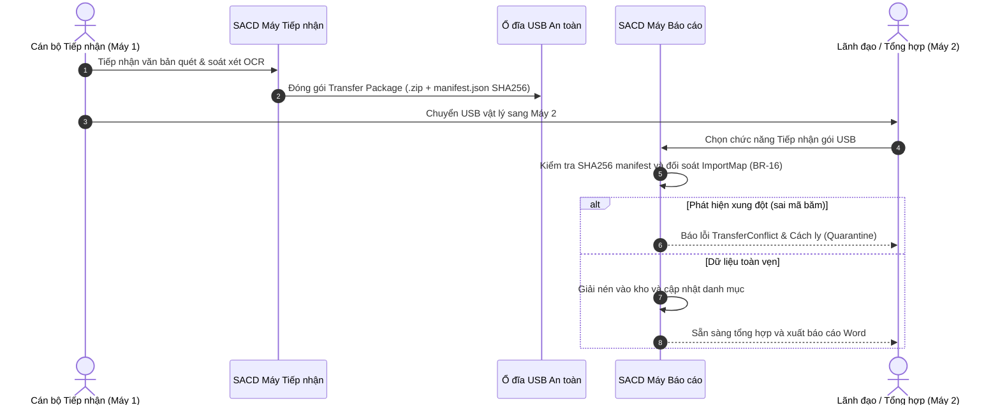

# TÀI LIỆU CÀI ĐẶT VÀ HƯỚNG DẪN SỬ DỤNG HỆ THỐNG SACD
## (Smart Air-gap Cabinet Desktop - Quản lý Văn bản và Báo cáo Hai Máy Cách Ly)

**Mã tài liệu:** SACD-USER-MANUAL-01  
**Phiên bản:** 1.1  
**Ngày phát hành:** 15/10/2026  
**Đường dẫn lưu trữ:** `E:\Project\SACD\docs\Review\Tai_lieu_cai_dat_va_huong_dan_su_dung.md`

---

## MỤC LỤC
1. [Giới thiệu hệ thống](#1-giới-thiệu-hệ-thống)
2. [Yêu cầu hệ thống và môi trường](#2-yêu-cầu-hệ-thống-và-môi-trường)
3. [Hướng dẫn cài đặt và triển khai](#3-hướng-dẫn-cài-đặt-và-triển-khai)
   - [Cách 1: Triển khai gói độc lập (Khuyên dùng cho máy Air-gap / máy yếu)](#31-cách-1-triển-khai-gói-độc-lập-khuyên-dùng-cho-máy-air-gap--máy-yếu)
   - [Cách 2: Chạy từ mã nguồn với .NET 8 SDK](#32-cách-2-chạy-từ-mã-nguồn-với-net-8-sdk)
   - [Cách 3: Chạy lõi xử lý với Docker Container](#33-cách-3-chạy-lõi-xử-lý-với-docker-container)
4. [Hướng dẫn sử dụng chi tiết từng chức năng](#4-hướng-dẫn-sử-dụng-chi-tiết-từng-chức-năng)
   - [4.1. Không gian làm việc (Workspace)](#41-không-gian-làm-việc-workspace)
   - [4.2. Tiếp nhận & Soát xét văn bản (Intake & Review)](#42-tiếp-nhận--soát-xét-văn-bản-intake--review)
   - [4.3. Theo dõi hạn văn bản & Nhiệm vụ (Deadlines & Tasks)](#43-theo-dõi-hạn-văn-bản--nhiệm-vụ-deadlines--tasks)
   - [4.4. Tra cứu văn bản toàn văn FTS5 (Search)](#44-tra-cứu-văn-bản-toàn-văn-fts5-search)
   - [4.5. Tổng hợp số liệu & Xuất báo cáo Word OpenXML (Word Report)](#45-tổng-hợp-số-liệu--xuất-báo-cáo-word-openxml-word-report)
   - [4.6. Tự động hóa thao tác QLVB (RPA Studio)](#46-tự-động-hóa-thao-tác-qlvb-rpa-studio)
5. [Quy trình luân chuyển dữ liệu hai máy cách ly qua USB (Air-gap Workflow)](#5-quy-trình-luân-chuyển-dữ-liệu-hai-máy-cách-ly-qua-usb-air-gap-workflow)
6. [Xử lý sự cố thường gặp (Troubleshooting)](#6-xử-lý-sự-cố-thường-gặp-troubleshooting)

---

## 1. GIỚI THIỆU HỆ THỐNG

**SACD** là hệ thống phần mềm máy trạm Windows chuyên dụng, được thiết kế đặc thù cho các cơ quan, đơn vị cần quản lý văn bản, trích xuất dữ liệu, kiểm soát hạn xử lý và lập báo cáo tổng hợp trong điều kiện **cách ly vật lý hoàn toàn với mạng internet (Air-gap)** giữa hai máy:
- **Máy 1 (Intake / Tiếp nhận):** Tiếp nhận văn bản thô từ máy quét (Scanner), tệp PDF/DOCX, thực hiện trích xuất OCR, soát xét dữ liệu và đóng gói an toàn sang USB.
- **Máy 2 (Drafting / Báo cáo):** Tiếp nhận gói USB từ Máy 1, đối soát toàn vẹn SHA256, tự động kiểm tra hạn, tổng hợp số liệu chính xác không làm tròn và xuất báo cáo Word chuẩn ISO/IEC 29500.

---

## 2. YÊU CẦU HỆ THỐNG VÀ MÔI TRƯỜNG

| Thành phần | Cấu hình tối thiểu (Máy yếu) | Cấu hình khuyến nghị |
|---|---|---|
| **Hệ điều hành** | Windows 7 SP1 (64-bit / 32-bit), Windows 10/11 | Windows 10/11 64-bit |
| **Bộ vi xử lý (CPU)** | Intel Core 2 Duo / Celeron 1.8 GHz | Intel Core i3 / AMD Ryzen 3 trở lên |
| **Bộ nhớ RAM** | 2.0 GB RAM | 4.0 GB RAM trở lên |
| **Dung lượng ổ cứng** | 500 MB trống cho phần mềm và DB | 10 GB trống cho lưu trữ hồ sơ |
| **Màn hình** | Độ phân giải 1024 x 768 | Độ phân giải 1920 x 1080 (Full HD) |
| **Kết nối mạng** | **Không yêu cầu (Hoàn toàn Offline)** | **Không yêu cầu** |

---

## 3. HƯỚNG DẪN CÀI ĐẶT VÀ TRIỂN KHAI

### 3.1. Cách 1: Triển khai gói độc lập (Khuyên dùng cho máy Air-gap / máy yếu)
*Đây là phương án tối ưu nhất, không cần cài đặt .NET SDK hay bất kỳ phần mềm phụ trợ nào.*

1. **Chuẩn bị gói chạy:**
   Trên máy phát triển, chạy lệnh đóng gói Self-Contained:
   ```powershell
   & "$env:USERPROFILE\.dotnet\dotnet.exe" publish src\SACD.Desktop\SACD.Desktop.csproj -c Release -r win-x64 --self-contained true -p:PublishSingleFile=true -o E:\Project\SACD\dist\win-x64
   ```
2. **Triển khai sang máy đích:**
   - Sao chép toàn bộ thư mục `E:\Project\SACD\dist\win-x64` vào ổ cứng máy trạm (ví dụ `C:\SACD` hoặc `D:\SACD`).
3. **Khởi chạy ứng dụng:**
   - Nhấp đúp chuột vào tệp `SACD.Desktop.exe` để bắt đầu làm việc ngay lập tức.

---

### 3.2. Cách 2: Chạy từ mã nguồn với .NET 8 SDK
Dành cho người kiểm thử hoặc lập trình viên:
```powershell
# Di chuyển vào thư mục dự án
cd E:\Project\SACD

# Chạy ứng dụng giao diện WPF:
& "$env:USERPROFILE\.dotnet\dotnet.exe" run --project src\SACD.Desktop\SACD.Desktop.csproj
```

---

### 3.3. Cách 3: Chạy lõi xử lý với Docker Container
Dành cho việc kiểm tra chẩn đoán hoặc tích hợp vào hệ thống máy chủ nội bộ:
```powershell
# Di chuyển vào thư mục dự án
cd E:\Project\SACD

# Khởi chạy qua Docker Compose:
docker-compose up -d

# Chạy kiểm tra chẩn đoán:
docker run --rm -v ${PWD}/docker_data:/data/sacd_workspace sacd-engine:latest /data/sacd_workspace --diag
```

---

## 4. HƯỚNG DẪN SỬ DỤNG CHI TIẾT TỪNG CHỨC NĂNG

### 4.1. Không gian làm việc (Workspace)
- **Mục đích:** Khởi tạo hoặc kết nối vào kho lưu trữ văn bản cục bộ, quản lý tệp khóa độc quyền `sacd.lock` (BR-01, BR-02) và nhận diện Windows SID người dùng.
- **Thao tác:**
  1. Nhập đường dẫn thư mục lưu trữ tại ô **Đường dẫn Kho Dữ liệu** (mặc định: `E:\Project\SACD\workspace_data`).
  2. Bấm nút **"Mở Kho Dữ liệu"**.
  3. Thanh trạng thái bên dưới sẽ chuyển sang thông báo: `Đã mở kho: [Mã kho] (SID: [Tên người dùng], Mode: Intake)`.
  4. Nếu cần sao lưu kho, bấm nút **"Sao lưu Kho (Zip)"**, tệp nén an toàn kèm mã kiểm tra SHA256 sẽ được tạo tự động.

---

### 4.2. Tiếp nhận & Soát xét văn bản (Intake & Review)
- **Mục đích:** Nhập tài liệu vào hệ thống, lưu trữ định danh nội dung bất biến SHA256, trích xuất khối văn bản (OCR) và duyệt soát xét.
- **Thao tác:**
  1. Bấm nút **"Tiếp nhận Văn bản mới..."**. Chọn các tệp PDF, DOCX hoặc hình ảnh văn bản.
  2. Hệ thống sẽ:
     - Kiểm tra magic bytes đầu tệp (`%PDF`, `PK\x03\x04`).
     - Tính mã băm SHA256 và lưu vào thư mục `objects/<sha256>`.
     - Tự động phân rã văn bản thành các khối (`TextBlock`) và chuẩn hóa tiếng Việt NFC.
  3. Bấm chọn tài liệu trong danh sách bên trái để xem các khối văn bản ở danh sách bên phải.
  4. Khi cần xác nhận nội dung đã đúng, chọn tài liệu và bấm nút **"Xác nhận Soát xét"**. Văn bản sẽ chuyển trạng thái sang `Reviewed` và lưu danh tính người duyệt vào nhật ký kiểm toán.

---

### 4.3. Theo dõi hạn văn bản & Nhiệm vụ (Deadlines & Tasks)
- **Mục đích:** Giám sát các hạn xử lý văn bản theo múi giờ Việt Nam (+07:00), tự động cảnh báo theo màu sắc.
- **Quy tắc phân loại mức độ khẩn:**
  - 🔴 **Quá hạn (Overdue):** Hạn xử lý đã qua so với thời điểm hiện tại.
  - 🟡 **Sắp đến hạn (UpcomingSoon):** Hạn xử lý nằm trong khoảng cảnh báo (24 giờ).
  - 🟢 **Đúng hạn (OnTime):** Còn nhiều hơn 24 giờ.
  - ⚪ **Đã hoàn thành (Completed):** Đã ký hoàn tất xử lý.
- **Thao tác:**
  1. Bấm nút **"Giao Nhiệm vụ mới"** để tạo hạn xử lý cho hồ sơ.
  2. Chọn nhiệm vụ và bấm **"Hoàn thành Nhiệm vụ"** khi đã xử lý xong. Hệ thống kiểm soát xung đột phiên bản qua `rowVersion` (BR-18).

---

### 4.4. Tra cứu văn bản toàn văn FTS5 (Search)
- **Mục đích:** Tìm kiếm từ khóa siêu tốc trên toàn bộ kho hồ sơ hàng vạn trang.
- **Đặc điểm nổi bật:** Hỗ trợ tìm kiếm **tiếng Việt có dấu** lẫn **không dấu** (ví dụ: gõ `Lao Cai` vẫn tìm thấy `Lào Cai`).
- **Thao tác:**
  1. Chuyển sang thẻ **Tra cứu Văn bản (FTS5)**.
  2. Nhập từ khóa vào ô tìm kiếm (ví dụ: `nghị quyết`, `kế hoạch 2026`).
  3. Bấm nút **"Tìm kiếm"**.
  4. Danh sách kết quả sẽ hiển thị tức thì kèm trích đoạn ngữ cảnh nổi bật (`<b>từ khóa</b>`) và số hiệu hồ sơ tương ứng.

---

### 4.5. Tổng hợp số liệu & Xuất báo cáo Word OpenXML (Word Report)
- **Mục đích:** Tổng hợp các chỉ tiêu kinh tế - xã hội chính xác và xuất file Word `.docx` chuyên nghiệp.
- **Hai chế độ xuất báo cáo:**
  - **Bản Dự thảo (Draft):** Cho phép xuất để rà soát nội bộ ngay cả khi còn nhận định chưa kiểm chứng.
  - **Bản Nộp Chính thức (Submission):** Nghiêm ngặt theo quy tắc BR-30: Bắt buộc toàn bộ nhận định đã soát xét (`Reviewed`) và báo cáo không bị cũ (`isStale = 0`).
- **Thao tác:**
  1. Nhập tiêu đề báo cáo và thư mục xuất tệp.
  2. Bấm **"Xuất Bản Dự Thảo (Draft)"** hoặc **"Xuất Bản Nộp Chính Thức (Submission)"**.
  3. Tệp Word được tạo trực tiếp với định dạng bảng biểu, kèm mã băm SHA256 của tài liệu ở trang bìa.

---

### 4.6. Tự động hóa thao tác QLVB (RPA Studio)
- **Mục đích:** Ghi lại và thực thi tự động các thao tác lặp đi lặp lại trên phần mềm Quản lý Văn bản (QLVB) nội bộ mà không cần can thiệp thủ công.
- **Cơ chế an toàn (NFR-11):** Khi thực hiện các bước nhạy cảm (như Ký duyệt, Gửi phát hành), RPA sẽ dừng lại ở trạng thái `PauseForUser` để người dùng xác nhận trên màn hình trước khi tiếp tục.

---

## 5. QUY TRÌNH LUÂN CHUYỂN DỮ LIỆU HAI MÁY CÁCH LY QUA USB (AIR-GAP WORKFLOW)



---

## 6. XỬ LÝ SỰ CỐ THƯỜNG GẶP (TROUBLESHOOTING)

1. **Lỗi `WorkspaceBusy` khi mở kho dữ liệu:**
   - *Nguyên nhân:* Phiên làm việc trước bị tắt đột ngột và tệp khóa `sacd.lock` chưa được giải phóng.
   - *Cách xử lý:* Đảm bảo không có tiến trình `SACD.Desktop.exe` nào đang chạy ngầm trong Task Manager, sau đó xóa tệp `sacd.lock` trong thư mục kho dữ liệu rồi mở lại.

2. **Lỗi `RevisionConflict` khi xuất báo cáo chính thức:**
   - *Nguyên nhân:* Số liệu nguồn của văn bản đã bị sửa đổi sau khi lập báo cáo, hệ thống tự động gắn cờ `isStale = 1` để bảo vệ tính chính xác.
   - *Cách xử lý:* Vào soát xét lại báo cáo, xác nhận các thay đổi số liệu mới nhất rồi thực hiện xuất lại.

3. **Lỗi `TransferConflict` khi cắm USB:**
   - *Nguyên nhân:* Tệp trong gói USB bị hỏng hoặc đã tồn tại một văn bản cùng phiên bản nhưng khác mã băm SHA256.
   - *Cách xử lý:* Kiểm tra lại tình trạng kết nối USB hoặc xuất lại gói chuyển từ máy gốc.
