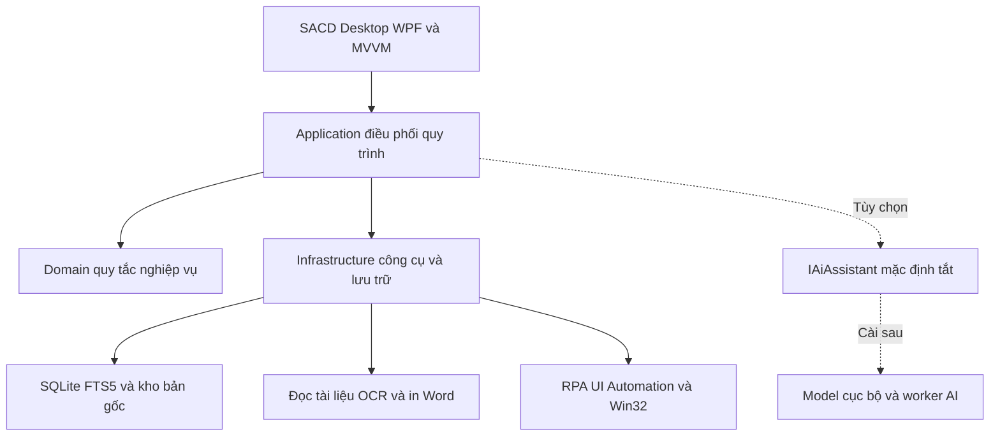

# CAPSTONE PROJECT REPORT

# Report 1 Project Introduction

**Dự án:** SACD — Software for Automatically Compiling Documents  
**Tên tiếng Việt:** Phần mềm hỗ trợ tự động hóa quy trình xử lý văn bản và tổng hợp tài liệu  
**Người thực hiện:** Đàm Quang Trung  
**Phiên bản:** 1.0  
**Địa điểm và thời gian biên soạn:** Lào Cai, tháng 10 năm 2026  
**Trạng thái:** dự thảo giới thiệu và xác định phạm vi; chưa phải biên bản nghiệm thu.

## Table of Contents

- I. Record of Changes
- II. Định nghĩa và từ viết tắt
- III. Project Introduction
  - 1. Overview
    - 1.1 Project Information
    - 1.2 Project Purpose
    - 1.3 Project Stakeholders
  - 2. Product Background
  - 3. Existing Solutions
    - 3.1 Web-Based Platforms
    - 3.2 Indirect Solutions
  - 4. Solution & Opportunity
    - 4.1 Solution
    - 4.2 Opportunity
  - 5. Project Scope & Limitations
    - 5.1 Major Features
    - 5.2 Limitations & Exclusions
      - 5.2.1 Limitations
      - 5.2.2 Exclusions
- Phụ lục A. Đối chiếu yêu cầu và quy trình
- Phụ lục B. Các nội dung cần xác nhận
- Phụ lục C. Nguồn tham khảo
- Phụ lục D. Đối chiếu khung tài liệu và trạng thái phạm vi

## I. Record of Changes

| Date | A, M, D | In charge | Change Description |
|---|---|---|---|
| 15/10/2026 | A | Đàm Quang Trung | Lập Report 1 SACD bằng Markdown theo khung mẫu được cung cấp; mô tả nghiệp vụ hai máy cách ly, tiếp nhận–xử lý–tổng hợp văn bản, desktop offline, RPA có điểm dừng và AI tùy chọn. |

A — Added, M — Modified, D — Deleted. Lịch sử của dự án mẫu không phải lịch sử phát triển SACD.

## II. Định nghĩa và từ viết tắt

| Acronym | Definition |
|---|---|
| SACD | Software for Automatically Compiling Documents; tên dự án trong tài liệu này. |
| QLVB | Phần mềm quản lý văn bản hiện có tại đơn vị, là ứng dụng đích được SACD hỗ trợ nhập liệu qua cách được phép. |
| Desktop App | Ứng dụng cài/chạy trực tiếp trên máy Windows, có giao diện riêng. |
| Offline | Nghiệp vụ lõi hoạt động với dữ liệu trên máy, không phụ thuộc Internet hoặc máy chủ SACD. |
| Air-gap | Cách ly mạng giữa hai môi trường máy; việc chuyển vật lý được xử lý theo quy trình riêng. |
| AI | Trí tuệ nhân tạo; trong SACD là khả năng hỗ trợ tùy chọn, chưa bắt buộc triển khai model. |
| LLM | Large Language Model, mô hình ngôn ngữ có thể dùng cho tóm tắt, gợi ý và hỏi đáp khi đủ cấu hình. |
| RPA | Robotic Process Automation, tự động hóa thao tác lặp lại trên ứng dụng đích theo kịch bản đã cấu hình. |
| Macro Recorder | Bộ ghi chuỗi thao tác chuột/phím để xem, sửa và phát lại có kiểm soát. |
| UI / UX | User Interface / User Experience, giao diện và trải nghiệm người dùng. |
| UIA | Microsoft UI Automation, cơ chế nhận diện và thao tác phần tử giao diện ứng dụng Windows. |
| FlaUI | Thư viện .NET hỗ trợ làm việc với UI Automation. |
| Win32 API | Các giao diện lập trình Windows dùng cho cửa sổ, tọa độ và mô phỏng đầu vào. |
| WPF / XAML | Windows Presentation Foundation và ngôn ngữ mô tả giao diện XAML. |
| MVVM | Model–View–ViewModel, mô hình tách trạng thái/xử lý giao diện khỏi phần hiển thị. |
| SQLite / FTS5 | CSDL nhúng cục bộ và phần mở rộng tìm kiếm toàn văn. |
| OCR | Optical Character Recognition, chuyển ảnh/scan thành văn bản; cần người kiểm tra kết quả. |
| Metadata | Thông tin có cấu trúc như số văn bản, ngày, đơn vị, người ký, thời hạn. |
| EvidenceRef | Tham chiếu nguồn gắn tài liệu, phiên bản, vị trí và trích đoạn làm căn cứ. |
| Fact | Số liệu hoặc sự kiện có chỉ tiêu, kỳ/phạm vi, nguồn và trạng thái xác nhận. |
| Grain | Cấp chi tiết ghi nhận số liệu, ví dụ theo vụ việc, cán bộ hoặc đơn vị; cần xác định trước khi cộng để tránh tính trùng. |
| Revision | Phiên bản nội dung được lưu để truy vết, không sửa đè bản đã dùng làm căn cứ. |
| Stale | Cờ cho biết nguồn/cấu hình liên quan đã đổi sau khi lập bản tổng hợp; cần rà soát lại. |
| SID / NTFS | Định danh bảo mật tài khoản Windows / hệ thống tệp có cơ chế quyền truy cập. |
| SHA256 | Hàm băm dùng đối chiếu tính khớp của dữ liệu; không phải công cụ chứng nhận tệp sạch mã độc. |
| DPI | Thông số mật độ/phóng đại ảnh hoặc màn hình; ảnh hưởng OCR và phát lại tọa độ. |
| UAC / UIPI | Cơ chế kiểm soát và cách ly quyền của Windows; RPA phải tuân theo giới hạn này. |
| GGUF / Q4_K_M | Dạng tệp model và phương án lượng tử hóa dự kiến khảo sát cho model cục bộ. |
| JSON | Định dạng trao đổi/lưu cấu hình có cấu trúc, dự kiến dùng cho kịch bản và bảng kê. |
| SRS / SDS | Đặc tả yêu cầu phần mềm / đặc tả thiết kế phần mềm. |

## III. Project Introduction

### 1. Overview

#### 1.1 Project Information

| Thuộc tính | Nội dung |
|---|---|
| English name | Software for Automatically Compiling Documents |
| Vietnamese name | Phần mềm hỗ trợ tự động hóa quy trình xử lý văn bản và tổng hợp tài liệu |
| Project code | SACD |
| Software type | Windows Desktop Application |
| Người thực hiện | Đàm Quang Trung |
| Đối tượng phục vụ | Cán bộ tiếp nhận, văn thư và tổng hợp tài liệu trong môi trường nội bộ được phép |
| Môi trường vận hành | Kho cục bộ; có thể cài độc lập trên máy nhận email nội bộ và máy quản lý văn bản tách biệt |
| Truyền dữ liệu giữa máy | Gói tệp được kiểm tra, chuyển vật lý qua USB được phép; không tạo cầu nối mạng |
| AI | Tắt mặc định, để mở khả năng tích hợp cục bộ sau; không là điều kiện vận hành lõi |
| Thời gian thực hiện đồ án | Chưa xác nhận cho SACD; không kế thừa lịch 04/05–17/08/2026 của đề tài mẫu |
| Mục đích tài liệu | Xác định bối cảnh, giải pháp, chức năng, phạm vi và giới hạn để phát triển các tài liệu SRS/SDS tiếp theo |

#### 1.2 Project Purpose

SACD nhằm giảm thao tác lặp lại trong tiếp nhận, xử lý và tổng hợp văn bản mà vẫn giữ quyền kiểm soát của cán bộ ở các quyết định nghiệp vụ. Phần mềm phải hỗ trợ được công việc thực tế ngay khi máy chưa chạy được AI: đọc/nhập dữ liệu, kiểm tra thông tin, theo dõi hạn, lập đề xuất, ghi kết quả duyệt/giao nhận, tra cứu và lập báo cáo theo mẫu.

Tài liệu trình bày mục tiêu của sản phẩm dự kiến; các chức năng dưới đây không được hiểu là đã hoàn thành chỉ vì đã có bản thử nghiệm trước. Report 1 cung cấp căn cứ cho phân tích chi tiết, thiết kế và kiểm thử; không thay thế toàn bộ SRS, SDS hoặc hướng dẫn sử dụng.

Các mục tiêu cụ thể gồm:

1. Giữ thống nhất hồ sơ văn bản, nguồn dữ liệu và lịch sử thay đổi trong từng môi trường máy.
2. Giảm việc lặp lại nhập liệu giữa email, tài liệu và phần mềm QLVB bằng quy tắc và kịch bản được kiểm soát.
3. Theo dõi đầy đủ các bước đề xuất, trình duyệt, giao, ký nhận và thực hiện nhiệm vụ.
4. Cảnh báo thời hạn trên dữ liệu đã được xác nhận; hỗ trợ xử lý ngoại lệ và cập nhật đúng căn cứ.
5. Tổng hợp thông tin và số liệu có thể đối chiếu với nguồn, tạo tài liệu Word để lãnh đạo xem xét.
6. Hoạt động độc lập trên desktop; tách RPA, OCR và AI để bổ sung hoặc thay đổi mà không làm hỏng lõi nghiệp vụ.

#### 1.3 Project Stakeholders

| Full Name / Chủ thể | Role | Email | Mobile |
|---|---|---|---|
| Đàm Quang Trung | Người đăng ký và phát triển đề tài SACD | Chưa xác nhận thông tin liên hệ dùng cho hồ sơ SACD | Chưa xác nhận |
| Người hướng dẫn | Hướng dẫn và góp ý chuyên môn sau khi được phân công | Chưa xác nhận | Chưa xác nhận |
| Cán bộ tiếp nhận/văn thư/tổng hợp | Người dùng trực tiếp; xác minh dữ liệu và thao tác nghiệp vụ | Theo phân công thực tế | Theo phân công thực tế |
| Trưởng phòng/lãnh đạo được phân công | Xem xét đề xuất và quyết định xử lý theo quy trình hiện hành | Không yêu cầu tài khoản SACD trong phạm vi này | Theo phân công thực tế |
| Đội/cán bộ xử lý và người ký nhận | Tiếp nhận văn bản, ký nhận và thực hiện nhiệm vụ | Ghi trong danh mục nếu được phép | Theo phân công thực tế |
| Người quản lý máy và an toàn thông tin | Cấp quyền môi trường, kiểm tra công cụ, phương tiện và hỗ trợ vận hành | Theo phân công thực tế | Theo phân công thực tế |

Vai trò trong bảng là vai trò nghiệp vụ hoặc triển khai, không đồng nghĩa có hệ thống tài khoản/RBAC nhiều người qua mạng. Các quyết định của lãnh đạo và việc ký nhận thực tế được cập nhật vào SACD trên cơ sở đã xảy ra và có căn cứ.

### 2. Product Background

Công việc hiện tại trải qua nhiều môi trường: thư điện tử nội bộ, tài liệu điện tử hoặc giấy, máy in, USB chuyển tệp và phần mềm quản lý văn bản. Cán bộ vừa phải đọc hiểu nội dung vừa thực hiện nhiều thao tác lặp lại. Các bước này cần giữ đúng thứ tự, nhất là khi hai máy cách ly mạng và dữ liệu có yêu cầu quản lý riêng.

Quy trình được xác định từ nội dung trao đổi truy xuất được gồm:

| Bước | Môi trường | Công việc thực tế | Điểm kiểm soát cần giữ |
|---|---|---|---|
| QT-01 | Máy nhận thư | Kiểm tra email nội bộ, chọn và mở thư có văn bản | Đúng thư/tài khoản, không tự gửi thư |
| QT-02 | Máy nhận thư | Đọc văn bản và tệp đính kèm | Đúng tài liệu, đủ trang, đọc được nội dung |
| QT-03 | Máy nhận thư | Phân loại, ghi loại/số/ngày/đơn vị/người ký/tóm tắt/vấn đề liên quan/hạn và thông tin mật, giải mật nếu có | Người dùng kiểm tra và xác nhận căn cứ |
| QT-04 | Máy nhận thư và máy in | In văn bản giấy | Kiểm tra bản in và số bản |
| QT-05 | Máy nhận thư và USB | Chuẩn bị, kiểm tra và chép tệp qua USB được phép | Chọn đúng dữ liệu và thực hiện quy trình phương tiện |
| QT-06 | Chuyển vật lý | Đưa USB sang máy quản lý văn bản tách biệt | Không hình thành kết nối mạng giữa hai máy |
| QT-07 | Máy quản lý văn bản | Kiểm tra gói nhận, kiểm tra văn bản còn hạn/sắp quá hạn/quá hạn | Không mất hoặc tự suy hạn; xử lý gói lỗi/trùng |
| QT-08 | Máy quản lý văn bản | Nhập số, trích yếu, đơn vị, ngày, thời hạn và trường liên quan vào QLVB | Xem trước và kiểm tra kết quả ghi |
| QT-09 | Máy quản lý văn bản | Đề xuất lãnh đạo/đội/cán bộ xử lý và công việc cần làm | Người dùng chọn nơi xử lý và xác nhận đề xuất |
| QT-10 | Máy in | In phiếu xử lý/phiếu đề xuất để trình | Đúng mẫu, đúng nội dung đề xuất |
| QT-11 | Quy trình lãnh đạo | Trưởng phòng/lãnh đạo duyệt hoặc yêu cầu sửa | Quyết định do người có thẩm quyền thực hiện |
| QT-12 | Máy quản lý văn bản | Cập nhật chỉ đạo và kết quả duyệt | Có căn cứ; không giả định đã duyệt từ việc in phiếu |
| QT-13 | Quy trình giao văn bản | Giao tài liệu cho đơn vị/cán bộ được phân công | Đúng người, tài liệu và thời điểm |
| QT-14 | Quy trình ký nhận | Người nhận kiểm tra và ký nhận | Không ký thay; chưa ký không ghi thành đã ký |
| QT-15 | Máy quản lý văn bản | Cập nhật giao/nhận, tiến độ, thời hạn và kết quả xử lý | Truy vết thay đổi, xử lý gia hạn/chưa hoàn thành |
| QT-16 | Máy tổng hợp được phép | Thu thập thông tin nhiều nguồn, đối chiếu số liệu, tạo báo cáo trình lãnh đạo | Có nguồn, không cộng trùng, kiểm tra trước xuất |

Hiện trạng tạo ra ba nhóm khó khăn. Thứ nhất, việc chuyển dữ liệu và nhập lại nhiều lần làm tăng thời gian xử lý và nguy cơ nhầm thông tin. Thứ hai, kết quả duyệt, giao và ký nhận dễ tách khỏi hồ sơ văn bản khi theo dõi bằng nhiều sổ hoặc tệp. Thứ ba, tổng hợp báo cáo cần đọc lại nhiều tài liệu, xử lý các số trùng hoặc kỳ không đồng nhất và kiểm tra nội dung được diễn giải từ nguồn.

SACD không làm mất bước chuyển USB, phê duyệt hoặc ký nhận của quy trình hiện hành. Phần mềm tổ chức dữ liệu, hỗ trợ chuẩn bị và theo dõi các bước đó; người có trách nhiệm vẫn quyết định phân loại, nơi xử lý, thời hạn và kết quả duyệt. Máy nhận email có thể truy cập hệ thống thư nội bộ theo cấu hình sẵn có; điều này không cho phép SACD mở Internet hay nối sang máy đang cách ly.

### 3. Existing Solutions

Phần này xem xét các nhóm giải pháp liên quan để xác định vai trò bổ trợ của SACD. Chưa có khảo sát đối chiếu một danh sách sản phẩm thương mại cụ thể; các giới hạn nêu dưới đây là vấn đề cần kiểm tra theo triển khai thực tế, không phải kết luận mọi sản phẩm trong nhóm đều thiếu tính năng.

#### 3.1 Web-Based Platforms

Các hệ thống quản lý văn bản, điều hành hoặc quản lý công việc qua web có thể phục vụ tiếp nhận, phân công, tra cứu và theo dõi văn bản trong hạ tầng được tổ chức cung cấp. Nếu phần mềm QLVB tại đơn vị thuộc nhóm này, SACD chỉ hỗ trợ thao tác trên giao diện hoặc cách tích hợp được cho phép; SACD không thay thế máy chủ hay cơ sở dữ liệu của hệ thống đó.

**Target Actors:** cán bộ văn thư, lãnh đạo, người xử lý văn bản và người quản trị hệ thống hiện hữu.

**Pros:** có thể tổ chức luồng xử lý tập trung, danh mục và tài khoản theo thiết kế hệ thống; người dùng có môi trường nghiệp vụ sẵn có để làm việc.

**Cons / Điểm cần khảo sát:** yêu cầu hạ tầng và kết nối phù hợp; dữ liệu ở hai môi trường cách ly không tự chuyển vào hệ thống; khả năng nhập tệp, OCR, lấy số liệu, mở API hoặc nhận diện giao diện thay đổi theo sản phẩm. Không có đủ căn cứ để khẳng định hệ thống đích đang cung cấp API dùng cho SACD.

Lựa chọn desktop cho SACD đáp ứng yêu cầu chạy độc lập của người dùng. Nếu RPA thao tác trên một QLVB chạy bằng trình duyệt, ứng dụng đích vẫn giữ kiến trúc riêng; SACD không vì vậy trở thành web app.

#### 3.2 Indirect Solutions

Các công cụ như Word, Excel, trình đọc PDF, phần mềm scan/OCR, email nội bộ, thư mục tệp và công cụ macro có thể hỗ trợ từng khâu: lưu tài liệu, ghi thông tin, in, theo dõi hạn hoặc chạy thao tác mẫu.

**Target Actors:** cán bộ trực tiếp tiếp nhận, nhập liệu và tổng hợp.

**Pros:** tận dụng công cụ đã có; có thể làm việc cục bộ; dễ bắt đầu ở từng bước nhỏ và giữ thao tác con người.

**Cons / Điểm cần khảo sát:** dữ liệu và trạng thái phân tán; phải nhập lại nhiều lần; khó theo dõi nguồn của báo cáo và lịch sử xử lý. Macro chỉ theo tọa độ phụ thuộc vị trí cửa sổ, độ phân giải/DPI và trạng thái ứng dụng; chỉ chờ cố định không bảo đảm biểu mẫu đã sẵn sàng. Công cụ OCR chưa tự chứng minh nội dung đọc được là đúng.

SACD được đề xuất để liên kết dữ liệu và kiểm soát tiến trình của các bước này: giữ nguồn, xác nhận trước dùng, phát lại có điều kiện, dừng khi cần người can thiệp và lưu lịch sử kết quả.

### 4. Solution & Opportunity

#### 4.1 Solution

##### 4.1.1 Mô hình desktop và bố trí hai máy

SACD là ứng dụng desktop Windows C#/.NET, có giao diện WPF và CSDL SQLite trong máy. Không xây frontend React, backend NodeJS, JWT hoặc MongoDB Atlas chỉ vì chúng xuất hiện trong mẫu DSMS. Không cần máy chủ SACD để mở kho, tìm kiếm, tính số liệu hoặc xuất báo cáo.

Có hai hồ sơ vận hành dự kiến:

- **Máy A — tiếp nhận:** làm việc với email nội bộ đã được cho phép; nhập/đọc/OCR tài liệu; kiểm tra metadata; phân loại; in văn bản; chuẩn bị gói chuyển USB.
- **Máy B — quản lý và tổng hợp:** nhận và kiểm tra gói tệp; theo dõi hạn; hỗ trợ nhập QLVB; lập đề xuất/phiếu; cập nhật duyệt, giao, ký nhận, tiến độ; tìm kiếm, tổng hợp và xuất báo cáo.

Mỗi máy có kho riêng, quyền và công cụ riêng. Người dùng chuyển gói dữ liệu vật lý, không mở kết nối tự động giữa hai máy. Gói cần có mã hồ sơ/tệp, phiên bản, hash và bảng kê để nhận biết bản cũ, bản sửa và tệp trùng; sự kiện nhập gói không tự ghi đè một phiên bản đã xác nhận. Nguồn trao đổi, đường đi được phép và quy tắc xử lý xung đột phải được chốt trước thử nghiệm thực tế.

##### 4.1.2 Kiến trúc phần mềm dự kiến

| Thành phần | Công nghệ dự kiến | Mục đích |
|---|---|---|
| Ngôn ngữ và nền tảng | C#, .NET 10 LTS | Chạy ứng dụng Windows và nghiệp vụ |
| Giao diện | WPF/XAML, MVVM | Tách màn hình, trạng thái và xử lý |
| CSDL và tìm kiếm | SQLite, Microsoft.Data.Sqlite, FTS5 | Lưu dữ liệu cục bộ, tìm nội dung có/không dấu |
| Tài liệu Word | Open XML SDK | Đọc DOCX, ánh xạ trường/mẫu và xuất tài liệu |
| PDF và ảnh | PdfPig, bộ Poppler được kiểm thử | Đọc text, giữ trang, dựng ảnh phục vụ OCR |
| OCR | Tesseract và dữ liệu vie/eng | Nhận dạng văn bản scan, xử lý theo trang |
| Ghi/phát thao tác | UI Automation/FlaUI, Win32 Hooks, SendInput | Ghi kịch bản có ngữ cảnh, thực hiện bước được phép |
| Tệp và toàn vẹn | Kho tệp, SHA256, bảng kê | Giữ bản gốc, kiểm tra tệp chuyển/backup |
| Điểm tích hợp AI | IAiAssistant; llama.cpp/GGUF là một adapter dự kiến | Giữ khả năng bổ sung AI mà không phụ thuộc model |
| Đóng gói | Gói Windows x64 có runtime và dependency đã khóa | Chuyển vào môi trường offline theo quy trình được phép |

.NET 10 là nhánh LTS theo chính sách Microsoft. WPF và SQLite phù hợp với phương án desktop đề xuất; tính tương thích CPU, Windows và bộ công cụ phải được kiểm tra trên máy đích. Các nguồn kỹ thuật được liệt kê ở phụ lục C.

##### 4.1.3 Ghi nhớ và phát lại thao tác

Bộ ghi chỉ hoạt động sau khi người dùng chọn ứng dụng đích và bật phiên ghi. Nó thu nhận thao tác chuột/phím được phép, xác định cửa sổ và cố gắng tìm phần tử UI Automation tương ứng. Kết quả ghi trở thành danh sách bước để người dùng xem, sửa và thay nội dung gõ bằng biến như số văn bản, trích yếu hoặc hạn đã xác nhận.

Thứ tự tìm đích khi chạy là: phần tử UI Automation khớp hồ sơ; tọa độ tương đối trong cửa sổ nếu được cấu hình; cuối cùng mới là tọa độ tuyệt đối với điều kiện màn hình được kiểm tra. Khi không đủ điều kiện, hệ thống dừng để xử lý, không tự đổi sang nhấp theo tọa độ chưa được xác nhận.

Các bước hỗ trợ dự kiến gồm chọn/đợi cửa sổ, đợi phần tử, nhấn, nháy đúp, cuộn, tổ hợp phím, nhập biến, kiểm tra giá trị hiển thị, chờ có giới hạn và `PauseForUser`. Kịch bản cần lưu selector, tọa độ dự phòng, thông tin cửa sổ/DPI, timeout, điều kiện trước/sau và phiên bản cấu hình. Không phải chỉ lưu một chuỗi điểm X/Y.

Ví dụ kịch bản nhập QLVB: chờ đúng cửa sổ → mở biểu mẫu Thêm mới → chờ các trường sẵn sàng → điền dữ liệu đã xác nhận → dừng cho cán bộ kiểm tra → sau xác nhận mới thực hiện lưu → kiểm tra kết quả hoặc mã tham chiếu. Nếu hết thời gian chờ sau lệnh lưu, ghi kết quả Chưa xác định và yêu cầu đối chiếu trước khi chạy lại.

Windows Hooks có thể nhận sự kiện ngoài cửa sổ đích; thiết kế phải lọc theo phiên ghi và ứng dụng đang được cho phép, không lưu chuỗi phím ngoài phạm vi hoặc trường mật khẩu. Các giới hạn quyền của Windows, đặc biệt UIPI đối với SendInput, phải được giữ nguyên; không đặt vượt UAC làm yêu cầu của hệ thống [TK-04–TK-07].

##### 4.1.4 Dữ liệu và kiểm soát nghiệp vụ

Hồ sơ cốt lõi gồm tài liệu gốc, phiên bản text, metadata, nhiệm vụ/hạn, đề xuất, kết quả duyệt, giao nhận, chỉ tiêu/số liệu, báo cáo, kịch bản và nhật ký. Danh mục lãnh đạo/đội/cán bộ phục vụ chọn đúng chủ thể xử lý, không phải phân quyền mạng cho toàn cơ quan.

Một tiến trình tham khảo là: **Tiếp nhận → Chờ kiểm tra → Chờ đề xuất → Chờ duyệt → Đã duyệt → Đã giao → Đã ký nhận → Đang xử lý → Hoàn thành → Lưu trữ**. Đây là mô hình trạng thái đề xuất để phân tích SRS; thứ tự chi tiết và ngoại lệ cần đối chiếu biểu mẫu của đơn vị. Nếu bị yêu cầu sửa, hồ sơ trở lại bước chuẩn bị phù hợp và giữ lịch sử quyết định cũ. Các trạng thái còn hạn/sắp đến hạn/quá hạn được tính riêng theo hạn và tình trạng hoàn thành, không thay thế trạng thái luồng xử lý.

Metadata và số liệu được gắn nguồn, vị trí và revision. Mọi trường không rõ được đánh dấu để xác minh. Phép tổng hợp phải phân biệt loại chỉ tiêu, đơn vị, kỳ, phạm vi, lũy kế và bản trùng; hiển thị được các nguồn đóng góp. Việc tính số do mã nghiệp vụ xác định, không giao cho mô hình ngôn ngữ.

Nháp báo cáo được tạo từ snapshot nguồn/mẫu/số liệu. Rà soát nội bộ không phải phê duyệt của lãnh đạo. Nguồn hoặc số liệu thay đổi làm bản liên quan stale; sửa câu chữ tạo nháp mới để đối chiếu trước khi xuất bản trình.

##### 4.1.5 AI để mở và không làm điều kiện vận hành

Giai đoạn hiện tại chỉ yêu cầu thiết kế điểm tích hợp và trạng thái không có AI. Phần mềm không tự tải model, không khởi động worker AI khi chưa bật, không gửi dữ liệu ra Internet và không chặn nhập liệu, RPA, theo dõi hạn hay xuất Word vì thiếu AI.

Khi có điều kiện, adapter AI cục bộ có thể hỗ trợ tóm tắt, gợi ý metadata/phân loại/nhiệm vụ/thời hạn, hỏi đáp theo nguồn và đề xuất câu chữ. Qwen3-1.7B GGUF Q4_K_M qua llama.cpp là ứng viên để thử, không phải lựa chọn bất biến hoặc bằng chứng chạy tốt trên máy cơ quan. Context, số luồng, bộ nhớ và chất lượng tiếng Việt phải được đo trên máy thực tế [TK-09–TK-10].

AI chỉ trả nội dung đề xuất và tham chiếu nguồn; người dùng kiểm tra trước xác nhận. Nếu worker tương lai dùng localhost, nó chỉ là tiến trình phụ trợ trên cùng máy, không tạo máy chủ web nghiệp vụ cho các máy khác truy cập.

#### 4.2 Opportunity

SACD có giá trị khi giảm số lần nhập lại thông tin và giúp cán bộ theo dõi tiến trình đầy đủ từ thư đến báo cáo. Dữ liệu có nguồn và phiên bản giúp việc kiểm tra, bàn giao công việc tổng hợp và giải thích số liệu thuận tiện hơn. RPA có điểm dừng cho phép tự động hóa phần lặp lại mà vẫn giữ các quyết định của người dùng.

Việc triển khai desktop độc lập giúp có thể phát triển lõi trước, bổ sung công cụ OCR và RPA theo máy/ứng dụng đã khảo sát, rồi đánh giá AI sau khi phần cứng đáp ứng. Khả năng thay model thông qua adapter giảm việc phụ thuộc một bộ chạy duy nhất.

Hiệu quả cần được đo bằng thời gian xử lý một hồ sơ, số lần sửa dữ liệu, tỷ lệ điền đúng trường, tỷ lệ kịch bản chạy thành công và số lỗi được phát hiện trước xuất báo cáo. Mức cải thiện chưa có số liệu đo nên không được ghi như kết quả đã đạt. Mở rộng chỉ thực hiện sau khi các luồng cơ bản và kiểm soát nguồn/phiên bản đã được kiểm thử.

### 5. Project Scope & Limitations

Phạm vi dưới đây phản ánh định hướng mới được người dùng đồng ý: desktop là nền tảng, ghi/phát lại thao tác thuộc chức năng cần phát triển, AI để ngỏ. Phải phân biệt mục tiêu này với phần đã có trong bản thử nghiệm trước và với phạm vi DSMS của tài liệu mẫu.

#### 5.1 Major Features

##### FE-01 Không gian làm việc và quyền truy cập

**Phạm vi:** Cốt lõi.

Tạo hoặc mở kho trên máy Windows, nhận diện tài khoản bằng SID, kiểm tra quyền đọc/ghi theo NTFS và ngăn hai phiên cùng ghi một kho. Người quản lý cấu hình đường dẫn, danh mục và sao lưu trong phạm vi quyền được cấp.

**Điều kiện và giới hạn:** Không bắt buộc tài khoản/mật khẩu/JWT riêng; các vai trò lãnh đạo và đội xử lý là chủ thể nghiệp vụ, không mặc nhiên là tài khoản truy cập chung qua mạng. Kho không được đặt trên thư mục mạng dùng chung để nhiều máy cùng sửa.

##### FE-02 Tiếp nhận văn bản từ email nội bộ

**Phạm vi:** Cốt lõi có điều kiện tích hợp.

Trên máy nhận thư, hỗ trợ kiểm tra thư, mở thư được chọn, lưu tệp đính kèm và lập hồ sơ tiếp nhận; ghi nguồn thư và thời điểm tiếp nhận. Có chế độ chọn tệp thủ công luôn sẵn dùng. Khi chưa có API được phép, người dùng thực hiện hoặc sử dụng kịch bản RPA trên ứng dụng email đã đăng nhập.

**Điều kiện và giới hạn:** Chỉ làm việc với hệ thống email và tài khoản được đơn vị cho phép. Không mặc định dùng Gmail/Internet, không lưu mật khẩu trong kịch bản, không tự gửi thư. Thao tác trong phiên email hiện hữu không biến SACD thành ứng dụng web server–client.

##### FE-03 Nhập tài liệu và bảo toàn bản gốc

**Phạm vi:** Cốt lõi.

Nhập PDF, DOCX, TXT UTF8 và ảnh PNG/JPG/TIFF theo bộ đọc đã kiểm thử; nhận tệp từ thư mục hoặc bản scan do phần mềm máy scan xuất ra. Lưu bản gốc, tên tệp, SHA256, nguồn cung cấp, ngày tiếp nhận và mã hồ sơ; cảnh báo trùng tệp.

**Điều kiện và giới hạn:** Kiểm tra loại thực và giới hạn đầu vào trước xử lý. Giữ nguyên bản gốc; sửa nội dung trích xuất tạo phiên bản mới. Điều khiển trực tiếp mọi model máy scan không phải điều kiện bắt buộc; TIFF/PDF scan cần bộ OCR tương ứng trước nghiệm thu.

##### FE-04 Đọc văn bản và OCR bản scan

**Phạm vi:** Cốt lõi có điều kiện công cụ.

Đọc text của PDF, DOCX và TXT; OCR tài liệu ảnh/scan bằng công cụ cục bộ. Giữ vị trí trang hoặc đoạn/ô bảng/dòng nguồn; có màn đối chiếu với bản gốc, sửa lỗi và xác nhận văn bản đã kiểm tra. Xử lý từng trang để hạn chế RAM, cho hủy và ghi rõ trang lỗi.

**Điều kiện và giới hạn:** OCR là bộ phận cài riêng và không phụ thuộc mô hình ngôn ngữ. Không tự xác nhận độ đúng chỉ vì OCR hoàn tất; chữ viết tay, bản mờ hoặc bảng phức tạp phải được người dùng kiểm tra. Không bỏ trang lỗi hoặc tự giảm chất lượng mà không thông báo.

##### FE-05 Trích xuất và xác nhận thông tin văn bản

**Phạm vi:** Cốt lõi.

Quản lý loại văn bản, số/ký hiệu, ngày ban hành, đơn vị phát hành, đơn vị nhận, người ký, trích yếu, nội dung tóm lược, vấn đề liên quan đơn vị, nhiệm vụ cần thực hiện và thời hạn. Tách ngày ban hành, ngày nhận và kỳ số liệu. Cho nhập tay, nhận diện bằng quy tắc và gắn vị trí nguồn cho giá trị đề xuất.

**Điều kiện và giới hạn:** Thông tin không có căn cứ được để Chưa xác định, không tự điền suy đoán. Phân biệt dữ liệu đề xuất, đã xác nhận và đã sửa; lưu người sửa, thời điểm, lý do và nguồn.

##### FE-06 Phân loại nghiệp vụ và theo dõi thông tin mật

**Phạm vi:** Cốt lõi.

Phân loại theo chủ đề, loại văn bản, đơn vị và công việc liên quan; ghi mức độ mật/khẩn theo thông tin người có quyền xác nhận. Theo dõi mốc, tình trạng, căn cứ và người cập nhật liên quan giải mật nếu có dữ liệu phù hợp.

**Điều kiện và giới hạn:** Không tự quyết định mức độ mật, tự giải mật hoặc tự kết luận đủ điều kiện lưu hành. Hạn/mốc chỉ tạo nhắc kiểm tra; thay đổi trạng thái phải có xác nhận và căn cứ của người có thẩm quyền theo quy trình đơn vị.

##### FE-07 In văn bản và phiếu xử lý

**Phạm vi:** Cốt lõi.

Hỗ trợ chuẩn bị bản in văn bản đến, phiếu đề xuất/phiếu xử lý và bản báo cáo theo mẫu đã cấu hình. Cho xem trước, chọn máy in, số bản, phạm vi trang và xác nhận lệnh in; ghi nhận lần gửi lệnh in để hạn chế in trùng.

**Điều kiện và giới hạn:** Gửi lệnh vào hàng đợi không đồng nghĩa đã in thành công trên giấy. Người dùng kiểm tra bản in; quản lý bản giấy thực hiện theo quy trình của đơn vị. Các định dạng cần ứng dụng đọc/in ngoài phải được kiểm thử riêng.

##### FE-08 Đóng gói và chuyển nhận qua USB được phép

**Phạm vi:** Cốt lõi.

Tạo gói dữ liệu được chọn gồm bản gốc, dữ liệu đã xác nhận và bảng kê mã hồ sơ/tệp/hash; hỗ trợ chép ra vị trí được phép sau xác nhận. Người dùng chuyển USB vật lý sang máy quản lý văn bản. Máy nhận kiểm tra bảng kê, hash, trùng hồ sơ và kết quả kiểm tra phương tiện trước khi nhập.

**Điều kiện và giới hạn:** Giữ cách ly mạng giữa hai máy. Không đồng bộ trực tiếp, không tự chạy tệp trên USB, không tự bỏ qua bước kiểm tra USB và không bảo đảm tuyệt đối không có mã độc. Hash chứng minh sự khớp byte trong gói, không chứng minh tệp vô hại hoặc được phép chuyển.

##### FE-09 Theo dõi công việc và cảnh báo thời hạn

**Phạm vi:** Cốt lõi.

Quản lý hạn xử lý của văn bản và từng nhiệm vụ; hiển thị còn hạn, sắp đến hạn, quá hạn, hoàn thành hoặc chưa rõ hạn. Cấu hình ngưỡng nhắc, lọc theo lãnh đạo/đội/cán bộ phụ trách; ghi nhận gia hạn, hạn mới, căn cứ và lịch sử.

**Điều kiện và giới hạn:** Thời hạn chỉ có hiệu lực sau xác nhận; không suy hạn chỉ từ ngày ban hành. Nhắc trong ứng dụng hoặc thông báo Windows khi tiến trình nhắc đang chạy. Khi máy tắt, cảnh báo được tính lại lúc mở; không hứa nhắc ngoài giờ khi không có tiến trình hoạt động.

##### FE-10 Hỗ trợ nhập vào phần mềm quản lý văn bản hiện có

**Phạm vi:** Cốt lõi có điều kiện tương thích.

Trên máy quản lý văn bản, ánh xạ dữ liệu đã xác nhận sang các trường số/ký hiệu, trích yếu, đơn vị, ngày, hạn và các trường được phép; xem trước trước khi điền. Thực hiện qua giao diện đã khảo sát, xác nhận kết quả và lưu mã tham chiếu của hệ thống đích nếu đọc được.

**Điều kiện và giới hạn:** SACD bổ trợ, không thay thế phần mềm quản lý văn bản. Không sửa trực tiếp CSDL, không tự gọi API chưa được cho phép. Khi không nhận diện được giao diện hoặc kết quả ghi chưa rõ, dừng để đối chiếu, không tự chạy lại thao tác lưu gây bản ghi trùng.

##### FE-11 Lập đề xuất lãnh đạo và đội xử lý

**Phạm vi:** Cốt lõi.

Dựa trên nội dung và danh mục đơn vị/người phụ trách, hỗ trợ người dùng chọn lãnh đạo, đội/cán bộ xử lý, công việc và hạn; lập phiếu đề xuất, cho sửa và in. Quy tắc cấu hình có thể gợi ý nơi xử lý; chưa có AI vẫn thực hiện đầy đủ bằng lựa chọn thủ công.

**Điều kiện và giới hạn:** Mọi đề xuất phải được cán bộ kiểm tra. Không tự phân công có hiệu lực chỉ vì quy tắc hoặc AI đưa ra gợi ý.

##### FE-12 Ghi nhận trình duyệt và kết quả chỉ đạo

**Phạm vi:** Cốt lõi.

Theo dõi phiếu đã trình, chờ duyệt, yêu cầu sửa, đã duyệt hoặc không được duyệt; sau khi trưởng phòng/lãnh đạo xem và quyết định theo quy trình hiện hành, cán bộ cập nhật nội dung chỉ đạo, người duyệt, thời điểm và căn cứ. Hỗ trợ cập nhật các trường tương ứng ở hệ thống đích bằng RPA có kiểm soát.

**Điều kiện và giới hạn:** Phê duyệt thực tế diễn ra ngoài SACD hoặc trong phần mềm nghiệp vụ được phép. Thao tác cập nhật trạng thái trên SACD không phải chữ ký số và không thay thế thẩm quyền phê duyệt.

##### FE-13 Giao văn bản và theo dõi ký nhận

**Phạm vi:** Cốt lõi.

Ghi nhận đơn vị/cán bộ nhận, tài liệu đã giao, thời điểm giao, hạn thực hiện, tình trạng ký nhận và thông tin chứng từ liên quan. Cập nhật sau khi đã giao/ký nhận; theo dõi chưa nhận, đang xử lý và hoàn thành để phục vụ nhắc việc và báo cáo.

**Điều kiện và giới hạn:** Phân biệt đã giao và đã ký nhận. Chứng từ giấy hoặc xác nhận trong hệ thống nghiệp vụ là căn cứ; SACD không tự ký thay người nhận hoặc đánh dấu hoàn tất từ một cú nhấp chuột gửi lệnh.

##### FE-14 Tra cứu và quản lý lịch sử tài liệu

**Phạm vi:** Cốt lõi.

Tìm theo từ khóa có/không dấu, số văn bản, ngày, đơn vị, người ký, chủ đề, người/đội xử lý, hạn và trạng thái; mở đúng nguồn. Giữ lịch sử nội dung, metadata, giao nhận và xử lý; lưu trữ logic để tra cứu.

**Điều kiện và giới hạn:** Tệp gốc và phiên bản đã dùng làm nguồn không bị sửa đè. Không đặt xóa vĩnh viễn tự động trong luồng nghiệp vụ; việc tiêu hủy và thời hạn lưu trữ cần quy trình riêng được chốt.

##### FE-15 Quản lý số liệu và tổng hợp có kiểm chứng

**Phạm vi:** Cốt lõi.

Ghi số liệu/sự kiện kèm chỉ tiêu, đơn vị tính, kỳ, phạm vi, nguồn và trạng thái xác nhận; xử lý bản ghi trùng/mâu thuẫn trước tổng hợp. Tính tổng, so sánh kỳ và tỷ lệ bằng quy tắc xác định, lưu các nguồn đóng góp.

**Điều kiện và giới hạn:** Số thiếu không đổi thành 0; không cộng lũy kế chồng kỳ hoặc số toàn đơn vị với số thành phần. Định dạng số phải được xác nhận; phép tính dùng decimal, kiểm tra tràn và quy tắc làm tròn. AI không quyết định phép cộng.

##### FE-16 Mẫu báo cáo và xuất tài liệu tổng hợp

**Phạm vi:** Cốt lõi.

Quản lý mẫu DOCX/phiếu, ánh xạ trường và phiên bản mẫu; chọn kỳ, nguồn, số liệu và mục báo cáo. Tạo nháp từ dữ liệu/trích đoạn hoặc câu chữ người dùng biên tập; kiểm tra từng mục trước xuất Word chỉnh sửa được, có danh mục nguồn. Tổng hợp cả tình hình văn bản đến, giao nhận, xử lý, thời hạn và số liệu nghiệp vụ được cấu hình.

**Điều kiện và giới hạn:** Tách Nháp, Đã rà soát nội bộ và trạng thái phê duyệt thực tế. Sửa nội dung tạo nháp mới; đổi nguồn/số liệu đánh dấu bản liên quan đã cũ. Chặn bản trình nếu chưa rà soát hoặc nguồn đã thay đổi. Mẫu chính thức phải do đơn vị cung cấp và kiểm thử, không hứa hiểu mọi bố cục Word.

##### FE-17 Ghi và biên tập thao tác chuột bàn phím

**Phạm vi:** Cốt lõi.

Bật ghi có chủ đích trong ứng dụng đích đã chọn; ghi di chuyển, nhấn/nháy đúp, cuộn, tổ hợp phím và nhập văn bản trong phạm vi cho phép. Lưu cửa sổ/phần tử, tọa độ, thời gian và điều kiện liên quan; chuyển thành các bước có thể xem, sửa, xóa, sắp xếp và gắn biến dữ liệu văn bản.

**Điều kiện và giới hạn:** Ưu tiên nhận diện UI Automation; tọa độ tương đối là dự phòng, tọa độ tuyệt đối dùng cuối cùng. Không ghi ngầm toàn máy; dừng/lọc khi ngoài ứng dụng đích và bỏ qua trường mật khẩu hoặc vùng không xác định an toàn để ghi. Mẫu thao tác không chứa mật khẩu hay nội dung nhạy cảm không cần thiết.

##### FE-18 Phát lại kịch bản và điểm người dùng can thiệp

**Phạm vi:** Cốt lõi có điều kiện tương thích.

Chạy thử từng bước hoặc kịch bản được chọn, ánh xạ dữ liệu đã xác nhận, chờ phần tử/cửa sổ sẵn sàng rồi thao tác. Có PauseForUser, tạm dừng, tiếp tục, dừng khẩn cấp, timeout, kiểm tra kết quả và nhật ký từng lần chạy; dừng tại đăng nhập, chọn phân loại/nơi xử lý, xác nhận in/chuyển/lưu và các điểm phê duyệt được cấu hình.

**Điều kiện và giới hạn:** Kiểm tra đúng cửa sổ, focus, màn hình/DPI và bản phần mềm đích. Mất điều kiện thì dừng, không nhấp mù. Không vượt UAC/UIPI hoặc quyền tài khoản; không tự lặp thao tác có tác dụng phụ khi chưa biết lần trước đã thành công hay chưa.

##### FE-19 Cấu hình nhật ký và sao lưu phục hồi

**Phạm vi:** Cốt lõi.

Cấu hình vai trò máy nhận thư/máy quản lý, danh mục, mẫu, cảnh báo, công cụ và hồ sơ RPA; quản lý phiên bản cấu hình liên quan. Ghi metadata hành động, phiên bản, người thực hiện, kết quả và lỗi; sao lưu CSDL cùng tệp nguồn, kiểm tra hash và phục hồi sang kho mới.

**Điều kiện và giới hạn:** Không ghi toàn văn, phím mật khẩu hoặc token vào log. Không coi log là chống sửa trước quản trị viên máy. Chuyển kho sang SID/máy khác và chính sách lưu giữ cần được thiết kế, kiểm thử trước áp dụng.

##### FE-20 Điểm tích hợp AI cục bộ tùy chọn

**Phạm vi:** Mở rộng chưa bắt buộc.

Định nghĩa giao diện IAiAssistant để về sau hỗ trợ phân loại, đề xuất metadata/nhiệm vụ/thời hạn, tóm tắt và hỏi đáp có nguồn, gợi ý câu chữ cho báo cáo. Khi có đủ cấu hình mới cài và bật bộ chạy cục bộ; Qwen3-1.7B GGUF Q4_K_M trên llama.cpp là ứng viên thử nghiệm, không khóa nhà cung cấp/model.

**Điều kiện và giới hạn:** Mặc định tắt; không tải model, không chiếm RAM AI và không chặn chức năng lõi khi chưa cấu hình. Không dùng dịch vụ AI Internet. Đầu ra chỉ là đề xuất cần người kiểm tra; AI không tự phê duyệt, giải mật, ký nhận, tính tổng hoặc tự điều khiển máy.

##### FE-21 Danh mục tổ chức người xử lý và quy tắc ánh xạ

**Phạm vi:** Cốt lõi.

Quản lý danh mục đơn vị phát hành/nhận, lãnh đạo, đội/tổ, cán bộ xử lý, loại văn bản, chủ đề và quy tắc gợi ý; dùng thống nhất trong nhập liệu, đề xuất, giao nhận, tra cứu và báo cáo. Cho cấu hình ánh xạ trường giữa SACD, biểu mẫu và giao diện đích.

**Điều kiện và giới hạn:** Danh mục là dữ liệu nghiệp vụ cục bộ, không mặc nhiên là hệ thống quản lý nhân sự hay cấp tài khoản cho toàn cơ quan. Đổi danh mục/quy tắc phải có phiên bản và không làm thay đổi âm thầm bản báo cáo đã chốt.

#### 5.2 Limitations & Exclusions

##### 5.2.1 Limitations

| Mã | Giới hạn | Ảnh hưởng và cách quản lý dự kiến |
|---|---|---|
| LI-01 | Cấu hình máy cơ quan chưa đáp ứng LLM | AI tắt mặc định; đánh giá RAM/CPU/Windows/ổ đĩa trước khi chọn model. Mức RAM 8 GB không tự chứng minh tốc độ hoặc tương thích. |
| LI-02 | Chưa khảo sát đầy đủ ứng dụng email và QLVB đích | Chỉ chốt khả năng tự động hóa sau thử nghiệm đúng ứng dụng/phiên bản; có chế độ nhập/chuyển thao tác thủ công. |
| LI-03 | Ghi/phát tọa độ phụ thuộc môi trường | Lưu cửa sổ, selector và DPI; ưu tiên UIA; dừng khi focus, vị trí hoặc điều kiện không còn khớp. |
| LI-04 | OCR và đọc PDF không bảo đảm tuyệt đối | Đối chiếu bản gốc, ghi trang lỗi, xác nhận trước dùng; không hứa nhận dạng chữ viết tay hoặc tài liệu mờ/bảng phức tạp. |
| LI-05 | Mẫu phiếu và thể thức báo cáo chưa có mẫu chính thức | Quản lý mẫu có mapping; chỉ xác nhận giữ thể thức sau khi đơn vị cung cấp mẫu và kiểm thử. |
| LI-06 | Hai máy không tự đồng bộ | Có bước chuyển vật lý và nhập kiểm tra; dữ liệu ở máy B chỉ cập nhật sau khi nhận gói, không được coi là tức thời. |
| LI-07 | Phê duyệt và ký nhận ngoài SACD | Ghi kết quả theo căn cứ; không coi nhấn nút, in phiếu hoặc gửi lệnh RPA là đã có quyết định. |
| LI-08 | SQLite cục bộ và một phiên ghi mỗi kho | Không hỗ trợ nhiều máy ghi đồng thời cùng tệp qua mạng; quyền truy cập phụ thuộc Windows/NTFS và môi trường máy. |
| LI-09 | Nhắc hạn phụ thuộc tiến trình và đồng hồ | Tính lại lúc mở; nếu cần nhắc khi đóng cửa sổ phải thiết kế tiến trình nhắc riêng được cho phép. Quy tắc ngày làm việc, gia hạn và múi giờ phải chốt. |
| LI-10 | Không có chứng nhận an toàn từ bản thử nghiệm | Kiểm tra đầu vào/hash không chứng minh dữ liệu được phép xử lý hoặc tệp sạch tuyệt đối; cần quy trình vận hành được phê duyệt. |
| LI-11 | Phạm vi mới lớn hơn bản thử nghiệm đã có | Cần cập nhật SRS/SDS, dữ liệu, kịch bản và kiểm thử; các chức năng đề xuất không tự chuyển thành trạng thái Đạt. |
| LI-12 | Chưa có toàn bộ transcript hội thoại được dẫn | Tài liệu bao phủ phần truy xuất được và trao đổi hiện tại; phụ lục B giữ hạng mục cần xác minh, không khẳng định đã kiểm tra toàn bộ bản gốc. |

AI, tương thích mọi giao diện, thời gian chạy và các thông số chất lượng là đối tượng cần thử nghiệm, không phải cam kết hiệu năng trước đo. Phiên bản thư viện/công cụ sẽ được khóa khi triển khai; bản mẫu/nguồn thử và cấu hình phải lưu cùng bằng chứng kiểm thử.

##### 5.2.2 Exclusions

| Mã | Ngoài phạm vi | Giải thích |
|---|---|---|
| EX-01 | Web server–client, cloud hoặc truy cập SACD từ Internet | SACD được chọn là ứng dụng desktop độc lập. |
| EX-02 | Kết nối tự động giữa hai môi trường cách ly | Không tạo cầu nối mạng, tự đồng bộ qua Internet hoặc bỏ bước chuyển USB được phép. |
| EX-03 | Thay thế hệ thống thư và QLVB | Chỉ hỗ trợ thao tác/tích hợp được phép; không thay backend hoặc sửa trực tiếp CSDL của hệ thống khác. |
| EX-04 | Tự phê duyệt, tự giải mật, ký thay hoặc chữ ký số chuyên dụng | Giữ quyết định và chứng từ ở quy trình có thẩm quyền. |
| EX-05 | Thu thập thao tác ngầm, mật khẩu hoặc vượt quyền Windows | Bộ ghi/phát chỉ phục vụ kịch bản người dùng bật trong phạm vi ứng dụng đích. |
| EX-06 | Bắt buộc chạy LLM, huấn luyện mô hình nền tảng hoặc AI cloud | Chỉ chuẩn bị điểm tích hợp; model cục bộ sẽ đánh giá sau. |
| EX-07 | Mobile riêng và tính năng lịch trực của DSMS | Android/iOS, phân lịch, đổi ca, nghỉ phép và bàn giao ca trực không thuộc SACD. |
| EX-08 | Tương thích tuyệt đối mọi thiết bị/phần mềm | Chỉ nghiệm thu trên bộ công cụ, ứng dụng đích và cấu hình đã thử. |
| EX-09 | Tự động gửi email/SMS diện rộng hoặc điều khiển từ xa | Không thuộc yêu cầu luồng nhận thư, xử lý cục bộ và nhắc việc hiện tại. |
| EX-10 | Tự động tiêu hủy dữ liệu hoặc bảo đảm USB sạch tuyệt đối | Các việc này không được suy ra từ chức năng lưu trữ, hash và chuyển tệp. |

## Phụ lục A Đối chiếu yêu cầu và quy trình

Bảng này dùng để kiểm tra việc đưa yêu cầu vào tài liệu. **HT** là yêu cầu đã thể hiện trong trao đổi hiện tại; **QT** là nội dung quy trình truy xuất được từ ngữ cảnh cuộc trò chuyện được dẫn; **TK** là cách thiết kế đề xuất để hiện thực yêu cầu, cần cụ thể hóa trong SRS. Mục mang QT chưa đồng nghĩa đã có toàn bộ transcript gốc. Các mã DC là mã đối chiếu của tài liệu này, không thay mã FR/UC của bộ SRS trước.

| Mã | Nội dung cần bao phủ | Căn cứ | Mục chức năng |
|---|---|---|---|
| DC-01 | Desktop Windows, không xây SACD thành web server–client | HT | FE-01, 4.1.1–4.1.2 |
| DC-02 | Máy cơ quan chưa đáp ứng AI; AI để mở, không chặn lõi | HT | FE-20, 4.1.5 |
| DC-03 | C#/.NET, WPF/MVVM, SQLite và công cụ cục bộ | HT/TK | 4.1.2 |
| DC-04 | Kiểm tra email nội bộ và mở thư có tài liệu | QT | FE-02 |
| DC-05 | Đọc văn bản giấy/scan/ảnh/PDF và nhiều nguồn | QT/HT | FE-03, FE-04 |
| DC-06 | Loại và số/ký hiệu văn bản | QT | FE-05 |
| DC-07 | Ngày phát hành, ngày nhận; đơn vị phát hành và đơn vị nhận | QT/TK | FE-05 |
| DC-08 | Người ký, trích yếu và tóm lược nội dung | QT | FE-05 |
| DC-09 | Vấn đề liên quan đơn vị và nhiệm vụ cần thực hiện | QT | FE-05, FE-11 |
| DC-10 | Phân loại, thông tin mật và mốc liên quan giải mật | QT | FE-06 |
| DC-11 | In văn bản giấy | QT | FE-07 |
| DC-12 | Copy/chuyển qua USB an toàn theo quy trình | QT | FE-08 |
| DC-13 | Hai máy tách biệt, không tạo kết nối mạng giữa chúng | QT/HT | FE-08, 4.1.1 |
| DC-14 | Kiểm tra còn hạn, sắp đến hạn, quá hạn và nhắc xử lý | QT | FE-09 |
| DC-15 | Nhập thông tin vào phần mềm QLVB hiện có | QT | FE-10 |
| DC-16 | Đề xuất lãnh đạo hoặc đội xử lý | QT | FE-11, FE-21 |
| DC-17 | In phiếu để trình trưởng phòng/lãnh đạo | QT | FE-07, FE-11 |
| DC-18 | Duyệt theo quy trình, cập nhật chỉ đạo/kết quả | QT | FE-12 |
| DC-19 | Giao văn bản theo phân công | QT | FE-13 |
| DC-20 | Ký nhận và cập nhật tình trạng sau ký nhận | QT | FE-13 |
| DC-21 | Cập nhật tiến độ, hoàn thành, gia hạn và lịch sử | QT/TK | FE-09, FE-13, FE-14 |
| DC-22 | Tra cứu và tổng hợp tài liệu thành báo cáo cho lãnh đạo | QT/HT | FE-14–FE-16 |
| DC-23 | Số liệu có nguồn, tránh cộng trùng và kiểm tra kỳ/đơn vị | HT | FE-15 |
| DC-24 | Mẫu Word, nháp, rà soát và xuất báo cáo chỉnh sửa được | HT | FE-16 |
| DC-25 | Ghi nhớ di chuyển con trỏ, click, cuộn và bàn phím | QT/HT | FE-17 |
| DC-26 | Sửa kịch bản và thay dữ liệu cố định bằng biến | HT/TK | FE-17, FE-18 |
| DC-27 | Phát lại, chờ có điều kiện, dừng/tiếp tục và can thiệp con người | QT/HT | FE-18 |
| DC-28 | UI Automation/FlaUI ưu tiên; Win32/tọa độ là dự phòng | HT | FE-17, FE-18 |
| DC-29 | Không ghi mật khẩu, không vượt quyền, không chạy ngầm ngoài phạm vi | HT/TK | FE-17–FE-19 |
| DC-30 | Giữ bản gốc và revision; truy xuất nguồn của nhận định | HT | FE-03, FE-04, FE-14–FE-16 |
| DC-31 | Không tự coi in/lưu/giao là đã duyệt hoặc đã ký nhận | QT/TK | FE-07, FE-10, FE-12, FE-13 |
| DC-32 | Nhật ký, sao lưu và phục hồi có kiểm tra | HT | FE-19 |
| DC-33 | Qwen3-1.7B GGUF/llama.cpp là ứng viên có thể thay, chưa bắt buộc | HT | FE-20 |
| DC-34 | Người dùng xác nhận trước dùng gợi ý AI, số liệu hoặc nơi xử lý | QT/HT | FE-05, FE-11, FE-15, FE-20 |
| DC-35 | Không sao chép nghiệp vụ DSMS và hạ tầng cloud trong mẫu | Yêu cầu chuyển đổi đề tài | 1.1, 4.1.1, 5.2.2 |

## Phụ lục B Các nội dung cần xác nhận

Những mục dưới đây còn thiếu dữ liệu hoặc mới là cách hiện thực đề xuất; chúng không được điền bằng thông tin của đề tài DSMS.

| Mã | Nội dung cần chốt | Ảnh hưởng |
|---|---|---|
| CB-01 | Bản đầy đủ cuộc trò chuyện được dẫn hoặc phần bổ sung chưa truy xuất được | Kiểm chứng yêu cầu bao phủ toàn bộ nội dung, chức năng và ngoại lệ |
| CB-02 | Người hướng dẫn, thông tin liên hệ và thời gian đồ án SACD | Hoàn thiện phiếu đăng ký và kế hoạch học thuật |
| CB-03 | Windows, CPU, RAM khả dụng, ổ đĩa và quyền cài công cụ trên từng máy | Chốt nền tảng, giới hạn tệp, lịch tác vụ và khả năng OCR/AI |
| CB-04 | Ứng dụng email, kiểu QLVB, phiên bản, quyền tự động hóa và môi trường thử | Chọn selector, UIA/tọa độ, điểm dừng và phạm vi RPA có thể nghiệm thu |
| CB-05 | Loại USB/phương tiện được phép, bước kiểm tra và loại dữ liệu được chuyển | Chốt đóng gói, kiểm tra nhận, mã hồ sơ và xử lý bản cũ/xung đột |
| CB-06 | Mẫu văn bản/phiếu xử lý/báo cáo của đơn vị | Mapping trường, khối ký, bảng số liệu và kiểm thử thể thức |
| CB-07 | Danh mục lãnh đạo/đội/cán bộ, quy tắc đề xuất và trường bắt buộc | Gợi ý nơi xử lý và kiểm tra dữ liệu trước nhập hệ thống đích |
| CB-08 | Nguồn xác định hạn, ngưỡng sắp hết hạn, ngày làm việc, gia hạn, hoàn thành | Tính trạng thái hạn và điều kiện nhắc; chưa chốt mặc định 1/3/7 ngày |
| CB-09 | Chủ thể và căn cứ cập nhật mật/giải mật; quyền xử lý từng môi trường | Chốt trường dữ liệu và điểm xác nhận; không suy diễn quy định pháp luật |
| CB-10 | Bộ chỉ tiêu, đơn vị, kỳ, grain, flow/stock/ratio/lũy kế và làm tròn | SRS số liệu, fixtures và đáp án tổng hợp |
| CB-11 | Bộ dữ liệu giả/được phép, tiêu chí đúng, số bước RPA và trường hợp lỗi | Xây kiểm thử thực tế, không dùng chạy demo làm nghiệm thu toàn bộ |
| CB-12 | Quy tắc lưu giữ, backup, đổi máy/tài khoản SID và quản lý phiên bản công cụ | Phục hồi và vận hành an toàn theo môi trường thực tế |

Lịch sử cũ của DSMS, kết quả kiểm thử mẫu và bản prototype SACD không được tự chuyển thành các mốc cam kết hoặc kết quả đã đạt của phạm vi mới. Thông số giới hạn tệp, thời gian, RAM và chất lượng OCR/AI sẽ được đề xuất rồi đo ở SRS/kế hoạch kiểm thử; chưa lấy tên model hoặc RAM danh nghĩa để cam kết hiệu năng.

## Phụ lục C Nguồn tham khảo

### C.1 Tài liệu và trao đổi làm căn cứ

1. `Funix-Phieu-dang-ky-de-tai_updated(1).docx`: mẫu khung phiếu đăng ký, được đọc từ tệp người dùng cung cấp.
2. `Report1_VIE_Project Introduction TrungĐQ - v1.1(3).docx`: mẫu khung Report 1, được đọc từ tệp người dùng cung cấp; tên dự án, lịch sử DSMS, chức năng lịch trực và kiến trúc web chỉ là nội dung mẫu.
3. Trao đổi hiện tại: chốt desktop, AI để mở, công nghệ dự kiến và ghi/phát lại thao tác có điểm dừng; người dùng đồng ý đề xuất trước khi yêu cầu lập tài liệu.
4. [Tự động hóa quy trình văn bảnCông việc](https://chatgpt.com/c/6ab0a359-3c38-83ec-ae4c-a1d922b76445): chỉ truy xuất được các đoạn ngữ cảnh/tóm lược liên quan quy trình; chưa đọc được toàn bộ transcript gốc. Các bảng QT/DC chỉ đối chiếu phần nội dung hiện có, không tuyên bố kiểm tra từng tin nhắn của toàn hội thoại.

### C.2 Tài liệu kỹ thuật

Đối chiếu ngày 15/10/2026. Các nguồn dưới đây hỗ trợ lựa chọn công nghệ, không chứng minh rằng SACD đã triển khai hoặc nghiệm thu tính năng.

- **TK-01:** [.NET support policy](https://dotnet.microsoft.com/en-us/platform/support/policy/dotnet-core).
- **TK-02:** [WPF overview](https://learn.microsoft.com/en-us/dotnet/desktop/wpf/overview/).
- **TK-03:** [Microsoft.Data.Sqlite](https://learn.microsoft.com/en-us/dotnet/standard/data/sqlite/) và [SQLite FTS5](https://sqlite.org/fts5.html).
- **TK-04:** [Microsoft UI Automation control patterns](https://learn.microsoft.com/en-us/windows/win32/winauto/uiauto-controlpatternsoverview).
- **TK-05:** [FlaUI](https://github.com/FlaUI/FlaUI).
- **TK-06:** [SetWindowsHookExW](https://learn.microsoft.com/en-us/windows/win32/api/winuser/nf-winuser-setwindowshookexw).
- **TK-07:** [SendInput và giới hạn UIPI](https://learn.microsoft.com/en-us/windows/win32/api/winuser/nf-winuser-sendinput).
- **TK-08:** [Open XML SDK](https://learn.microsoft.com/en-us/office/open-xml/open-xml-sdk), [PdfPig](https://github.com/UglyToad/PdfPig), [Poppler](https://poppler.freedesktop.org/) và [Tesseract](https://github.com/tesseract-ocr/tesseract).
- **TK-09:** [Qwen3-1.7B model card](https://huggingface.co/Qwen/Qwen3-1.7B).
- **TK-10:** [llama.cpp](https://github.com/ggml-org/llama.cpp).

## Phụ lục D Đối chiếu khung tài liệu và trạng thái phạm vi

### D.1 Khung mẫu và phần chuyển đổi

| Khung trong mẫu | Nội dung thay cho SACD |
|---|---|
| Phiếu: tiêu đề và thời gian đồ án | Giữ loại phiếu; ngày thực hiện SACD để chờ xác nhận |
| Phiếu: 1. Thông tin người hướng dẫn | Giữ bảng đủ tên, số điện thoại, email, chức danh; chưa gán người hướng dẫn DSMS cho SACD |
| Phiếu: 2.1 Tên đồ án | Tên Anh, Việt, viết tắt SACD |
| Phiếu: 2.2 Lý thuyết và thực hành | Tổng quan, thực trạng, giải pháp, người dùng và sản phẩm |
| Phiếu: Chương trình phần mềm | Đổi các nhóm frontend/backend web thành desktop, lớp nghiệp vụ, dữ liệu, RPA và AI tùy chọn |
| Phiếu: 3. INSCOPE và OUTSCOPE | Bao phủ nghiệp vụ văn bản, desktop, cách ly, RPA; tách AI mở rộng và loại nghiệp vụ DSMS |
| Phiếu: 4. Nhận xét và phần ký | Giữ nhận xét, điểm cần chốt và hai vị trí ký |
| Report 1: I. Record of Changes | Lịch sử mới của tài liệu SACD |
| Report 1: II. Definitions | Thuật ngữ desktop, văn bản, dữ liệu, OCR, RPA, AI |
| Report 1: III.1 Overview | Giữ đủ 1.1 Project Information, 1.2 Purpose, 1.3 Stakeholders |
| Report 1: III.2 Background | Quy trình tiếp nhận–chuyển máy–đề xuất–duyệt–giao nhận–báo cáo |
| Report 1: III.3 Existing Solutions | Giữ 3.1 Web-Based Platforms và 3.2 Indirect Solutions, đổi nội dung theo nghiệp vụ SACD |
| Report 1: III.4 Solution & Opportunity | Giữ 4.1 Solution và 4.2 Opportunity; bổ sung kiến trúc và điều kiện thực hiện |
| Report 1: III.5 Scope & Limitations | Giữ 5.1 Major Features và 5.2.1 Limitations / 5.2.2 Exclusions |
| Phụ lục bổ sung | Ma trận DC, hạng mục CB, nguồn tham khảo và bảng đối chiếu này để kiểm tra tính đầy đủ |

### D.2 Phân biệt định hướng mới và phần đã triển khai

| Nội dung | Cách hiểu trong bộ Markdown này |
|---|---|
| Nghiệp vụ lõi không cần AI | Điều kiện bắt buộc của định hướng mới |
| Ghi/phát lại chuột/phím và nhập QLVB | Thuộc phạm vi phát triển mới, cần khảo sát và kiểm thử; không được bỏ chỉ vì bản thử nghiệm trước chưa có |
| Email nội bộ và chuyển USB | Có trong quy trình; không suy thành email Internet hoặc mạng đồng bộ giữa máy |
| AI cục bộ thực tế | Chưa bắt buộc; điểm tích hợp được giữ, model chỉ là ứng viên để khảo sát sau |
| Các FE trong Report 1 | Mục tiêu chức năng; chưa được gắn trạng thái hoàn thành từ tài liệu mẫu hoặc prototype |
| Hồ sơ SRS/SDS và các workbook trước | Cần cập nhật theo phạm vi mới trước khi dùng làm baseline nghiệm thu; không tự đổi kết quả kiểm thử |

Bộ tài liệu này đủ làm bản dự thảo đăng ký và giới thiệu theo nguồn hiện có. Để xác nhận bao phủ toàn bộ cuộc trò chuyện được dẫn, cần đối chiếu thêm bản transcript đầy đủ ở CB-01; không thay việc đối chiếu đó bằng suy đoán chức năng chưa thấy trong nguồn.
